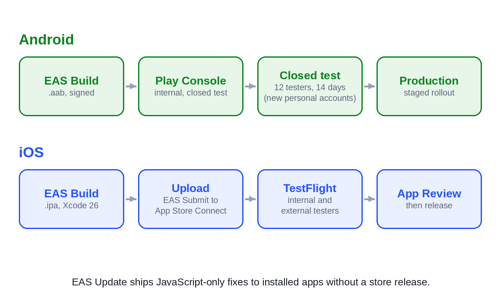

# Chapter 26: Builds and Releases With EAS

Up to now, the apps have run in a browser and in development. Shipping them means producing signed native builds: an Android App Bundle for Google Play and an iOS app archive for the App Store. Expo Application Services (EAS) does this in the cloud, so you can build an iOS app without owning a Mac. This chapter sets up builds, versions, signing and over-the-air updates for the apps.



## Expo Go, Development Builds and Release Builds

There are three ways to run an Expo app, and knowing which you need saves a lot of confusion:

- **Expo Go** is an app from the stores that runs your JavaScript with a fixed set of native libraries. It's great for the first hour of a project, but it can't include native code you add (payments, push, some maps), and it doesn't support remote push from SDK 53 on.
- **A development build** is your own app with your native libraries and Expo's developer tools. You install it once on your phone or emulator and then iterate on JavaScript as quickly as in Expo Go. From the moment you add native libraries such as Stripe, Razorpay or notifications, this is how you develop.
- **A release build** is what users get: optimized, signed, without developer tools. It's what you upload to the stores, and what you should test performance on (Chapter 20).

## Setting Up EAS

Install the command-line tool, sign in with a free Expo account, and link the app:

```text
npm install -g eas-cli
eas login
cd apps/platter
eas init
eas build:configure
```

`eas build:configure` creates an `eas.json` with build profiles. A typical one:

```json
{
  "cli": { "appVersionSource": "remote" },
  "build": {
    "development": {
      "developmentClient": true,
      "distribution": "internal"
    },
    "preview": {
      "distribution": "internal",
      "channel": "preview"
    },
    "production": {
      "autoIncrement": true,
      "channel": "production"
    }
  },
  "submit": { "production": {} }
}
```

- **development** builds the development client, shared with your team as an installable file.
- **preview** builds a release-like app for testers outside the stores.
- **production** builds the store version and increments the build number each time.

> **Tip:** In a monorepo like this book's, run EAS commands from the app's folder (`apps/platter`), and check Expo's monorepo guide if a build can't find a workspace package. Ask Claude to set up `eas.json` for all four apps and verify the first build of each.

## App Identity

Each app's `app.json` already has the fields that identify it in the stores:

```json
@include code/apps/platter/app.json
```

- `name` is what appears under the icon.
- `ios.bundleIdentifier` and `android.package` are permanent IDs. They can never change once the app is published, so choose them carefully, in reverse-domain form on a domain you own (`com.yourcompany.platter`). The `.example` IDs in this book's code are placeholders that you must replace.
- `version` is the version users see ("1.0.0"). The build number (iOS) and version code (Android) are separate numbers that must increase with every upload; with `appVersionSource: "remote"` and `autoIncrement`, EAS manages them for you.

Before the first store build, add the real **icon** (1024 by 1024 pixels, no transparency for iOS), the **adaptive icon** layers for Android, and the **splash screen**.

## Building

```text
eas build --platform android --profile production
eas build --platform ios --profile production
```

The Android build produces an `.aab` (Android App Bundle), which Google Play turns into optimized downloads for each device. The iOS build produces an `.ipa`. Both run on EAS's servers and take several minutes; the command prints a link to follow progress and download the result.

### Signing

Every app must be signed, and the signing keys matter:

- **Android:** EAS can generate an upload keystore and keep it for you. Google Play App Signing (required for new apps) holds the final app signing key; you sign uploads with your upload key. If you lose the upload key, Google can reset it; keep a backup anyway with `eas credentials`.
- **iOS:** EAS can create and manage your distribution certificate and provisioning profiles through your Apple Developer account. You need a paid membership ($99 a year).

## Submitting

EAS Submit uploads a build to the stores:

```text
eas submit --platform android --profile production
eas submit --platform ios --profile production
```

For Android, the very first upload of a new app must be done by hand in the Play Console; later ones can use EAS Submit with a Google service account key. For iOS, EAS Submit uploads to App Store Connect, where the build appears in TestFlight after processing. Chapters 27 and 28 continue from there.

## Over-the-Air Updates

Most changes to a React Native app are JavaScript: a fixed bug, a new label, a changed screen. **EAS Update** delivers those to installed apps without a store release. The app checks for an update when it starts and applies it, by default, on the next launch.

```text
eas update --channel production --message "Fix coupon rounding"
```

Rules for using it safely:

- **Only JavaScript and assets can be updated.** A change to native code, a new native library, or a permission needs a new store build. The **runtime version** in `app.json` marks which builds an update is compatible with; the `fingerprint` policy computes it from your native code, so an update can't reach a build it would break.
- **Test the update first.** Publish it to the `preview` channel, check it in a preview build, then publish the same change to `production`.
- **Roll back if needed.** EAS can republish a previous update; keep the last good one in mind.
- **Stay within store rules.** Both stores allow updating your app's code this way, but not changing its main purpose or adding features that would have needed review. Use updates for fixes and small improvements; ship features through the stores.

## Versions and Release Notes

Use semantic versions: increase the third number for fixes (1.0.1), the second for new features (1.1.0), and the first for big changes (2.0.0). Keep a `CHANGELOG.md`, and ask Claude to draft release notes from the git log in plain, user-facing words ("You can now reorder a past order with one tap"), not commit messages.

## Automating It

EAS Workflows (YAML files in `.eas/workflows/`) or any CI service can run the checks, build, run Maestro flows (Chapter 22), and submit, on every merge to your main branch or every tag. A good first automation is small: on every pull request, run `npm run check`; on every tag, build and submit to the internal testing tracks.

```text
Set up EAS for apps/platter: eas.json with development, preview and
production profiles, remote app versions with auto-increment, channels
for updates, and the fingerprint runtime version policy. Replace the
.example bundle IDs with com.mycompany.platter. Add an EAS workflow that
runs npm run check on pull requests and builds both platforms on tags
starting with v. Explain each setting in a short comment in the PR.
Don't run any build.
```

## Key Takeaways

- Develop in a development build once you add native libraries; test performance and behavior in release builds.
- `eas.json` defines development, preview and production profiles; let EAS manage build numbers and signing credentials.
- Bundle IDs and package names are permanent: choose them carefully on a domain you own.
- `eas build` makes signed store builds in the cloud; `eas submit` uploads them.
- EAS Update ships JavaScript fixes without a store release; protect it with runtime versions, test on a preview channel first, and keep features for store releases.
