# Part VII: Bonus

# Chapter 30: Reelhouse: Building for Android TV (and Apple TV)

Phones are held a few inches from the face and touched. Televisions sit three meters away and are driven by a remote with four arrows, a select button and Back. Everything about the interface changes: text sizes, layout, navigation, and above all **focus**, the highlight that shows what the select button will do. This bonus chapter builds Reelhouse, a streaming app for Android TV in the style of the big streaming services, with an original brand and fictional catalog, from the same Expo and React Native skills as the rest of the book.

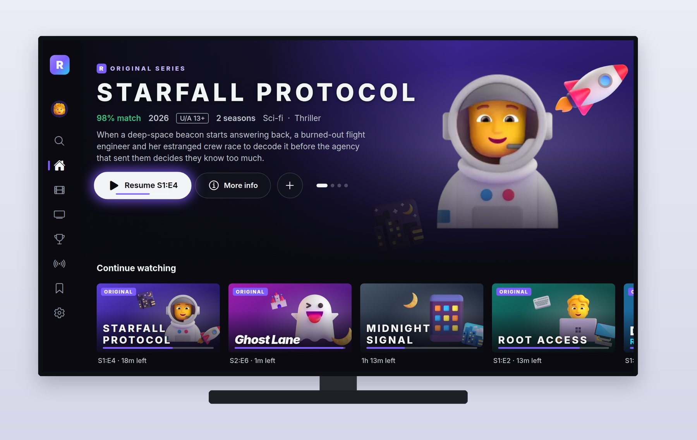

## The 10-Foot Interface

Designers call TV the "10-foot" interface, after the viewing distance. Its rules:

- **Big type and big targets.** Body text around 24 to 28 pixels on a 1920 by 1080 canvas, titles far larger. Reelhouse lays everything out on a 1920 by 1080 canvas and scales it to the screen.
- **Dark, cinematic surfaces.** Streaming apps are dark so that the artwork glows and the room stays dim. Reelhouse is dark only, with a violet and cyan brand.
- **One obvious focus.** At every moment exactly one thing is focused, and it must be unmistakable from across the room: Reelhouse uses a white ring, a violet glow and a slight scale-up.
- **Rows, not pages.** Content sits in horizontal rows that the remote moves through: right for the next card, down for the next row.
- **Safe margins.** Keep important content away from the screen's edges, which some TVs crop.
- **Back always works.** Every screen and overlay has a sensible answer to Back.

## How Expo Builds for TV

Expo apps run on Android TV and Apple TV through **react-native-tvos**, a community-maintained fork of React Native with TV support: focus handling, remote events and TV-specific views. For Expo SDK 58 it's `react-native-tvos` 0.88.0-0, which must match the SDK's React Native version. You install it as the `react-native` dependency and add the `@react-native-tvos/config-tv` config plugin, which edits the native projects for TV when you prebuild with `EXPO_TV=1`. Not every Expo library supports TV; the Expo "Building for TV" guide lists which do.

Reelhouse lives in `tv/`, outside the workspace, because its `react-native` is the TV fork. It copies the theme tokens, the `Art` component and the illustrations from `@pro/ui` rather than importing them. Its configuration:

```json
@include code/tv/app.json
```

The plugin's options point to the TV banner and icon. Prebuilding with `EXPO_TV=1` writes them into the Android project.

## The Prompt

```text
@include sessions/06-reelhouse-tv.prompt.md
```

Three choices in this prompt made the session work:

- **"Focus is the heart of a TV app"** and the paragraph after it turned a vague quality into a checklist: a focus ring and scale on everything focusable, initial focus on every screen, rows that scroll to keep focus visible, Back that always goes somewhere sensible.
- **"Make it run on the web too, with arrow keys and Enter driving focus"** gave Claude a way to check the app without a TV or an emulator: drive it with the keyboard in a headless browser and take screenshots of real focus states.
- **"Run prebuild and confirm the generated AndroidManifest"** checked the Android TV-specific configuration, which a web build can't show.

## What the Session Built

Session 6 reported 76 tests passing and 25 screenshots, every one taken by driving the app with arrow keys, Enter and Escape only.

### Profiles and Home

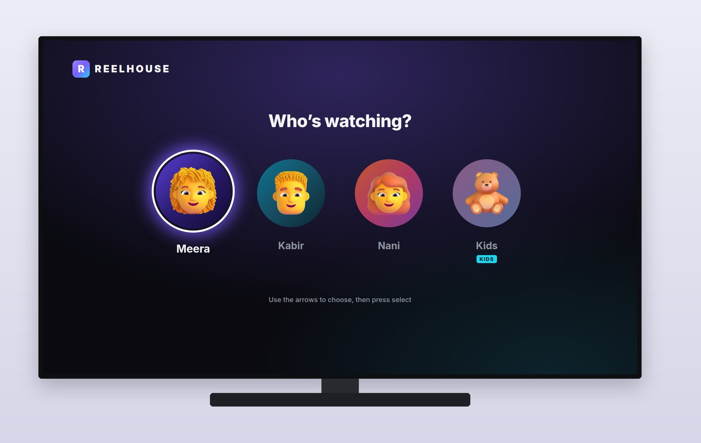

The app opens on **Who's watching?**, with four profiles, including a Kids profile that sees only children's titles. Home is a full-screen **hero billboard** for a featured title (its artwork, "match" score, year, rating, seasons and genres, a synopsis, and Resume, More info and My list buttons), rotating through featured titles while the buttons have focus, and following the focused card once you move into the rows.

The **side rail** on the left shows only icons until it receives focus, then expands with labels: Search, Home, Movies, Series, Sports, Live TV, My list and Settings. Pressing left from anywhere in the rows lands on the current section.

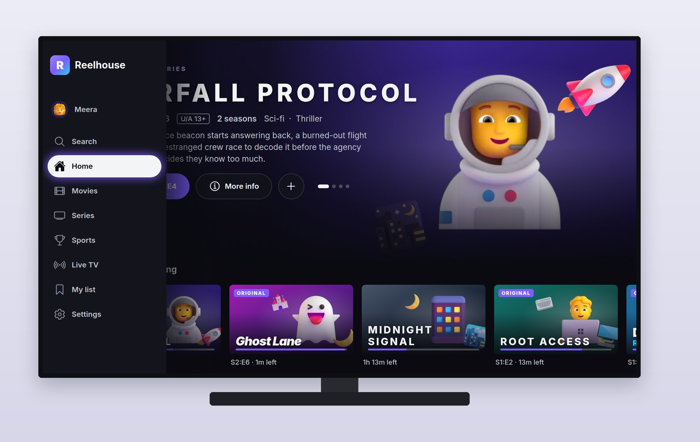

### Rows

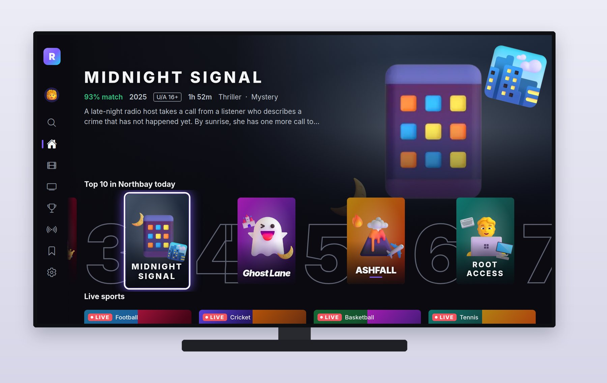

Below the hero sit the rows: **Continue watching** with progress bars and "13m left", the **Top 10 in Northbay today** with large outlined numbers behind the posters, **Live sports** with red LIVE badges and score strips, New releases, Because you watched, tall **Originals** posters, and Genres.

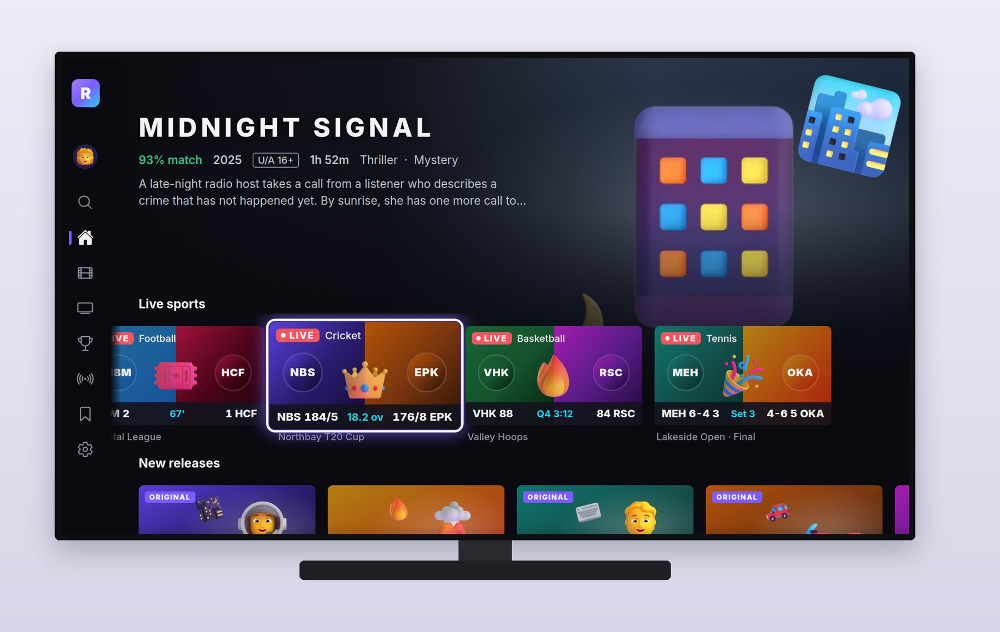

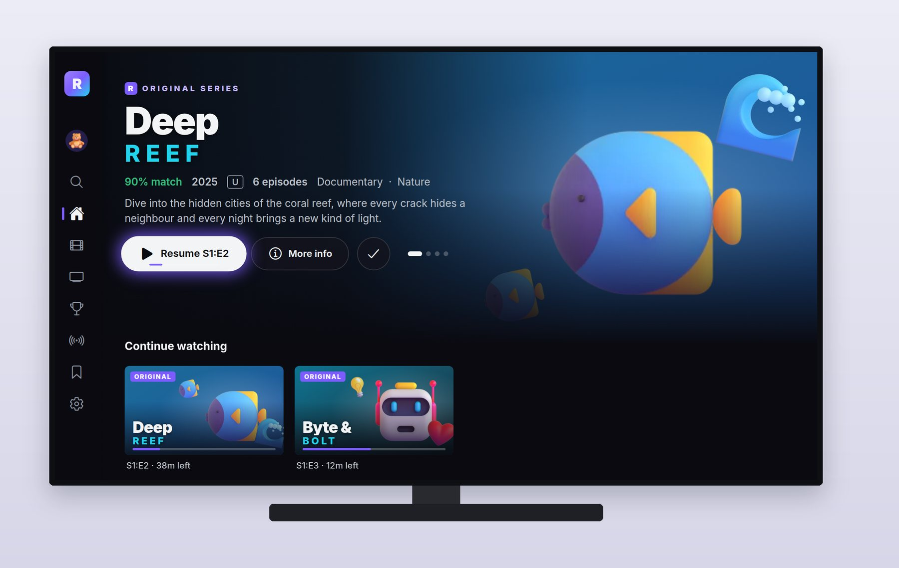

### Title Details

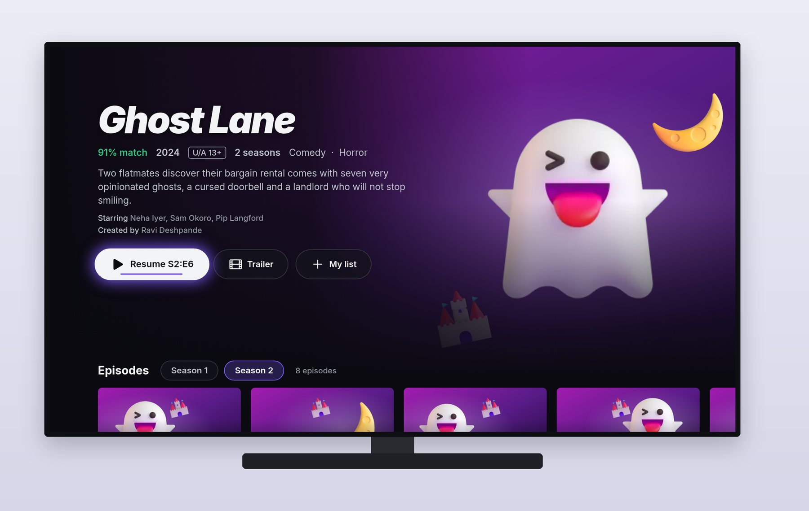

The details page shows the title "logo" in display type, the metadata and cast, **Resume S2:E6** with progress, Trailer and My list, then **season chips** and an **episode row** with numbers, titles, durations, synopses and progress. Further down, **More like this**. The backdrop dims as focus moves down the page, so text stays readable.

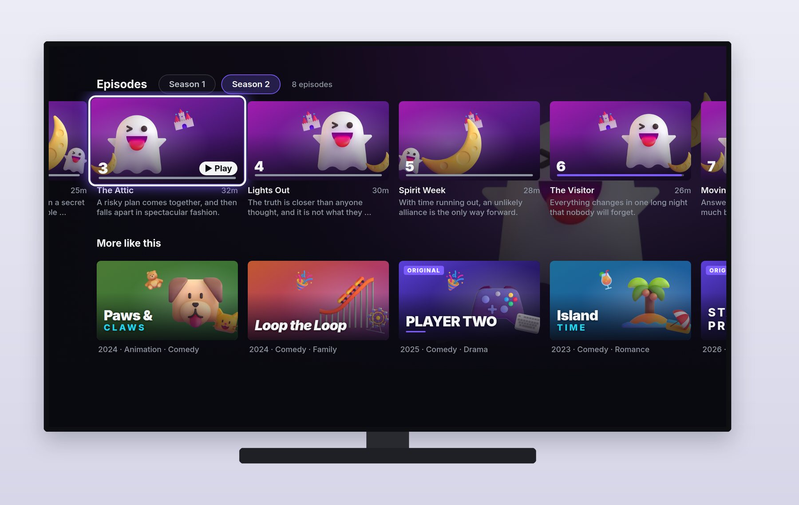

### Search

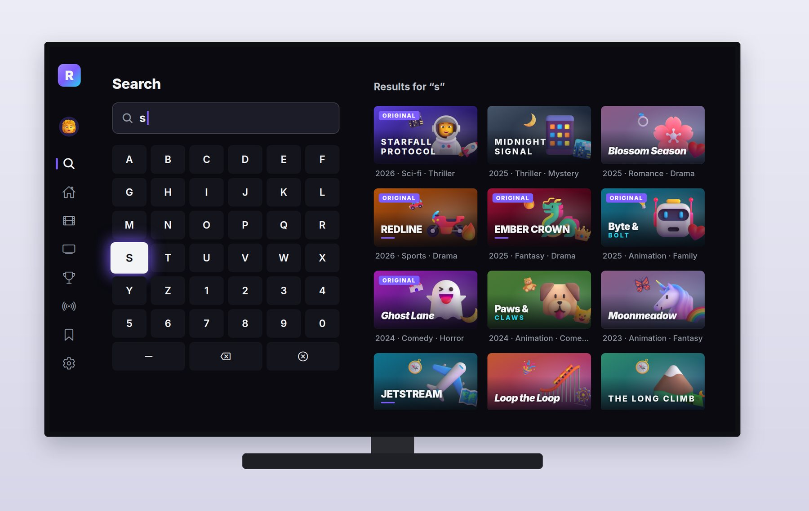

Typing with a remote is slow, so the search screen makes every press count: a grid keyboard with letters, digits, space, delete and clear; results that update with each letter; and trending searches when the query is empty.

### The Player

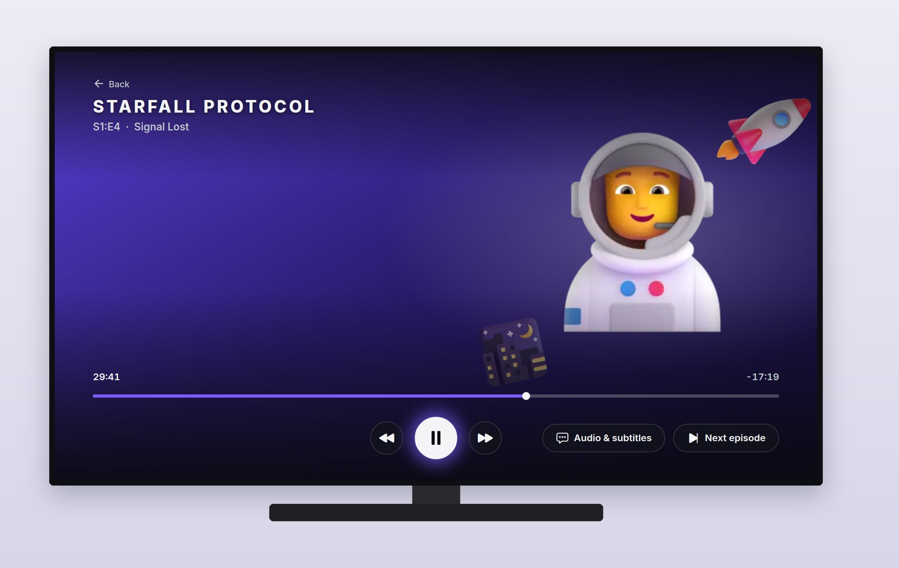

The player is mocked (no real video), but its behavior is the real thing: controls appear on any key press and fade out after five seconds of playback; the first key press only brings them back rather than also acting; left and right on the seek bar skip ten seconds; an audio and subtitles menu; and near the end a **Next episode** card takes focus and counts down. Its rules are pure, tested functions:

```ts
@include code/tv/src/screens/playerLogic.ts#L1-L26
```

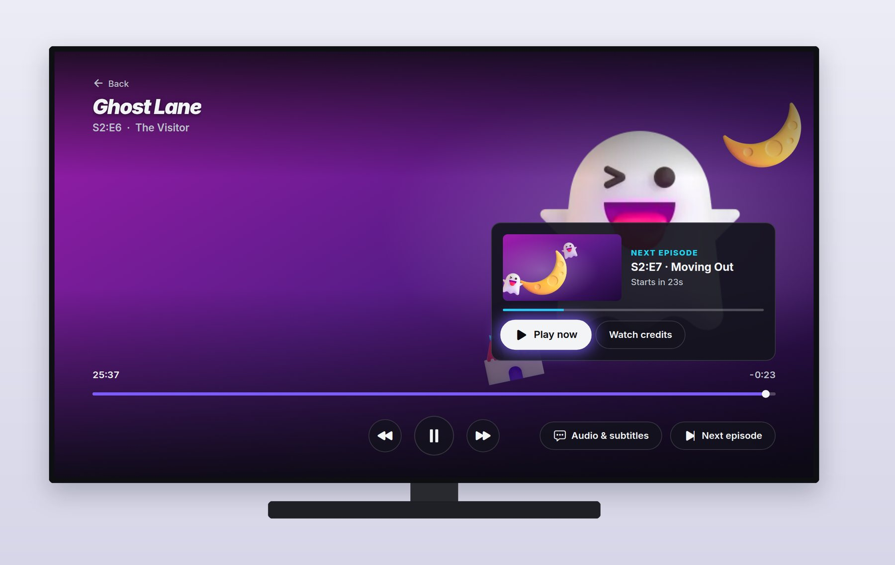

### Live TV

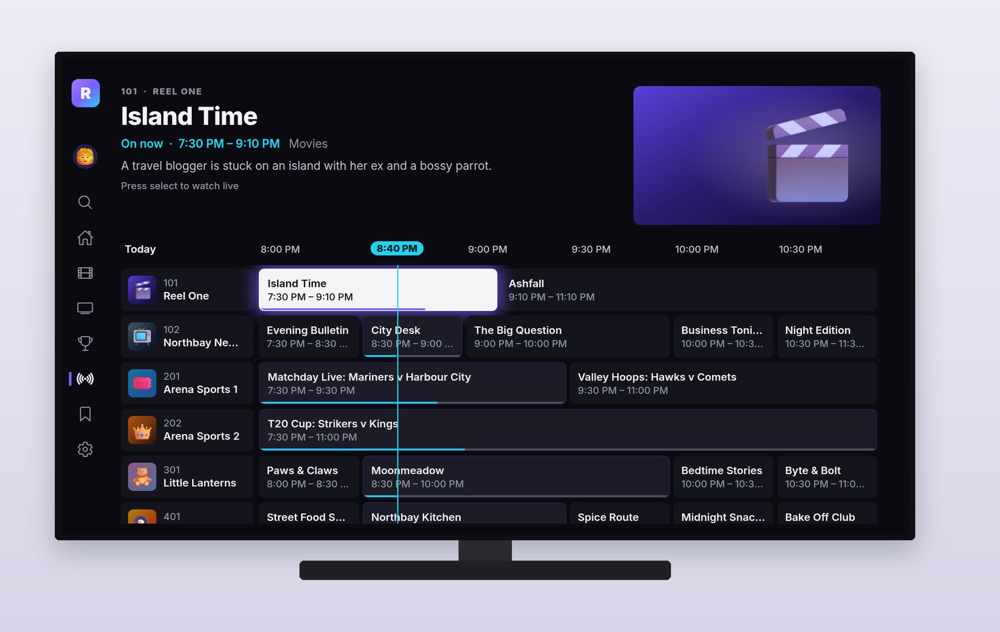

The **guide** shows a preview of the focused program at the top, a time ruler with a cyan "now" line, and a grid of channels by time. Programs on now open live; later ones set a reminder.

## Focus, Step by Step

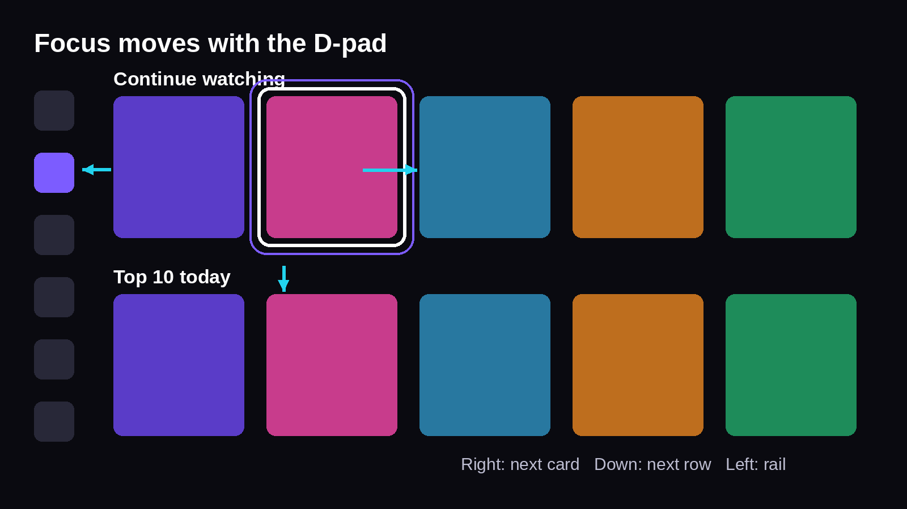

On Android TV, the native focus engine moves focus between focusable views in the direction pressed. Your job is to make every focusable look focused, to tell the engine where focus should go in the awkward places, and to scroll content so the focused item stays visible.

### One Focusable Component

Everything the remote can land on is a `Focusable`. It tracks its focus state, animates its scale (instantly under reduce motion), draws the ring and glow, and takes focus when its screen asks it to:

```tsx
@include code/tv/src/components/Focusable.tsx#L84-L111
```

The `autoFocus` and `focusKey` props are how each screen sets **initial focus** and **restores focus**. Screens under the top one stay alive, so when you press Back from a title's details, focus returns to exactly the card you left.

### Focus Groups

Rows and panels are **focus groups**. On Android TV they're `TVFocusGuideView`s from react-native-tvos, which remember the last focused child (so moving down into a row lands where you were), can name a destination for first entry (the rail's current section), and can trap directions:

```tsx
@include code/tv/src/focus/FocusGroup.tsx#L22-L45
```

Trapping is how the player's seek bar keeps left and right for skipping, and how a menu keeps focus until it closes.

### Remote Keys

Remote buttons arrive as TV events on Android TV and as keyboard events on the web. One tiny module maps both to the same names, so screen logic handles "select" or "playPause" without caring where it came from:

```ts
@include code/tv/src/focus/remoteKeys.ts
```

### Scrolling to Keep Focus Visible

TV rows move under a fixed **focus line**: the focused card stays near the left edge while the row slides, until the row runs out of content and the last cards scroll in. That's a calculation, and it's tested:

```ts
@include code/tv/src/focus/scroll.ts#L27-L35
```

On the web, a small spatial-navigation layer reproduces the same rules for arrow keys, which is what made the screenshots possible.

## The Review That Found Two Bugs

Looking through the 25 screenshots found two problems the session hadn't noticed. In the Top 10 screenshot, a card scrolled underneath the collapsed side rail and showed through it. In the guide, the preview panel read "Island Time on Reel One.", a placeholder rather than a synopsis. A short follow-up session fixed both:

```text
@include sessions/06b-reelhouse-fixes.prompt.md
```

Session 6b made the rail opaque with a short fade, clipped rows at the rail's edge with a tested helper, wrote a one-line synopsis for every program, made a missing synopsis a type error, and added a test that rejects placeholder text and overlong lines. It also caught its own regression: its first, wider fade dimmed the first letter of "Island Time", which it saw in the re-captured screenshot and fixed. The TV app finished with 80 tests passing.

The screenshot session itself had found three more focus bugs while capturing: the rail's group memory overrode its current section, right on the seek bar jumped to Pause, and My list had no initial focus.

## Android TV Configuration

TV apps on Google Play must declare themselves correctly. The session ran `EXPO_TV=1 npx expo prebuild --platform android --clean` and checked the generated manifest:

- the **`LEANBACK_LAUNCHER`** category on the main activity, so the app appears on the TV home screen;
- **`android.software.leanback`** declared with `required="false"`, so the same app can also install on phones (set the plugin's `androidTVRequired` option for a TV-only app);
- **touchscreen not required**, since TVs have no touchscreen;
- an **`android:banner`** pointing at a 320 by 180 banner image that includes the app name, which the TV launcher shows.

Then it removed the generated `android/` folder; the configuration lives in `app.json`, and EAS generates the native project at build time.

### Google Play Requirements for TV

From Google's documentation in October 2026:

- **Target API level**: Android TV apps must target at least Android 14 (API level 34).
- **64-bit and 16 KB page sizes**: from 1 August 2026, TV apps must support both 32- and 64-bit architectures and 16 KB memory page sizes.
- **Launcher assets**: a 320 by 180 banner containing the app name, and a 160 by 160 icon at xhdpi.
- **TV app quality guidelines**: full D-pad navigation, no dependence on touch, a working Back button, content that fits the screen, and more. Google reviews TV apps against these before they appear on TV devices. You opt into the Android TV form factor in the Play Console and add TV screenshots.

### Testing on an Emulator or a TV

Reelhouse has been built natively and run on an Android 16 TV emulator, driven with the D-pad, but not on a real TV. On your computer, create an Android TV emulator in Android Studio (an Android TV system image, API 31 or later), then:

```text
cd tv
EXPO_TV=1 npx expo prebuild --platform android --clean
npx expo run:android
```

Or install a development build on a real Android TV or streaming stick with developer options enabled. Test every screen with the remote only: no mouse, no touch.

## Apple TV

The same code can target Apple TV: react-native-tvos supports tvOS, and the config plugin prepares the iOS project when you prebuild for iOS with `EXPO_TV=1`. You'd need Apple TV app icons and top-shelf images, and you'd test on the tvOS simulator in Xcode. Session 6 didn't configure tvOS, and on Apple TV some libraries are unsupported; the focus engine also behaves a little differently, so plan a separate round of focus testing.

## Making It Real

Reelhouse is a convincing shell; a real streaming app adds:

- **Real video** with a TV-capable player library (`expo-video` or `react-native-video`), adaptive streaming (HLS or DASH), and **DRM** for licensed content.
- **Accounts and profiles on a server**, with sign-in that suits a TV: a code shown on screen that the user enters on their phone.
- **Subscriptions** through Google Play Billing and Apple's In-App Purchase (Chapter 23), with access checked on the server.
- **Continue watching sync** across devices, written to the server every few seconds during playback.
- **Accessibility**: captions everywhere, audio description tracks, and screen reader support through TalkBack on Android TV.

```text
Add real video playback to Reelhouse's player with expo-video, if it
supports Android TV in our SDK (check the docs and tell me), playing a
public HLS test stream. Keep the existing controls, auto-hide, seek and
Next episode behavior and their tests; wire play, pause and seek to the
real player; and report what you could and couldn't verify without a TV.
```

## Key Takeaways

- TV is a 10-foot, remote-driven interface: big type, dark surfaces, rows, safe margins, and one unmistakable focus.
- Expo builds for Android TV with react-native-tvos and the config-tv plugin when prebuilding with `EXPO_TV=1`.
- Build every focusable from one component, set and restore focus per screen, use focus groups for rows, and keep the focused card visible with tested scroll math.
- Verify a TV app with keyboard-driven screenshots on the web, prebuild checks of the manifest, and finally a real TV or emulator.
- Android TV on Play needs target API 34, 64-bit and 16 KB page support, the leanback declarations, a 320 by 180 banner and full D-pad navigation.
