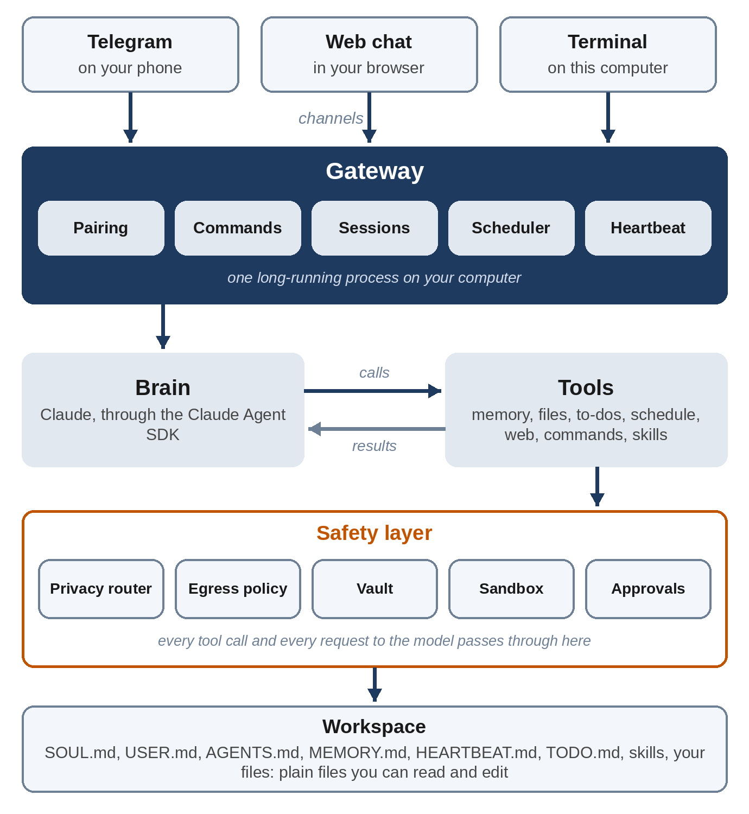

# Chapter 2: The Architecture

This chapter is the map for the rest of the book. It shows Sparrow's parts, follows one message from your phone to a reply, and sets out the design rules that every later chapter follows. If you lose your way in Part II, come back here.

## The Parts

Read the picture from top to bottom:

- **Channels** carry messages in and out: Telegram on your phone, a web chat in your browser, and the terminal. Each one turns its app's messages into the same simple shape, an `Inbound`, and knows how to send text back.
- **The gateway** is the one long-running process at the center. It decides who is talking (the owner, an approved guest, or a stranger), handles commands such as `/status`, keeps each conversation's history, runs scheduled jobs and the heartbeat, and runs one conversation turn at a time per conversation.
- **The brain** is Claude, through the Claude Agent SDK. Given a system prompt, the conversation and a list of tools, it decides which tools to call and what to say.
- **Tools** are Sparrow's hands: search memory, save a fact, read and write files, manage to-dos, schedule reminders, fetch a web page, run a command, read or propose a skill. Fifteen in all.
- **The safety layer** sits under every tool and around every model request: the privacy router, the network (egress) policy, the vault of secrets, the sandbox and the approval system.
- **The workspace** is a folder of plain files: Sparrow's personality, what it knows about you, its house rules, its memory, your to-dos, its skills and your documents.

Under all of this is a little **state**: one SQLite database for scheduled jobs, approvals, paired guests and spending; the transcripts of conversations; and the audit log. Chapter 9 covers it.

## One Message, End to End

Here is what happens when you send Sparrow "Remind me at 6 to call Mum" on Telegram. Every step is a few lines of code you'll write.

1. **The channel receives it.** The Telegram channel asks Telegram's servers for new messages (Chapter 11), finds yours, and hands the gateway an `Inbound`: channel `telegram`, your user ID, your name, the chat ID and the text.
2. **The gateway checks who you are.** Your Telegram ID is in the list of owners in the settings, so you're the owner. A stranger would get a pairing code and nothing else; the model would never see their message (Chapter 14).
3. **It's not a command**, because it doesn't start with `/`, so the gateway starts a conversation turn. It takes the lock for your conversation, so two of your messages are never handled at once, and checks today's spending against the daily limit (Chapter 19).
4. **The privacy router scans the text** for private data such as email addresses and card numbers and swaps any it finds for placeholders (Chapter 18). There's none here.
5. **The gateway builds the prompt.** The **system prompt** is made from the workspace files: who Sparrow is, who you are, the house rules, long-term memory, the list of skills, and the current date and time. The **user prompt** is the recent conversation plus your new message (Chapters 5 and 9).
6. **The brain runs.** Claude reads the prompt and the list of tools, and decides to call `schedule` with `kind` "remind", `message` "Call Mum" and `when` "today 18:00".
7. **The tool call passes through `call_tool`,** the one function every tool call goes through (Chapter 6). It checks that the owner may use this tool, puts back any real values behind placeholders, runs the tool, scrubs secrets and private data from the result, and writes the call to the audit log.
8. **The scheduler stores the job** in the database and returns "Scheduled job 3 for Tue 2026-10-27 18:00."
9. **Claude writes the reply**: "Done, I'll remind you at 18:00 to call Mum."
10. **The gateway finishes the turn.** It puts back any private values, saves both messages to the conversation's transcript, records the cost, writes a summary to the audit log, and sends the reply to Telegram.
11. **At 18:00, the scheduler's loop finds the job due** and sends "Reminder: Call Mum" to the chat where you asked (Chapter 12).

That's the whole system in miniature. Every other feature is a variation: a different tool, a different channel, or a check in a different place.

## Design Rules

A handful of rules shape every part of Sparrow. They're worth stating now, because you'll see each of them many times.

**The model asks; the code decides.** Claude never runs anything. It can only ask for tools, and every request goes through `call_tool`, which can refuse. Anything that must hold no matter what the model says, such as "guests can't read your files" or "commands have no network," is enforced in code, below the model, never by an instruction in the prompt alone.

**Plain files you can read.** Personality, memory, to-dos and skills are Markdown files in the workspace. You can open them in any editor to see exactly what Sparrow knows, fix a wrong memory, or add a skill. Sparrow's own state is in one SQLite file and its logs are JSON lines, all readable with standard tools.

**Deny by default.** Strangers get nothing. Commands get no network. Unknown websites need your approval. A missing sandbox means no commands at all, not commands without a sandbox. When Sparrow isn't sure something is allowed, it isn't.

**Outside content is data, not instructions.** Text from web pages, files and command output is wrapped in `<untrusted>` tags before the model sees it, and the house rules tell the model to treat it as information only. This doesn't make prompt injection impossible, which is why the other rules matter, but it helps the model a great deal (Chapter 23 measures it).

**Never leave the owner hanging.** If the model fails, a channel breaks, or a tool raises an error, the owner gets a short, honest message and the error goes to the audit log. One bad message must never stop the gateway.

**Everything is testable without the model.** The brain is one small interface: give it a `Turn`, get a `Reply`. A scripted brain plays back fixed tool calls and answers, so every other part can be tested quickly, for free, and the same way every time. The real model is tested separately, end to end (Chapter 22).

## The Files

Sparrow is a Python package called `sparrow`. These are its modules, in the order the book builds them:

| File | What it does | Chapter |
| --- | --- | --- |
| `brain.py` | One turn with Claude through the Agent SDK; the scripted brain | 4 |
| `config.py` | Settings from `sparrow.yaml` | 5 |
| `workspace.py`, `templates/` | The Markdown files and the system prompt | 5 |
| `tools.py`, `todo.py` | The fifteen tools and `call_tool` | 6 |
| `memory.py` | Long-term memory and search | 7 |
| `skills.py`, `templates/skills/` | Skills | 8 |
| `store.py`, `sessions.py`, `core.py` | State, transcripts, and the parts wired together | 9 |
| `gateway.py` | The gateway | 9, 12 |
| `channels/terminal.py`, `channels/webchat.py` | Terminal and web chat | 10 |
| `__main__.py` | The command line: `init`, `doctor`, `chat`, `run` | 10 |
| `channels/telegram.py` | Telegram | 11 |
| `scheduler.py` | Reminders and scheduled tasks | 12 |
| `pairing.py` | Owners, guests and strangers | 14 |
| `approvals.py` | Approval codes | 15 |
| `sandbox.py` | The bubblewrap sandbox | 16 |
| `egress.py`, `vault.py` | Network policy and secrets | 17 |
| `privacy.py` | The privacy router | 18 |
| `audit.py` | Audit log and spending ledger | 19 |

Next to the package are `tests/` (Chapters 20 to 24), `evals/` for the real-model evaluations, and `deploy/` for running Sparrow as a service (Chapter 25).

Some modules use parts that come later: the gateway, for example, uses pairing and approvals. Where that happens, the book tells you what the later part does in a sentence, so you can read on without jumping ahead. If you type the code as you go, you can try each module from the Python prompt as soon as it's written; the whole of Sparrow starts once every module it imports exists, at the end of Part III. Chapter 10 shows it running, so you know what to expect.

## Key Takeaways

- Channels bring messages to one gateway, which decides who's talking, builds the prompt, runs the brain, and sends the reply.
- Every tool call goes through `call_tool`, and every model request through the privacy router: those two choke points are where the safety layer lives.
- The model asks and the code decides; anything that must always hold is enforced in code.
- The workspace is plain Markdown, so you can always see and fix what Sparrow knows.
- The brain is a small interface, so everything else can be tested without the model.
