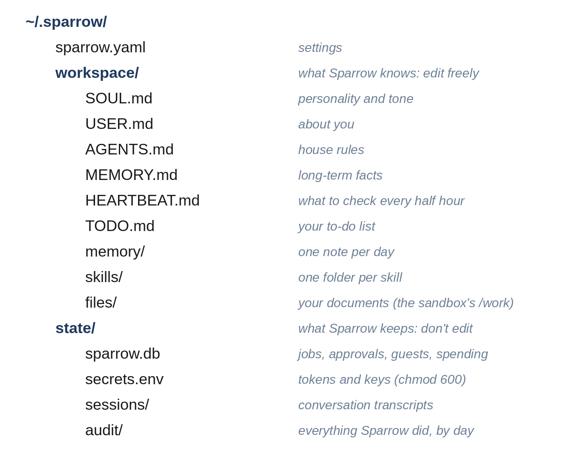

# Chapter 5: The Workspace: Personality, Owner and House Rules

A model on its own knows nothing about you and has no particular personality. Everything that makes Sparrow *your* assistant comes from the system prompt, and Sparrow builds that prompt from a folder of plain Markdown files: the **workspace**. This chapter creates the workspace, the settings that sit beside it, and the code that turns both into a prompt.

## Sparrow's Home Folder



Everything Sparrow keeps lives in one folder, `~/.sparrow` by default. It has three parts:

- **`sparrow.yaml`**, the settings, which you edit.
- **`workspace/`**, what Sparrow knows and works on, which you can read and edit freely: its personality, what it knows about you, its rules, its memory, your to-dos, its skills, and a `files/` folder for your documents.
- **`state/`**, what Sparrow keeps for itself: a database, secrets, conversation transcripts and the audit log. You can read these, but you shouldn't need to edit them.

Keeping everything in one folder makes Sparrow easy to back up, move to another computer, or reset: copy the folder, or delete it and run `init` again.

## Settings

`sparrow/config.py` reads `sparrow.yaml` into Python data classes. It starts with one small class for each section of the file:

```python
@include sparrow/config.py#L1-L46
```

Each field has a sensible default, so a settings file only needs the lines you want to change. The Telegram and web chat sections don't hold their tokens; they hold the *name* of the secret (`token_env`), which the vault looks up (Chapter 17), so the settings file never contains a secret and is safe to show someone when you ask for help.

The main `Settings` class gathers the sections and the top-level options:

```python
@include sparrow/config.py#L49-L76
```

`owners` lists the identities that are you, written as `channel:id`, such as `telegram:123456789`. `model` is the model for conversations and `heartbeat_model` the cheaper one for heartbeat checks. `history_turns` is how many recent exchanges go into each prompt, `daily_budget_usd` is the spending limit, and `privacy` chooses what the privacy router does: replace private values with placeholders (`redact`), refuse to send them (`block`), or nothing (`off`). `secrets_for_hosts` says which secret goes in which header for which website, as you'll see in Chapter 17. The two properties give the workspace and state folders.

`load_settings` reads the file:

```python
@include sparrow/config.py#L79-L111
```

It uses `yaml.safe_load`, which reads only plain data, never Python objects, so a settings file can't run code. Sections become their data classes. A section with nothing under it, such as a bare `heartbeat:` line, keeps its defaults, and a section that isn't a list of settings (`heartbeat: 5`) is an error that names it. YAML has no tuples, so the heartbeat's active hours are converted from a list. Anything else must be a known field of `Settings`. A misspelled setting, such as `daily_budjet_usd`, raises an error naming it, instead of being silently ignored while you wonder why your limit doesn't work.

> **Tip:** Fail loudly on configuration you don't understand. A setting that's silently ignored is one of the most common ways security features end up switched off without anyone noticing.

## The Workspace Files

Sparrow ships starter files in `sparrow/templates/`, which `init` copies into the workspace. Each becomes one section of the system prompt.

`SOUL.md` is Sparrow's personality:

```
@include sparrow/templates/SOUL.md
```

`USER.md` is about you. The starter version asks you to fill it in:

```
@include sparrow/templates/USER.md
```

A few honest lines here make a large difference: your name, where you live (which sets what "the weather" and "the bank holiday" mean), what you do, the people Sparrow will hear about, and how you like answers.

`AGENTS.md` holds the **house rules**: how Sparrow should behave, whoever it is talking to.

```
@include sparrow/templates/AGENTS.md
```

Every rule is there for a reason you'll meet later. The plain-text rule exists because chat apps show Markdown symbols as they are; the first web chat screenshots for this book were full of asterisks until it was added. "Use your tools instead of guessing" and "search memory before saying you don't know" stop the model answering from its imagination. The `<untrusted>` rule is the first defense against prompt injection (Chapter 13). The last rule matters more than it looks: without it, a model told "waiting for approval" sometimes tries another route to the same goal, such as a different web address. Sparrow should ask, then stop.

`MEMORY.md` starts almost empty; Sparrow adds a line each time it remembers something (Chapter 7):

```
@include sparrow/templates/MEMORY.md
```

And `HEARTBEAT.md` is the checklist for the heartbeat, which Chapter 12 covers.

> **Note:** These files are the most powerful settings Sparrow has. Anything you write in `USER.md` or `AGENTS.md` is in every prompt. Keep them short (every word costs tokens on every turn) and don't put secrets in them: the model sees everything in the system prompt.

## The Workspace Class

`sparrow/workspace.py` manages the folder and builds the prompt:

```python
@include sparrow/workspace.py#L1-L34
```

`create` copies every template into the workspace, including the skills folders, but **never overwrites a file that already exists**. That makes it safe to run on every start: a new Sparrow version can add a new template file, and your edited `USER.md` is never touched. `read` returns a file's text, or an empty string if you've deleted it, so a missing file simply drops its section from the prompt.

## Building the System Prompt

The system prompt is the workspace files in a fixed order, then the skills, then the current moment:

```python
@include sparrow/workspace.py#L36-L55
```

Three details are worth noticing:

- **Memory is capped.** `MEMORY.md` grows forever, but the prompt can't. Only the last 6,000 characters (the newest facts) go in, after `...` to show that something was cut. Older facts aren't lost: they're still in the file, and Sparrow finds them with the `memory_search` tool.
- **Skills are listed, not included.** Only each skill's name and description go in; the full instructions are read when needed (Chapter 8).
- **The date and time are always there.** A model doesn't know what day it is. Without this line, "remind me tomorrow" or "is anything due today?" can't work. The time zone comes from the settings, and the `%Z` shows its abbreviation, such as WET or CET, so the model knows which clock it's reading.

Here's a real system prompt, built for an owner with a short `USER.md` and one remembered fact:

```
@include transcripts/system-prompt.txt
```

## A Different Prompt for Guests

Guests, people you've allowed to chat with Sparrow, get a different prompt:

```python
@include sparrow/workspace.py#L57-L74
```

It has Sparrow's personality and the list of skills, but no `USER.md`, no house rules about your files, no memory and not even your name. As the comment says, a model can't leak what it was never given. Telling the model "don't reveal private things to guests" would be much weaker: a persistent guest might talk it round. Leaving the private material out of the prompt, and giving guests only the `read_skill` tool (Chapter 6), makes the guarantee hold whatever the model does. Chapter 23 tries hard to break it.

## Key Takeaways

- Sparrow's home folder holds settings, a workspace you can edit, and state Sparrow keeps.
- Settings have defaults, hold the names of secrets rather than secrets, and reject unknown keys.
- The system prompt is built from plain Markdown files: personality, owner, house rules, recent memory, skills, and the current time.
- `create` never overwrites your edits, so it's safe to run on every start.
- Guests get a prompt without anything private, because what the model never sees, it can't reveal.
