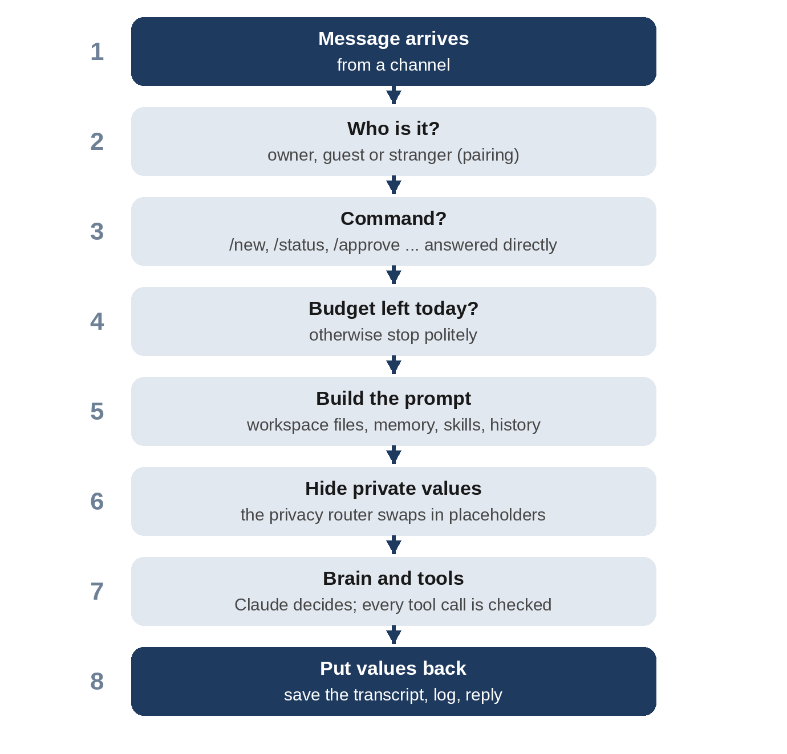

# Chapter 9: The Gateway and Sessions

The gateway is Sparrow's center: one long-running process that every message passes through. It decides who's talking, handles commands, keeps each conversation's history, runs one turn at a time per conversation, and sends the replies back. This chapter builds it, along with the small pieces it stands on: a database for Sparrow's state, conversation transcripts, and the `Core` object that wires all the parts together.

## State in One Database

Some of what Sparrow keeps must survive a restart: scheduled jobs, approval requests, paired guests, and today's spending. All of it goes in one SQLite file, `state/sparrow.db`, managed by `sparrow/store.py`:

```python
@include sparrow/store.py#L1-L45
```

Five tables, each with a comment for every column, because six months from now you'll open this database with the `sqlite3` command to find out why a reminder didn't arrive, and the comments are the documentation. `jobs` holds reminders and tasks (Chapter 12), `approvals` holds requests waiting for you (Chapter 15), `people` holds guests and strangers (Chapter 14), `spending` has one row per model call (Chapter 19), and `kv` holds a few single values, such as when the last heartbeat ran.

```python
@include sparrow/store.py#L48-L73
```

`Store` is a thin layer over the connection. `run` executes a statement and commits immediately, so every change is on disk before Sparrow does anything else; if the process is killed a moment later, nothing is lost. `rows` reads. The `?` placeholders mean values are always passed separately from the SQL, never pasted into it, so a guest's name like `Robert'); DROP TABLE people;--` is stored as a name, not run as SQL. `row_factory = sqlite3.Row` lets code read columns by name, as in `job["message"]`. `close` closes the database file.

> **Note:** SQLite is a good fit for a personal agent: it's a single file, needs no server, is included with Python, and handles far more traffic than one person generates. Chapter 24 measures Sparrow handling about 250 messages a second with SQLite underneath.

## Sessions

A **session** is one conversation's transcript. `sparrow/sessions.py` keeps each one as a JSON Lines file, one message per line:

```python
@include sparrow/sessions.py#L1-L53
```

The session key becomes the file name, with anything other than letters, digits, dots and hyphens replaced, so a key like `telegram:555` becomes `telegram_555.jsonl` and can never name a path elsewhere. `append` adds one message with its time and role. `history` returns the last `turns` exchanges, two lines each. `reset` doesn't delete the transcript; it moves it into `archive/` with a timestamp, so `/new` gives you a fresh conversation without destroying the record.

The module docstring states an important choice: **all of the owner's direct messages share one session, called `main`**, whatever channel they come from. Start a conversation on Telegram on your phone, sit down at your computer, and continue it in the web chat: Sparrow knows what you were talking about. Each guest gets a session of their own, keyed by their identity, so guests never see each other's conversations or yours.

`render` turns history into plain text for the prompt:

```python
@include sparrow/sessions.py#L56-L62
```

Each line has the time, so the model can tell that "yesterday's" message was yesterday, and who spoke.

## The Core

Every part needs some of the others: tools need memory and the scheduler, the gateway needs everything. `sparrow/core.py` builds each part once, from the settings, and holds them together:

```python
@include sparrow/core.py
```

Some of these classes come later in the book: `Scheduler` in Chapter 12, `Approvals` and `Pairing` in Chapters 14 and 15, `Vault`, `EgressPolicy` and `Fetcher` in Chapter 17, `Audit` and `Ledger` in Chapter 19.

Three arguments make the core testable. `clock` is a function that returns the current time; the tests pass one they control, so "advance thirty minutes" takes no time at all and a reminder test can run in milliseconds. `http_client` lets tests and evaluations supply a pretend internet, and `resolve` a pretend DNS to go with it (Chapter 17). `close` closes both databases; the command line calls it when a command is done, and the tests call it after every test. Notice also the owners list: the terminal and the web chat are always the owner, because only someone at your computer, or with the web chat's secret token, can use them.

## Messages In

The gateway lives in `sparrow/gateway.py`. It starts with its imports and the help text:

```python
@include sparrow/gateway.py#L1-L25
```

Then the shape every channel produces, and the gateway's basic plumbing:

```python
@include sparrow/gateway.py#L41-L87
```

An `Inbound` message has the channel, the sender's ID and name, the chat ID and the text. Two properties combine them. The **identity** is who sent it, such as `telegram:100`; it decides permissions. The **route** is where to reply, such as `telegram:100` for a private chat. On Telegram these are the same for private chats, but keeping them separate means a group chat, if you added one, would reply to the group while still checking the sender.

`send` looks up the channel by name and logs every outgoing message, including whether there was a channel to deliver it to. `owner_route` is where Sparrow sends messages nobody asked for, such as the heartbeat's: wherever the owner last talked from, so if you've been using the web chat all evening, that's where an alert appears.

The `locks` dictionary holds one `asyncio.Lock` per session, created on first use by `defaultdict`. You'll see why it matters in a moment.

```python
@include sparrow/gateway.py#L89-L125
```

`handle` is what channels call. It wraps `handle_message` in a `try` that catches *everything* and logs it, because a channel loop that crashes on one odd message would stop Sparrow answering anyone. The test in Chapter 21 sends a message through a channel that throws an error and checks the gateway carries on.

`handle_message` logs the message, then decides by role. A stranger goes to `stranger` (Chapter 14) and stops there: no command, no model. For the owner, it remembers the route. Then, a message starting with `/` is a command; anything else is a conversation turn, in the `main` session for the owner or a per-person session for a guest. Either way, the reply goes back on the same route.

## One Conversation Turn



`converse` is where a message becomes an answer:

```python
@include sparrow/gateway.py#L149-L232
```

Step by step:

- **The lock.** `async with self.locks[session]` means one turn at a time per session. If you send two messages quickly, the second waits for the first, so the history Sparrow sees is always in order and two turns never edit your to-do list at once. Different sessions have different locks, so a guest's slow question never holds up yours. Chapter 24 tests both properties with thirteen messages at once.
- **The budget.** If today's spending has reached the limit, Sparrow says so and stops, before calling the model.
- **Privacy.** A fresh `PrivacyRouter` is made for each turn. In `block` mode, a message with private data is refused here, before anything is sent anywhere (Chapter 18).
- **The prompt.** The user prompt is the new message, with the recent history in front if there is any. The system prompt is the owner's or the guest's version from Chapter 5. With redaction on, the private-values note (Chapter 18) is added, so the model knows what `<EMAIL_1>` means.
- **The turn.** Both prompts are redacted, and the brain runs with the tools for this role. Any exception becomes an error reply, so the owner is never left waiting in silence.
- **After the turn.** The cost is recorded, even for a failed turn, because a failed turn can still cost money. On error the owner gets a short apology (the details are in the audit log); otherwise the reply has its private values restored. Both messages are saved to the session, a summary of the turn goes to the audit log with the names of the tools used, and any notices from the tools, such as an approval request, are added to the end, with their private values put back too.

Note what's saved in the transcript: the owner's original text and the restored reply, with real values. The transcript is on your machine, so that's fine; what matters is that the *model* sees placeholders, and the history is redacted again on its way into the next prompt.

## Commands

Messages starting with `/` never reach the model:

```python
@include sparrow/gateway.py#L234-L276
```

`/help` and `/new` work for anyone who's allowed to talk to Sparrow; everything else is owner-only, and a guest who tries gets a polite refusal. `/new` gives the owner's session its flush turn from Chapter 7 before archiving, so facts from the conversation are saved first. `/status` reports the model, today's spending against the limit, and counts of jobs, approvals and guests. It's also available from the command line, as `python -m sparrow status`, using the same method. (The expression spread over three lines inside the f-string needs Python 3.12 or newer.)

Commands are answered directly by code for two reasons: they're instant and free, and they're the owner's controls. If approving a request went through the model, a prompt injection could approve its own request.

## Key Takeaways

- Sparrow's lasting state is one SQLite file, written immediately and queried with placeholders.
- Transcripts are JSON Lines files; `/new` archives rather than deletes.
- The owner has one session across all channels; each guest has their own.
- The `Core` builds each part once, with a clock and an HTTP client that tests can replace.
- The gateway never lets one message crash it, runs one turn at a time per session, checks the budget and privacy before calling the model, and answers commands in code.
