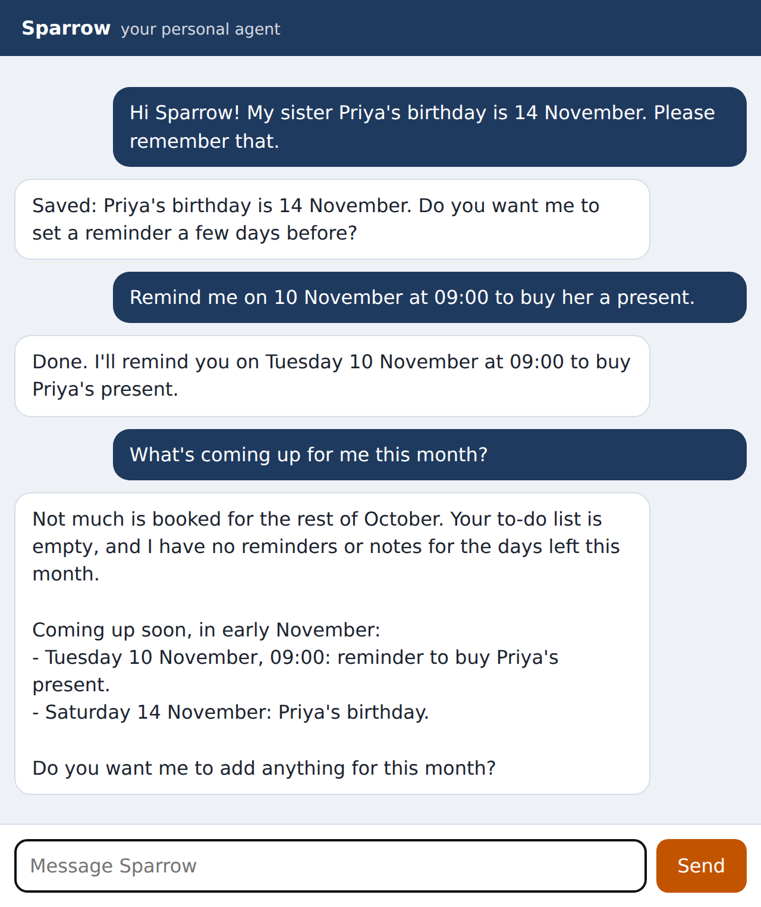

# Chapter 10: Channels: Terminal and Web Chat

A channel connects Sparrow to a place where you chat. Every channel has the same two jobs: turn incoming messages into an `Inbound` and hand them to the gateway, and deliver the gateway's replies. This chapter builds the two channels that run on your own computer, the terminal and a web chat in your browser, and the command line that starts Sparrow. By the end, Sparrow runs.

## The Channel Interface

The gateway needs only two things from a channel: a `name`, such as `"web"`, which is the first part of a route, and an `async` method `send(chat_id, text)`. Each channel also has a way of receiving messages, which is different for each one: reading lines from the keyboard, a WebSocket, or polling Telegram. Python doesn't need a formal interface for this; any object with a `name` and a `send` will do. The tests use exactly that: a `Recorder` channel that keeps what it's sent in a list.

## The Terminal

`sparrow/channels/terminal.py` is the simplest channel:

```python
@include sparrow/channels/terminal.py
```

`run` reads a line at a time and hands each one to the gateway as the owner. Reading from the keyboard blocks, so `asyncio.to_thread` runs it in a worker thread; meanwhile the event loop stays free for the scheduler, so a reminder can arrive while you're typing. An empty string means the input ended (Ctrl+D, or the end of a file piped in), and the chat stops. The reading and writing functions can be replaced, which is how the test in Chapter 21 types into it.

The terminal is always the owner. Anyone who can type in a terminal on your account can already read every file Sparrow can, so there's nothing to protect by asking who they are.

## The Web Chat Server

The web chat is a small web page that talks to Sparrow over a **WebSocket**, a connection that stays open so either side can send at any time. That's what lets Sparrow's reply, or a reminder, appear without the page asking. `sparrow/channels/webchat.py` serves both the page and the socket with FastAPI:

```python
@include sparrow/channels/webchat.py#L1-L36
```

Unlike the terminal, a web page can be reached by other programs on your computer, and by other web pages open in your browser. So the web chat has three protections:

- **It listens on 127.0.0.1 only** (the default `host` in the settings), so other computers on your network can't reach it.
- **It needs a secret token** of at least 16 characters, generated by `init` and stored in the vault. You open the chat once with `?token=...` in the address; the page reads it and uses it for the socket. `allowed` compares tokens with `secrets.compare_digest`, which takes the same time whether the first character or the last one is wrong, so an attacker can't guess the token one character at a time by measuring how quickly it's refused.
- **It checks where the socket was opened from**, as you'll see below.

The constructor refuses a missing or short token, and turns off FastAPI's automatic documentation pages, which would otherwise describe the server to anyone who asked.

```python
@include sparrow/channels/webchat.py#L38-L85
```

The page itself is served only with the right token; anything else gets a plain 403.

The socket handler is where the third protection lives. When a web page opens a WebSocket, the browser adds an `Origin` header saying which site the page came from, and the page can't change it. Browsers don't stop a page on one site from opening a WebSocket to another, including to `127.0.0.1`. So without a check, any site you visited could try to connect to Sparrow; it would still need the token, but the token is the only thing in the way. The check accepts the connection only if the origin is Sparrow's own address (or absent, as it is for programs that aren't browsers, such as the tests and `websockets` clients). A wrong token or a foreign origin closes the socket with code 1008, "policy violation."

> **Real-World Story:** CVE-2026-25253, the one-click takeover of OpenClaw, worked through exactly this kind of gap: OpenClaw's web interface accepted a gateway address from a link and opened a WebSocket to it without checking, handing over its token. Sparrow's web chat never connects anywhere it's told to, and refuses sockets opened by other sites. The Origin test in Chapter 21 was added while writing this chapter, after asking "could a web page I visit talk to my agent?"

Once connected, anything that isn't a JSON object, such as plain text or a list, is ignored rather than dropping the connection with an error. Each message is limited to 8,000 characters, answered with `{"typing": true}` so the page can show that Sparrow is thinking, and handed to the gateway as a separate task. That way the socket keeps reading while Sparrow thinks, and a second message can arrive; the gateway's session lock keeps them in order. `working` holds the tasks so they aren't garbage-collected before they finish.

```python
@include sparrow/channels/webchat.py#L87-L101
```

`send` delivers a reply to every open web chat tab, and quietly forgets any tab that has closed. `run` starts the web server with uvicorn.

## The Web Chat Page

The page, `sparrow/channels/webchat.html`, is one file of HTML, CSS and JavaScript, with no libraries:

```
@include sparrow/channels/webchat.html
```

The script opens the socket with the token from the address, adds your messages and Sparrow's to the log, shows "Sparrow is thinking..." while it waits, and says so if the connection drops. It sets each message with `textContent`, never `innerHTML`, so a reply containing `<script>` (from a web page Sparrow summarized, say) is shown as text, not run as code. `white-space: pre-wrap` keeps Sparrow's line breaks.

Here's the page in use, with the real model:



In three messages, Sparrow called `remember`, then `schedule` with "2026-11-10 09:00", and for the last question checked the to-do list, listed the schedule and searched memory before answering. The suggestion in its first reply, to set a reminder a few days before, came from the model, not from anything in the code: that's the personality in `SOUL.md` at work.

## The Command Line

`sparrow/__main__.py` makes `python -m sparrow` work. It starts with the starter settings file that `init` writes:

```python
@include sparrow/__main__.py#L1-L48
```

The starter file has a comment on each line that isn't obvious, and safe defaults: privacy on, egress set to ask, only Wikipedia allowed, Telegram off until you set it up, and an empty owners list. The double braces aren't in the written file; `{name}` and `{zone}` are filled in by `format`.

```python
@include sparrow/__main__.py#L51-L72
```

`init` writes the settings file and the secrets file only if they don't exist, so running it again never overwrites your changes. The secrets file gets a new random web chat token from `secrets.token_urlsafe(24)`, 32 characters, and `chmod 600` so only you can read it. Creating the `Core` creates the workspace from the templates.

```python
@include sparrow/__main__.py#L85-L141
```

`doctor` checks everything a first run needs and prints `ok` or `FIX` with what to do. The order follows the order people get stuck: no model login, a sandbox that can't start, a broken skill, a missing token, an empty owners list. The `nonlocal problems` line lets the inner `check` function update the count. The return code is 1 if anything needs fixing, so you can use `doctor` in scripts and in the Docker health check of Chapter 25. You saw its output in Chapter 3; Appendix D lists each `FIX` line and its solution.

```python
@include sparrow/__main__.py#L144-L200
```

`serve` builds the core and the gateway with the real brain, and collects the jobs to run: always the scheduler, then either the terminal channel (for `chat`) or the web chat and Telegram, as enabled. Channel modules are imported only when used, so a missing optional piece can't break the others. A missing web chat token stops Sparrow straight away with a message saying what to set, instead of a confusing error. The web chat listens on the host from the settings, unless the environment variable `SPARROW_WEB_HOST` says otherwise; the Docker image sets it, for reasons Chapter 25 explains.

`supervise` runs every job together until one of them ends. In `chat`, the terminal channel is allowed to end: that's when you press Ctrl+D. Any other job ending is a failure, whether it crashed (the web chat's port already in use, say) or returned when it shouldn't have, so `supervise` raises an exception. Python prints it and exits with an error code, and a service manager such as systemd sees the failure and restarts Sparrow (Chapter 25). The first version simply returned when any job ended, so a crashed Telegram channel made Sparrow exit quietly with a success code, and nothing restarted it; a review caught that, and Chapter 24 tests the fix.

```python
@include sparrow/__main__.py#L203-L255
```

`main` reads the command and the `--home` option, which defaults to the `SPARROW_HOME` environment variable or `~/.sparrow`. `status` and `pairing` work directly on the state, with no model and no running gateway, so you can check spending or approve a guest from another terminal while Sparrow runs.

## Running It

With every module from Parts II and III written, start Sparrow:

```
$ python -m sparrow init
$ python -m sparrow doctor
$ python -m sparrow run
Web chat: http://127.0.0.1:8765/?token=...
Sparrow is running. Press Ctrl+C to stop.
```

Open the address with your token from `~/.sparrow/state/secrets.env` (the line `SPARROW_WEB_TOKEN=...`) in your browser, and say hello. For a quick conversation without a browser, use `python -m sparrow chat` instead.

## Key Takeaways

- A channel needs a `name` and a `send` method, plus its own way of receiving messages.
- The terminal is always the owner; blocking reads run in a thread so the scheduler keeps working.
- The web chat listens only on 127.0.0.1, needs a long secret token compared in constant time, and refuses WebSockets opened by other sites.
- Set message text with `textContent`, so nothing in a reply can run as code in the page.
- `init` and `doctor` make the first run predictable; `status` and `pairing` work without the model.
