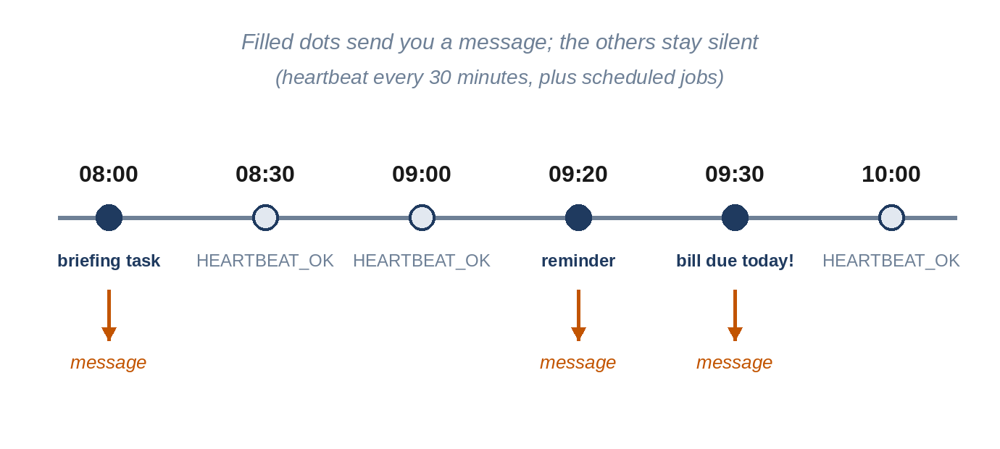

# Chapter 12: Heartbeat and Scheduled Jobs

So far Sparrow only speaks when spoken to. A personal agent should also act on its own: send the reminder you asked for at the time you asked, run your morning briefing every weekday at eight, and notice when something needs your attention. This chapter adds both kinds of initiative: **scheduled jobs**, which run at times you set, and the **heartbeat**, a regular check-in that decides for itself whether there's anything worth saying.



## A Small Language for Time

People say "remind me in twenty minutes," "tomorrow at half seven," "every Monday morning." Parsing natural language about time is surprisingly hard, and getting it wrong means a reminder at the wrong time, which is worse than none. Sparrow splits the work. The model, which is good at language, turns what you said into one of a few fixed forms; the code, which is good at being exact, parses only those forms. The `schedule` tool's description lists them, and `sparrow/scheduler.py` documents them at the top:

```python
@include sparrow/scheduler.py#L1-L19
```

Here is every form, with what the code makes of it at 09:00 on Tuesday, October 27, 2026, taken from the tests:

| You or the model write | First run | Repeats |
| --- | --- | --- |
| `2026-10-28 09:00` | Wed 2026-10-28 09:00 | no |
| `in 30 minutes` | Tue 2026-10-27 09:30 | no |
| `in 2 days` | Thu 2026-10-29 09:00 | no |
| `tomorrow 07:30` | Wed 2026-10-28 07:30 | no |
| `today 18:00` | Tue 2026-10-27 18:00 | no |
| `daily 08:00` | Wed 2026-10-28 08:00 | `daily 08:00` |
| `daily 10:00` | Tue 2026-10-27 10:00 | `daily 10:00` |
| `weekdays 08:00` | Wed 2026-10-28 08:00 | `weekdays 08:00` |
| `weekly mon 09:00` | Mon 2026-11-02 09:00 | `weekly mon 09:00` |
| `every 2 hours` | Tue 2026-10-27 11:00 | `every 120m` |
| `Every 45 Minutes` | Tue 2026-10-27 09:45 | `every 45m` |

And these are refused with an error the model can read and correct: `next week` (not a form), `today 08:00` and `2026-10-01 09:00` (already past), `every 1 minute` (too often), `weekly xyz 09:00` (not a day) and `2026-10-28 25:00` (not a time).

## Parsing Times

```python
@include sparrow/scheduler.py#L22-L46
```

`at_time` puts a time of day on a date, checking the hours and minutes. `next_after` finds the next time a repeat rule fires, strictly after a given moment. "Every N minutes" is simple addition. For daily, weekday and weekly rules, it tries today and each of the next seven days, skips any candidate that isn't after `after`, and returns the first one whose weekday matches the rule. Eight days is always enough, because every rule fires at least once a week.

Time zones are handled by Python's `zoneinfo`. The `now` passed in has the owner's time zone, and adding days and setting the hour keep it, so "daily 08:00" means 08:00 on the owner's wall clock all year, including the days the clocks change. One of the tests checks the night in October 2026 when Lisbon's clocks went back an hour: the next "daily 08:00" is still 08:00, now in winter time.

```python
@include sparrow/scheduler.py#L49-L87
```

`parse_when` normalizes the text (lowercase, commas to spaces, single spaces), then tries each form in turn with `re.fullmatch`, which must match the whole text, so "in 30 minutes or so" is refused rather than half-understood. A date and time, or "today" or "tomorrow" with a time, that has already passed is refused (otherwise a typo such as last year's date would fire at once). A one-off time returns `None` as its repeat rule; a repeating one returns the rule in a short standard form, which is what's stored. Repeats more often than every five minutes are refused, because a job every minute is almost always a mistake, and each run of a task costs a model call. The final error lists every accepted form, so a model that guessed wrong knows exactly how to try again.

## Storing Jobs

```python
@include sparrow/scheduler.py#L90-L144
```

The `Scheduler` keeps jobs in the `jobs` table from Chapter 9. `add` checks the kind, parses the time and stores the job with its route, so it will be delivered to the chat where it was asked for. `list` returns active jobs, soonest first. `cancel` switches a job off rather than deleting it, so the database keeps a history of what was scheduled; it returns `False` for a job that doesn't exist or was already off, so the model hears "There is no active job 7" instead of a false success.

`due` returns every active job whose time has come, and `done` updates a job after it has run: a repeating job gets its next run time, calculated from *now* rather than from when it was due. That choice matters after downtime. If your computer was asleep for three days, a daily briefing runs once when Sparrow wakes up, not three times in a row.

## Running Jobs

The gateway checks for due jobs on a timer:

```python
@include sparrow/gateway.py#L329-L362
```

`tick` runs every due job, and the first thing it does with a job is mark it done, which schedules a repeating job's next run or switches a one-off job off. Only then does it deliver the job. The order matters. The first version marked a job done *after* delivering it, so if Telegram was down and the send failed, the job stayed due, and the next tick, twenty seconds later, ran it again: for a task, another model call and another round of tool calls, every twenty seconds for as long as Telegram was down. A review found it by simulating exactly that. Now a failed delivery is caught, logged as a `job_error`, and the job isn't repeated; the heartbeat keeps running too. Losing one reminder during an outage is much better than repeating an action without end.

A **reminder** is sent as it is, prefixed with "Reminder:"; no model is involved, so it's instant, free, and exactly the words you asked for. A **task** runs a full conversation turn, as the owner, in the owner's main session, with the job's message as the request. "Send my daily briefing" at 08:00 is just as if you'd typed it at 08:00, so Sparrow reads the daily-briefing skill, checks your to-dos and memory, and answers you.

If a job runs more than ten minutes late, because Sparrow was stopped or the computer was asleep, the message says so: "Reminder: Take the cake out (late: this was due at 09:10)." A reminder without that note could be dangerously misleading. Each job that's delivered is logged as a `job` event.

## The Heartbeat

Scheduled jobs run at fixed times. The heartbeat is different: every 30 minutes, during waking hours, Sparrow reads a checklist and decides whether anything needs your attention. Most of the time, nothing does, and it should say nothing at all. The checklist is `HEARTBEAT.md` in the workspace:

```
@include sparrow/templates/HEARTBEAT.md
```

You can add your own checks, in plain language: "If it's Friday after 16:00, remind me to submit my timesheet," or "If a to-do has been overdue for three days, ask whether to drop it."

```python
@include sparrow/gateway.py#L364-L391
```

The heartbeat has four guards before it calls the model:

- **Not on start-up.** The first time it's checked after Sparrow starts, it only records the time. Otherwise, every restart would trigger a beat, and a crash loop would become a message loop. The first beat comes one interval later.
- **Not too often.** It runs only when the interval has passed since the last beat, stored in the database so restarts don't reset it.
- **Not at night.** Outside the active hours, 08:00 to 22:00 by default, it records the beat but skips it.
- **Not expensive.** It uses the heartbeat model, Claude Haiku 4.5, which costs about half as much as the main model and is plenty for "is anything due?"

The beat runs as a turn in its own session, `heartbeat`, with role `heartbeat`, which has the owner's tools but its own history, so the checklist doesn't clutter your conversation. If the answer starts with `HEARTBEAT_OK`, it's logged and nothing is sent; otherwise the answer goes to wherever you last talked to Sparrow.

> **Interesting Fact:** The `HEARTBEAT_OK` convention comes from OpenClaw, where it does the same job: a reply that's only the token is dropped instead of being sent. It's a small idea that makes the heartbeat usable. Without it, an agent that checks in every half hour would be the most annoying contact on your phone.

## The Loop

```python
@include sparrow/gateway.py#L393-L401
```

`run_scheduler` calls `tick` every 20 seconds, so a reminder is at most 20 seconds late, and catches any error so a single bad job can't stop all future ones. Twenty seconds is a trade-off: checking the database three times a minute costs nothing measurable, and nobody minds a reminder at 18:00:15.

In the tests, `tick` is called directly, with a clock the test controls. "Advance 29 minutes, tick, check nothing was sent; advance one more, tick, check the reminder arrived; tick again, check it arrived only once" runs in a few milliseconds. Chapter 21 shows those tests, and Chapter 24 kills Sparrow while a reminder is pending and checks that it still arrives after a restart.

## Key Takeaways

- Let the model turn natural language into a few exact time forms, and parse only those in code.
- Use time-zone-aware times so daily jobs follow the owner's wall clock across clock changes.
- Reminders are sent word for word without the model; tasks run a full turn as the owner.
- Repeating jobs are rescheduled from now, so downtime doesn't cause a burst; late jobs say they're late.
- The heartbeat checks a plain-language checklist with a cheaper model, never on start-up or at night, and stays silent with `HEARTBEAT_OK`.
