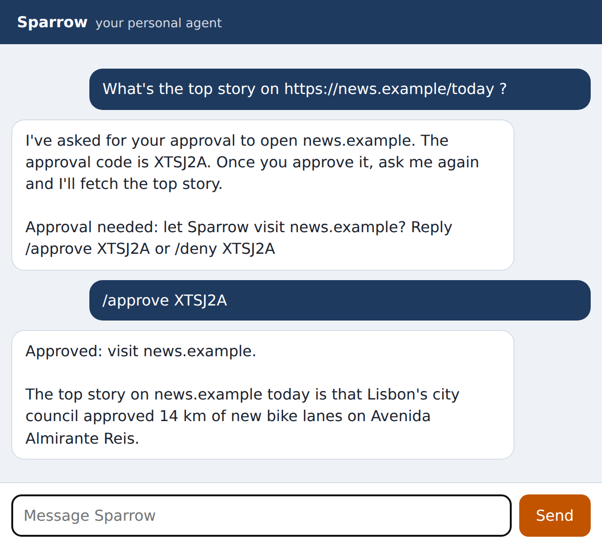

# Chapter 15: Approvals for Risky Actions

Some actions are too important to leave to the model alone. Visiting a website Sparrow has never been to could send your data somewhere new. Installing a skill plants instructions Sparrow will follow from then on. For actions like these, Sparrow asks you first, with a short code you answer with `/approve` or `/deny`. This chapter builds the approval system and shows it working end to end with the real model.

## What Needs Approval

Asking about everything would make Sparrow useless, and people who are asked too often stop reading and approve everything. So approvals are kept for actions that are both **risky** and **rare**:

- **Visiting a new website** (`allow_host`). Once approved, the site is remembered, so you're asked once per site, not once per page.
- **Installing a new skill** (`install_skill`). Rare, and one of the most dangerous things an agent can do.

Things that are risky but common, such as running a command, are handled differently: the sandbox (Chapter 16) makes them safe enough to allow without asking. Things that are common and harmless, such as adding a to-do, just happen.

## How an Approval Works

1. A tool decides an action needs approval. It files a **request** with the action, its exact arguments (the **payload**), a one-line summary, and the route of the conversation.
2. The tool tells the model that it's waiting, and adds a **notice** for you: "Approval needed: let Sparrow visit news.example? Reply /approve XTSJ2A or /deny XTSJ2A". The notice is added to the reply by the gateway, after the model has finished, so the model can't change or leave it out.
3. You reply `/approve XTSJ2A`. The gateway, in code, finds the pending request, runs the action exactly as described in its payload, and tells you.
4. The gateway gives Sparrow a follow-up turn, so it can finish what it started.

Here it is with the real model, in the web chat:



The audit log of that session shows the sequence: a `web_fetch` that returned "waiting for approval", the owner's `/approve`, and a second `web_fetch` in the follow-up turn that succeeded. The model's first answer suggests you "ask me again"; the follow-up turn makes that unnecessary.

## The Approvals Module

`sparrow/approvals.py`:

```python
@include sparrow/approvals.py#L1-L20
```

The code alphabet leaves out `0`, `O`, `1` and `I`, because you'll read codes on a phone and might type them on another device. `secrets.choice` picks each character with a cryptographically secure random generator, so codes can't be predicted from earlier ones. Requests expire after 24 hours: an approval you didn't give today shouldn't be lying around to be approved by accident next week.

```python
@include sparrow/approvals.py#L23-L84
```

`request` first looks for a pending request with the same action and payload, and returns its code if there is one. A model that tries the same blocked site three times in one turn produces one request, not three, so you see one notice, not a list to puzzle over. The payload is stored as JSON with sorted keys, so the same arguments always compare equal.

`pending` returns live requests, marking old ones `expired` as it goes. `decide` accepts a code in any case, with spaces trimmed, and marks it approved or denied. It returns the request's row, or `None` for a code that's wrong, already used or expired, and each code can be decided only once. Approving the same code twice does nothing the second time; the tests in Chapter 21 check this.

## Deciding

The gateway's `decide` method runs approved actions:

```python
@include sparrow/gateway.py#L278-L306
```

The action is chosen from a fixed list in code, `allow_host` or `install_skill`, and its arguments come from the stored payload, not from anything the model says now. That's the core of the design: what you approve is exactly what runs. If the model asked to visit `news.example`, approving can't result in a visit to anywhere else.

After the action, Sparrow gets a follow-up turn in your main session, with a system note saying what you approved and asking it to continue. That turn can now fetch the page or use the new skill, and you get one message with both the confirmation and the result. If you deny, Sparrow simply reports it; no follow-up turn runs, so a denied action costs nothing more.

## Writing Good Approval Requests

An approval is only as safe as your ability to judge it in a few seconds on a phone. Sparrow's requests follow three rules worth copying:

- **Say exactly what will happen, in words.** "Let Sparrow visit news.example?" not "Approve request 4?" The summary is written by code from the payload, not by the model, so a prompt injection can't write a misleading summary such as "visit your bank (safe)". For a skill, "in words" means the whole thing: the notice shows the description and the instructions, and says plainly when the new skill would replace one you already have (Chapter 6).
- **One decision per request.** Bundled requests ("visit these four sites and install a skill") get approved wholesale.
- **Make the safe answer easy.** `/deny` is as short as `/approve`, and ignoring a request is safe too: it just expires.

> **Warning:** The weakest part of any approval system is the person approving. If you approve every request without reading it, approvals protect nothing. If Sparrow asks for a site you didn't expect, especially in the middle of reading something else, deny it and look at why. In Chapter 23, a malicious recipe page tries exactly that: it tells Sparrow to visit an attacker's site, which would have produced an approval request had the model followed the instruction.

## Key Takeaways

- Ask for approval only for actions that are both risky and rare; make common risky actions safe instead.
- The approval notice is added by code after the model finishes, so the model can't hide it.
- Codes are random, unambiguous, single-use and expire after a day; repeated requests share one code.
- The approved action runs from the stored payload in code, so what you approve is exactly what happens.
- A follow-up turn lets Sparrow finish the task as soon as you approve.
