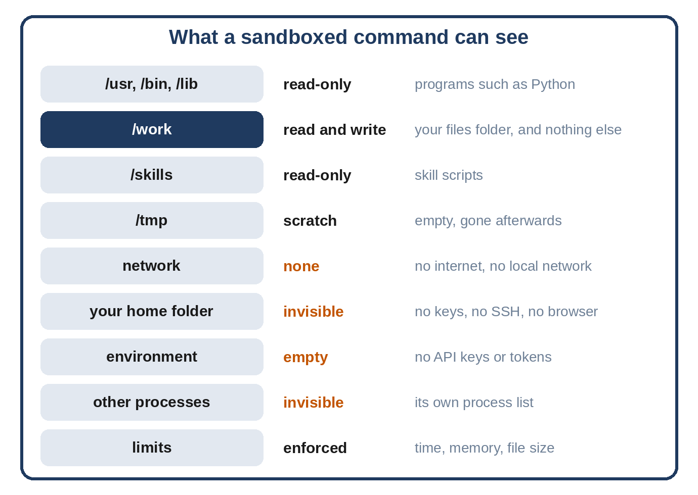

# Chapter 16: The Sandbox

`run_command` is Sparrow's most powerful tool. It lets Sparrow run a skill's script, total a spreadsheet, convert a file or do a calculation, in any language installed on your computer. It's also the most dangerous: a shell command can delete files, read your SSH keys, or download and run anything. This chapter puts every command in a **sandbox**, an isolated environment where it can do its job and nothing else, and tells the story of the leak the tests found in the first version.

## What a Command Can See



Inside the sandbox, a command sees the system's programs, read-only, so `python3` and the usual tools work. It sees your files folder as `/work`, which it can read and write; that's where it starts, and it's the only lasting thing it can change. Skill scripts are at `/skills`, read-only, so a command can't rewrite a skill. There's an empty `/tmp` that disappears afterward. And that's all: no network, no home folder, no environment variables beyond a few harmless ones, no view of other processes, and limits on time, memory and file size.

Sparrow builds this sandbox two ways: with Linux namespaces and bubblewrap on Linux, and with Apple's built-in sandbox on macOS. The picture is the same on both; a few details differ, and this chapter points them out.

## Linux Namespaces and bubblewrap

The sandbox is built from **Linux namespaces**, the same kernel feature that containers such as Docker use. A namespace gives a process its own private view of one kind of resource: its own list of mounted file systems, its own network (with nothing in it), its own process IDs, its own user IDs. The process isn't fenced in by rules that it could talk its way around; the things outside simply don't exist in its view.

**bubblewrap** (`bwrap`) is a small program that sets up namespaces for one command. You tell it what to mount where, which namespaces to create and what to run, and it does exactly that. It was written for Flatpak, which uses it to isolate desktop applications, so it's well reviewed and works for normal users without root on most Linux systems.

> **Interesting Fact:** NemoClaw's OpenShell runtime and Anthropic's own sandboxing for Claude Code both rely on kernel-level isolation rather than on asking the model to behave. Claude Code's sandbox on Linux uses bubblewrap, the same tool as Sparrow. When the people who build agents for a living converge on the same approach, it's a good sign.

## Building the Command

`sparrow/sandbox.py` starts by choosing the sandbox for this computer, then builds the bubblewrap arguments:

```python
@include sparrow/sandbox.py#L1-L76
```

`backend` returns `"bwrap"` on Linux when bubblewrap is installed, `"seatbelt"` on macOS (whose sandbox tool is always there), or `None`. Read the bubblewrap arguments as a description of the sandbox's world:

- `--ro-bind /usr /usr` mounts the system's programs and libraries read-only. On modern Linux, `/bin`, `/lib` and the rest are links into `/usr`, so the loop recreates those links rather than binding more folders.
- `--proc /proc` and `--dev /dev` give the command a fresh process list and a minimal set of devices, not the real ones.
- `--size` and `--tmpfs /tmp` give it an empty scratch folder in memory, of at most 64 MB, so writing to `/tmp` can't use up your computer's memory.
- `--bind <files> /work` mounts your files folder read-write, and `--ro-bind <skills> /skills` mounts the skills read-only. `--chdir /work` starts the command there.
- `--unshare-all` creates every kind of namespace. Most importantly, the new network namespace has only a loopback interface, so there is **no network at all**: no internet, no local network, no cloud metadata service.
- `--die-with-parent` kills the sandbox if Sparrow dies, so no command outlives it. `--new-session` detaches it from Sparrow's terminal, which stops a known trick for typing into the parent's terminal.
- `--cap-drop ALL` removes every special privilege the process might otherwise have inside its namespaces.
- `--clearenv` empties the environment, then `--setenv` adds back just `PATH`, `HOME` and `LANG`.
- Finally `/bin/sh -c <command>` runs the command through a shell, so pipes and `&&` work.

Notice what isn't mounted: `/home`, `/root`, `/etc`, `/var`. Your SSH keys, your browser profile, `~/.sparrow/state/secrets.env`, system password files: none of them exist inside.

## The Sandbox on macOS

macOS has no namespaces and no bubblewrap, but it has its own sandbox, built into the kernel: **Seatbelt**. Every app from the Mac App Store runs inside it. A program called `sandbox-exec` starts a command under a **profile**, a short list of rules in a Lisp-like language, and the kernel checks every file access, network connection and process against those rules. Apple marks `sandbox-exec` as deprecated for app developers, but it ships with every Mac and is what Claude Code uses for its own sandbox on macOS.

```python
@include sparrow/sandbox.py#L78-L116
```

The profile starts from `(deny default)`: nothing is allowed unless a rule allows it. Then it allows running programs, reading system settings, and signals within the sandbox. Network access is never allowed, so it stays denied. For files, later rules win over earlier ones, which lets the profile say what it means in order: allow reading everything; then deny reading `/Users` (everyone's home folders), `/Volumes` (other disks) and your home folder, wherever it is; then allow reading file names and sizes, so programs can find their way around; then allow reading the files folder, the skills, the scratch folder and the Python installation, even if they're under your home folder. Writing is allowed only in the files folder and the scratch folder.

Two differences from Linux follow from how Seatbelt works. It applies rules to real paths rather than showing folders under new names, so there is no `/work` or `/skills`. `seatbelt_command` rewrites those names in a command to the real folders, so a skill that says `python3 /skills/expense-log/totals.py` works on both systems. And the system folders, including `/etc`, are readable, as `/usr` is on Linux; on a Mac they hold no passwords or keys (the system keeps account data elsewhere), but don't put secrets there. The `-D` options pass the folders into the profile as parameters, so no path is ever pasted into the rules as text.

## Limits

```python
@include sparrow/sandbox.py#L118-L135
```

Namespaces control what a command can *see*; **resource limits** control how much it can *use*. `limits` returns a function that runs in the child process just before the sandbox starts, setting three limits that the sandbox and the command inherit: address space (512 MB by default), so a runaway allocation fails with a `MemoryError` instead of exhausting your computer; CPU time, so a busy loop is stopped; and file size, 50 MB, so a command can't fill your disk. macOS doesn't enforce the address-space limit, so each limit is set separately and one that the system refuses is skipped rather than stopping the command from starting. On a Mac, the time limit is what stops a runaway command.

## Running It

```python
@include sparrow/sandbox.py#L138-L212
```

`run_sandboxed` first checks that the sandbox is on and that this computer has one. If either isn't the case, it **refuses** with exit code 126 and a clear message. There is no fallback that runs the command unsandboxed. A missing sandbox should make Sparrow less capable, never less safe.

Each command gets a fresh scratch folder from `TemporaryDirectory`, deleted afterward. On Linux it isn't used, because bubblewrap makes its own `/tmp`; on macOS it becomes the command's `TMPDIR` and the one place outside the files folder it may write. The macOS command gets a short `PATH` that starts with the Python installation Sparrow runs on, then the usual system and Homebrew folders.

The command runs in its own process group (`start_new_session=True`), so on a timeout the whole group can be killed with `SIGKILL`, including anything the command started in the background, and the result is exit code 124, the same code the standard `timeout` command uses.

Output needs care. The obvious way to collect it, `communicate()`, keeps everything a command prints in memory until it finishes. A command like `yes`, which prints forever, would produce gigabytes in twenty seconds and could exhaust Sparrow's memory before the time limit stopped it. So `read_limited` reads the output in a separate thread, 64 KB at a time, keeping only the first 16,000 bytes and counting the rest, while the main thread waits for the command with its time limit. The model gets the first 4,000 characters and a note of how much there was in all. The thread waits at most five seconds after the command ends, in case some process escaped the group and still holds the output open; Sparrow never waits forever on a command.

## The Leak the Tests Found

Look at the `env` that the Linux branch gives `Popen`. It wasn't in the first version of this file, and the reason it's there is the best lesson in this book about testing security.

The first version cleared the environment with `--clearenv`, and the test for it passed: run `env` in the sandbox, check that `ANTHROPIC_API_KEY` isn't in the output. It wasn't.

But `--clearenv` clears the environment of the *command*. bubblewrap itself was started by Sparrow with Sparrow's full environment, including the API key, and inside the new process namespace, bubblewrap is **process 1**. On Linux, a process can read another process's environment from `/proc/<pid>/environ` if it runs as the same user, and inside the sandbox the command and bubblewrap are the same user. So:

```
cat /proc/1/environ
```

run inside the sandbox printed the API key.

This came out of a deliberate exercise: listing every way a process can learn a secret (its environment, files, other processes, the network) and writing a test for each. The second test ran `cat /proc/*/environ` and checked the output for the key, and it *passed*, even though the key was there. The output was more than 2,000 characters, the test's output limit, and the key came after the cut. The test was checking a truncated string.

The fix to the test was to make the sandbox do the searching and print only a number:

```
cat /proc/*/environ | tr '\0' '\n' | grep -c should-not-leak
```

A count of `0` means no process in the sandbox holds the secret; anything else is a leak. With that test, the leak showed up as a failure. Then the fix: start bubblewrap itself with an explicit minimal environment, `PATH` and `LANG` only, so there is nothing secret anywhere inside. The test turned green, and to be sure the test really guards the fix, the fix was removed again and the test failed again.

> **Common Mistake:** A security test that passes proves nothing until you've seen it fail. Every test for a protection should be checked at least once against a version without the protection. Here, the first test of `/proc` was wrong in a way that would have hidden the bug forever.

Two more lessons hide in this story. First, the environment is a poor place for secrets: everything you start inherits it unless you say otherwise. Sparrow's own secrets live in the vault (Chapter 17), and the model's API key is in the environment only because the Agent SDK reads it from there. Second, isolation tools do exactly what you ask, not what you mean. `--clearenv` did its job perfectly; the gap was in what nobody had asked it to do.

## Without Root

Everything above works as a normal user. To be sure Sparrow doesn't rely on root, the sandbox was run as an unprivileged user, ID 30033, with these results (exit code first):

```
@include evals/unprivileged-sandbox.txt
```

Writing to `/work` works; `/etc/passwd` and `/home` don't exist; `/usr` is read-only; the network is unreachable; and `sleep 30` is stopped at the time limit with code 124.

Some systems switch off unprivileged user namespaces, and some container setups block them. In those places bubblewrap fails, `doctor` reports it, and `run_command` refuses. Chapter 25 shows what that looks like inside Docker and the options that allow it.

## On a Mac

The same sandbox tests run on macOS, on the Macs GitHub provides for testing, with every Python version from 3.12 to 3.15 (Chapter 20). There, writing in the files folder works and skill scripts run through the rewritten `/skills` path. Writing to `/usr` or to the skills is refused with "Operation not permitted", and so is opening a network connection. A secret file in the home folder can't be read, the environment holds no keys, endless output is cut and stopped at the time limit, and `sleep 30` ends with code 124. Four Linux-only checks are skipped: the `/proc` test (macOS has no `/proc`), the missing `/etc/passwd` and `/home`, and the memory limit, which macOS doesn't enforce.

## Key Takeaways

- Run every command the model asks for in a sandbox: read-only system, one writable folder, no network, no home folder, an empty environment, and limits.
- Linux namespaces make outside resources invisible rather than forbidden; bubblewrap sets them up for one command. On macOS, a Seatbelt profile gives the same rules, checked by the kernel.
- Read a command's output with a cap, so a command that prints forever can't fill memory.
- If the sandbox isn't available, refuse commands; never fall back to running them unsandboxed.
- Secrets can leak through paths you didn't think of, such as `/proc/1/environ`; list every way a secret could be read, and test each.
- See every security test fail at least once without its protection.
