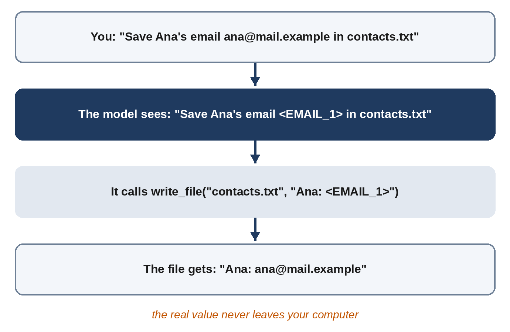

# Chapter 18: The Privacy Router

Everything Sparrow sends to the model goes to a server you don't control. Most of it has to: the model can't help with your message without reading it. But some of what passes through a personal agent doesn't need to leave your machine at all: an email address you want saved, a phone number, a card number, a password you mentioned by mistake. The model needs to know *that* there's an email address and where it goes, not what it is. This chapter builds a **privacy router** that replaces such values with placeholders on the way out and puts the real values back on the way in.

## Two Ways to Keep Data Local

NemoClaw's privacy router routes requests: when a request contains sensitive data, it goes to a model running locally on your own hardware, such as one of NVIDIA's Nemotron models, instead of to a cloud model. Nothing sensitive leaves, but you need a capable local model and the hardware to run it, and the local model may be less capable.

Sparrow takes a different route, sometimes called **pseudonymization**:



1. Before a prompt leaves, the router finds structured private values and replaces each with a placeholder: `okafor@clinic.example` becomes `<EMAIL_1>`, `+351 912 345 678` becomes `<PHONE_1>`.
2. The model works with the placeholders. It can still understand "save `<EMAIL_1>` in contacts.txt" perfectly well.
3. When the model calls a tool with a placeholder, `call_tool` puts the real value back, so your file gets the real address.
4. When a tool result contains a real value, it's replaced with the placeholder again before the model sees it.
5. The reply has its placeholders restored before you see it.

The model never sees the real values, and you never see the placeholders. It works with Claude, needs no local model, and costs nothing. The limit is in step 1: it finds data that has a recognizable *shape*. A name, an address or a medical condition written in words has no fixed shape, and passes through. Chapter 27 discusses combining both approaches.

## Finding Private Data

`sparrow/privacy.py` starts with its patterns:

```python
@include sparrow/privacy.py#L1-L42
```

Seven kinds, each a regular expression:

- **KEY** finds API keys and tokens by their well-known prefixes: `sk-` (used by several AI providers), GitHub's `ghp_`-style tokens, AWS access keys starting `AKIA`, and Slack's `xox` tokens.
- **PASSWORD** finds "password is ...", "pin: ..." and similar, and keeps only the value (the part in parentheses), leaving a trailing full stop or comma out.
- **EMAIL**, **IBAN** (international bank account numbers), **CARD** (13 to 19 digits, optionally in groups), **SSN** (US Social Security numbers) and **PHONE** (digits in groups, optionally with a `+` country code or brackets).

Patterns for numbers are greedy: dates, order numbers and prices are full of digits. So matches go through a second check:

```python
@include sparrow/privacy.py#L45-L63
```

A **card** number must pass the **Luhn check**, the checksum that every real payment card number satisfies: double every second digit from the right, subtract 9 from anything over 9, add everything up, and the total must end in 0. A random 16-digit order number fails it nine times out of ten. A **phone** number must have 10 to 15 digits, which is the range of real international numbers, must be written with a `+` or some separator, and must not be a date such as `2026-10-27`.

These second checks were added when the first tests failed. Here's what the final router finds, and what it rightly leaves alone, from the tests:

| Text | Found |
| --- | --- |
| `mail me at maria.lopez@mail.example` | EMAIL |
| `card 4111 1111 1111 1111` | CARD |
| `call +351 912 345 678` | PHONE |
| `call (555) 010-7788` | PHONE |
| `my password is Hunter22!` | PASSWORD |
| `pin: 4821` | PASSWORD |
| `key sk-live-abcdefghijklmnop1234` | KEY |
| `IBAN DE89 3704 0044 0532 0130 00` | IBAN |
| `SSN 123-45-6789` | SSN |
| `Meet on 2026-10-27 at 12:30` | nothing |
| `Order number 1234567890123` | nothing |
| `It costs 1,250.00 dollars` | nothing |
| `card 4111 1111 1111 1112` | nothing (fails the Luhn check) |
| `Room 101, floor 3` | nothing |

## Redacting and Restoring

```python
@include sparrow/privacy.py#L66-L112
```

A `PrivacyRouter` keeps two dictionaries for one turn: placeholder to real value, and real value to placeholder. `redact` gives each new value the next number for its kind and reuses the same placeholder when a value appears again, so "email Ana at `<EMAIL_1>`, and copy `<EMAIL_1>`" stays consistent. Because the gateway creates one router per turn and redacts the system prompt, the history and the new message with it, a value keeps the same placeholder throughout the turn, including in tool results.

`restore` and `restore_args` put real values back, in replies and in tool arguments. They only ever run on your machine.

The router has three modes, set by `privacy` in `sparrow.yaml`:

- **`redact`** (the default) does all of the above.
- **`block`** refuses to send a message containing private data at all. The gateway answers "I didn't send that to the model because it contains private data (PASSWORD). Please leave it out." Use it if you'd rather be stopped than have values swapped.
- **`off`** sends everything as it is.

## Telling the Model About Placeholders

The first end-to-end runs of the privacy router taught a lesson about models. The scenario asked Sparrow to save a card number to a file. Every check of the router passed: the model never saw the number. But the model refused the task: "I can't save card numbers, even to a file ... Your message also only showed a placeholder, not a real number, so I haven't written anything." From its point of view, it had been handed `<CARD_1>`, an odd string it didn't understand, in a request to store sensitive data.

Two changes followed. The scenario changed from a card number, which a careful assistant *should* hesitate to store in a plain text file, to contact details, which are an ordinary thing to save. And the gateway now explains the placeholders in the system prompt whenever redaction is on:

```python
@include sparrow/gateway.py#L27-L32
```

With that note, the model treats `<EMAIL_1>` as what it is, a stand-in for a real value it may use but can't see, and the contacts scenario passed in every run (Chapter 22).

> **Tip:** When you change what a model sees, tell it. A model that meets an unexplained transformation, such as placeholders, truncation or tags, has to guess what it means, and a careful model will often guess "something's wrong" and refuse.

## Key Takeaways

- Structured private values (emails, phone numbers, cards, keys, passwords) can be kept off the model entirely with placeholders.
- Replace values on the way out, restore them in tool arguments and replies, and re-hide them in tool results.
- Second checks such as the Luhn checksum and digit counts keep false alarms down.
- Pattern matching can't find private data written in words; that still reaches the model.
- Explain placeholders to the model, or it may refuse to work with them.
