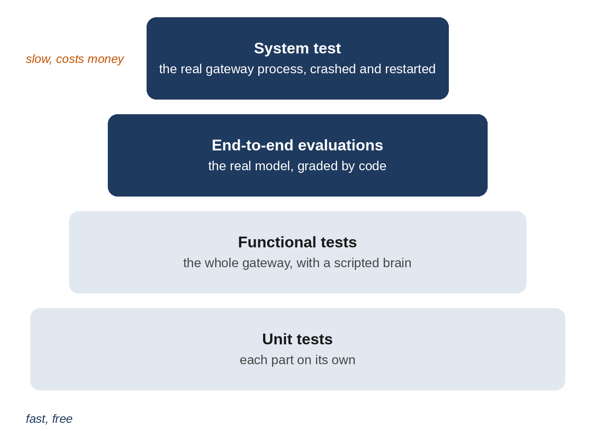

# Part IV: Testing It Completely

# Chapter 20: A Test Strategy for Agents

An agent is harder to test than ordinary software, for three reasons. Its central component, the model, gives different answers to the same question. It acts in the world: it writes files, schedules jobs and calls websites, so a test has to check effects, not just output. And it has adversaries: people who will try to make it misbehave on purpose. This chapter sets out a strategy that handles all three, and starts with the first layer, unit tests of each part.

## What "Completely" Means

Testing Sparrow completely means answering two questions for every feature in Parts II and III:

- **Functional:** does it do what it should? Remember a birthday, deliver a reminder on time, split a long Telegram message, refuse a guest.
- **Non-functional:** how well does it do it, and does it hold under pressure? Security against attacks, reliability when the model or the network fails or the process crashes, performance, and cost.

No single kind of test can answer both for an agent, so Sparrow uses four layers.



1. **Unit tests** check each part on its own: the time parser, the privacy patterns, the egress policy, the sandbox. They're fast, exact and free. (This chapter, and the security units in Chapter 23.)
2. **Functional tests** check the whole gateway, from an incoming message to the reply, with the scripted brain from Chapter 4 in place of the model. Every channel, command and tool flow is covered, and they're still fast and free. (Chapter 21.)
3. **End-to-end evaluations** run Sparrow with the real model, against a pretend internet, and grade what it *did*. They're slow and cost money, so there are 16 scenarios, each run three times. (Chapters 22 and 23.)
4. **A system test** starts Sparrow as a real process, talks to it only from outside through a fake Telegram server and a real WebSocket, kills it, restarts it, and checks that nothing was lost. (Chapter 24.)

The layers form a pyramid: many fast tests at the bottom, a few slow ones at the top. Most bugs are caught at the bottom, where a failure points straight at the cause. The top layers catch what the bottom can't see: how the real model behaves with your prompts and tools, and how the real process behaves when things break.

## Separating the Model From Everything Else

The key design decision for testing was made in Chapter 4: the brain is a small interface, and the scripted brain plays back exactly the tool calls and replies a test asks for. That splits Sparrow's behavior into two questions:

- **Given what the model asks for, does Sparrow do the right thing?** This doesn't depend on the model at all, so it's tested exactly, with the scripted brain: if the model calls `write_file` with `../secrets.env`, does `call_tool` refuse? If a guest's turn asks for `memory_search`, is it blocked? These tests can play the part of a *perfectly fooled* model, one that does whatever an attacker wants, which is the strongest test of the safety layer.
- **Given Sparrow's prompts and tools, does the real model ask for the right things?** This is tested statistically, with the real model, several runs per scenario, grading the effects.

Most agent test suites mix these up, and end up either flaky (exact checks on the model's wording) or weak (only checking that *something* came back). Keeping them apart lets the first kind be exact and the second kind be fair.

## Test Fixtures

The tests share their setup in `tests/conftest.py`, which pytest loads automatically:

```python
@include tests/conftest.py
```

Every test gets a fresh Sparrow home in a temporary folder, with a settings file that has one owner (Asha, `telegram:100`), an allowlist, a deny list and a secret header for a weather API, so every safety feature is switched on. The `Clock` starts at 09:00 on Tuesday, October 27, 2026, in Lisbon, and moves only when a test calls `advance`, so a test can wait thirty minutes in no time. The `Recorder` is a channel that keeps what it's sent. `make_gateway` builds a gateway with a scripted brain and two recording channels, `telegram` and `web`. `owner_says` and `stranger_says` build incoming messages. `anyio_backend` tells the async test plugin to use asyncio.

## Unit Tests

`tests/test_parts.py` tests each part on its own. A few examples show the style; the full file has 56 tests. Settings must reject a misspelled key:

```python
@include tests/test_parts.py::test_unknown_setting_is_an_error
```

The guest prompt must contain nothing private, even with private facts in the workspace:

```python
@include tests/test_parts.py::test_guest_prompt_has_nothing_private
```

Memory search must find hand edits, and must never break, whatever the query:

```python
@include tests/test_parts.py::test_search_sees_hand_edits_and_daily_notes,test_search_never_breaks_on_odd_queries,test_remember_keeps_one_line
```

The last test is a small security test in disguise: a fact containing a newline and a fake dated line must stay one line, so a web page can't plant an "old" memory.

The scheduler's time language is tested form by form with `parametrize`, which runs one test function once for each row of inputs. These are the rows behind the table in Chapter 12:

```python
@include tests/test_parts.py::test_parse_when,test_parse_when_rejects,test_daily_rule_across_clock_change
```

And the privacy router is tested both ways: it must find each kind of private data, and must *not* fire on ordinary text such as dates, order numbers and prices:

```python
@include tests/test_parts.py::test_privacy_finds,test_privacy_leaves_ordinary_text
```

> **Tip:** For any detector, test what it should ignore as carefully as what it should find. A privacy router that fires on every date would replace "2026-10-27" with a placeholder and break reminders. These "negative" cases were what forced the Luhn check and the phone-number rules in Chapter 18.

## Running the Tests

From the project folder, with the virtual environment active:

```
$ pytest
```

```
@include transcripts/pytest.txt
```

All 150 tests passed on Python 3.12, 3.13, 3.14 and 3.15, taking between 16 and 20 seconds, most of it in the sandbox tests, which wait out two five-second time limits on purpose. They need no API key and make no network requests. Run them after every change; if you typed the code from this book, they're the quickest way to find a typo.

The book's code repository runs the same tests automatically on every change, on GitHub's Linux and Mac machines, with all four Python versions: eight runs in all. On a Mac, 146 pass and 4 are skipped, each with its reason: the checks for `/proc`, for the missing `/etc/passwd` and `/home`, and for the memory limit, which test Linux-only protections. A test that can't apply to a computer is skipped and says why; it never silently passes.

`pytest.ini` also turns two kinds of warning into failures: a file or database left open, and an error that happened somewhere Python could only report as a warning. Leaks like these do no harm in a test, but in an agent that runs for months they add up.

| File | Tests | What it covers |
| --- | --- | --- |
| `test_parts.py` | 56 | Settings, workspace, memory, skills, scheduler, to-dos, privacy |
| `test_gateway.py` | 15 | Messages, roles, commands, approvals, budget, privacy, failures |
| `test_schedule_and_channels.py` | 22 | Reminders, tasks, heartbeat, terminal, web chat, Telegram |
| `test_safety.py` | 50 | Egress, vault, sandbox, file paths, guests, untrusted content, memory, audit |
| `test_robustness.py` | 7 | Retries, concurrency, placeholders note, supervision, command line |

## Key Takeaways

- Test both what an agent does (functional) and how well it holds up (security, reliability, performance, cost).
- Use layers: many fast unit and functional tests, fewer real-model evaluations, and one system test from outside.
- Separate "does Sparrow do the right thing given the model's requests?" (exact, scripted) from "does the model make the right requests?" (statistical, real).
- A controlled clock and recording channels make time and delivery testable in milliseconds.
- Test what a detector should ignore, not only what it should find.
