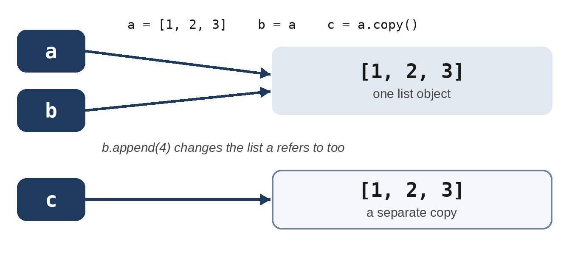

# Part II: Organizing Data and Code

# Chapter 6: Lists and Tuples

Most programs work with collections of values: the songs in a playlist, the readings from a sensor, the books on your shelf. A **list** keeps any number of values in order, and lets you add, remove, sort and search them. A **tuple** is its fixed-size, unchangeable cousin. In this chapter you'll learn both, and you'll start the project that runs through the rest of the book: Pocket Library.

## Making and Using Lists

A list is written as values separated by commas, inside square brackets. Lists can grow and shrink, and their contents can change:

```
@include code/ch06/lists_basics.py
```

```
@include code/ch06/lists_basics.out
```

Indexes work as they do for strings: `fruits[0]` is the first item and `fruits[-1]` the last. The rest are **methods**, which change the list itself:

| Method | What it does |
| --- | --- |
| `append(x)` | Adds `x` to the end |
| `insert(i, x)` | Adds `x` at position `i`, moving the rest along |
| `remove(x)` | Removes the first item equal to `x` (a `ValueError` if there's none) |
| `pop()` | Removes the last item and gives it back; `pop(i)` removes item `i` |
| `sort()` | Sorts the list in place |
| `index(x)` | Gives the position of the first item equal to `x` |
| `count(x)` | Counts the items equal to `x` |

The `in` operator checks whether a value is in a list, and `len` counts the items. A list can hold any type of value, including a mixture, but most lists hold values of one kind.

## Slices, Copies and Useful Functions

```
@include code/ch06/session_lists.txt
```

A **slice** takes part of a list: `numbers[1:3]` takes the items from index 1 up to, but not including, index 3. Leave out the start to begin at the beginning, or the end to go to the end; a third number is the step, and a step of -1 gives you the list reversed. Slices work on strings too.

The middle of the session shows something that surprises nearly everyone. `b = a` doesn't copy the list: it makes `b` a second name for the **same** list, so appending through `b` changes what `a` shows. When you want an independent copy, use `a.copy()` (or `a[:]`).



`sum`, `min` and `max` work on any list of numbers. `sorted` gives you a new sorted list and leaves the original alone, unlike the `sort` method. Capital letters sort before lower-case ones, so `"Fig"` comes first; `key=str.lower` sorts as if everything were in lower case. You'll learn more about `key` in Chapter 7.

## Looping Over Lists

A `for` loop visits each item in turn. Two built-in functions make loops more useful:

```
@include code/ch06/loops_over_lists.py
```

```
@include code/ch06/loops_over_lists.out
```

`enumerate` gives you a number with each item; `start=1` counts from 1, as people do. `zip` walks through two lists side by side, pairing their items. In both loops there are two names after `for`, because each step gives two values.

> **Tip:** Don't add or remove items in a list while you loop over it; the loop can skip items. Loop over a copy (`for task in tasks.copy():`), or build a new list instead.

## Tuples

A **tuple** is like a list that can't be changed. Tuples use parentheses, or no brackets at all:

```
@include code/ch06/tuples.py
```

```
@include code/ch06/tuples.out
```

Use a tuple for a small, fixed group of values that belong together: a point's coordinates, a color's red, green and blue values, a date. **Unpacking** assigns the parts of a tuple to several names at once: `x, y = point`. `a, b = b, a` uses the same trick to swap two values without a temporary variable.

The last line tries to change a tuple and fails. That's the point: when you see a tuple, you know its contents won't change behind your back.

## Project: Pocket Library, Version 1

Pocket Library is a program for keeping track of your books. Over the coming chapters it will learn to save to a file, use classes, run tests, and store its books in a database. Version 1 is a list of titles that you can add to:

```
@include code/ch06/library_v1.py
```

A session, adding three books (one of them twice) and then pressing Enter on an empty line:

```
@include code/ch06/library_v1.out
```

Everything in this program is something you've already learned: a `while True` loop with a `break`, a check with `in` so that a title isn't added twice, `append`, and `enumerate` to number the list. `sorted(books)` prints the titles alphabetically without changing the order in which they were added.

Version 1 has two problems. When the program ends, the books are gone. And a title isn't enough: you'll want the author, the year and whether you've read it. Chapter 7 fixes the second problem and Chapter 10 the first.

## Try It

1. In the shell, make a list of five numbers and print the first three with a slice, and the list reversed.
2. Add `print(fruits.index("kiwi"))` to `lists_basics.py`. What happens if you ask for the index of a fruit that isn't there?
3. Change `library_v1.py` so that the duplicate check ignores case: `dune` should count as a duplicate of `Dune`. (Hint: compare lower-case versions.)

## Exercises

1. **Scores.** Given the scores `[72, 88, 95, 61, 79, 88]`, print the highest, the lowest, the average with one decimal place, and the scores sorted from highest to lowest.
2. **Unique names.** Given a list of names with repeats, build a new list containing each name once, in the order they first appear.
3. **Rotate.** Rotate a list two places to the right, so that `[1, 2, 3, 4, 5]` becomes `[4, 5, 1, 2, 3]`, using slices.

## Key Takeaways

- A list holds values in order and can change: `append`, `insert`, `remove`, `pop` and `sort` change it in place.
- Indexes start at 0; slices like `[1:3]` take part of a list; `in` checks membership.
- `b = a` gives the same list a second name. Use `copy()` for an independent copy.
- `enumerate` numbers items in a loop and `zip` pairs two lists. Tuples are fixed groups of values; unpacking splits them into names.
