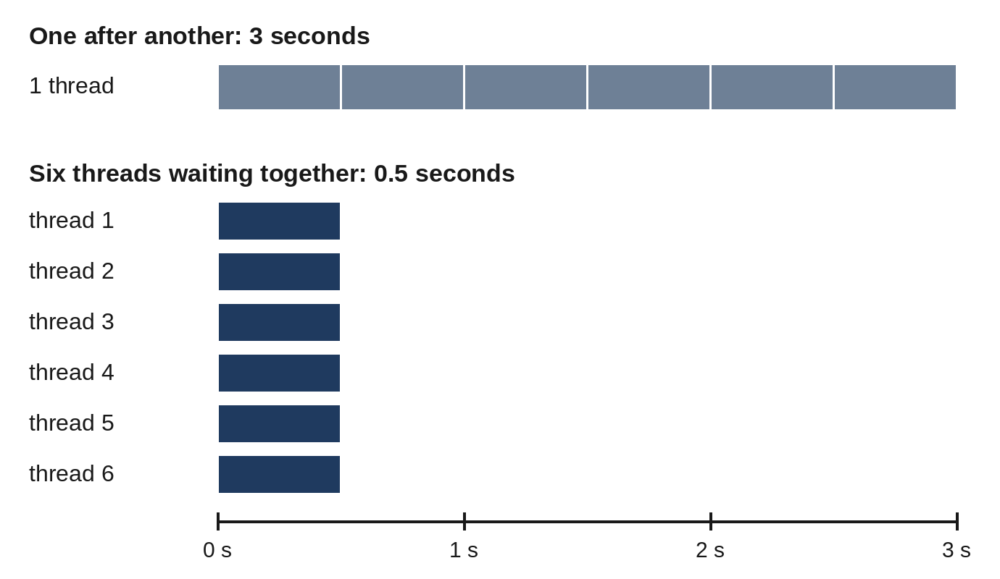

# Chapter 21: Concurrency: Threads, Processes and asyncio

Most programs do one thing at a time. But a program that downloads twenty files spends nearly all its time waiting for the network, and a program that crunches numbers on a computer with eight processor cores uses only one of them. **Concurrency** means making progress on several tasks at once. Python offers three tools for it, and choosing the right one depends on a single question: is your program mostly **waiting**, or mostly **calculating**?

## Waiting versus Calculating

| Your program mostly... | Examples | Use |
| --- | --- | --- |
| Waits for input and output | Downloads, web APIs, databases, files | Threads or asyncio |
| Calculates | Simulations, image processing, number crunching | Processes |

The standard Python interpreter has a **global interpreter lock**, the **GIL**, which lets only one thread run Python code at any moment. Threads still help with waiting, because a thread that's waiting for the network releases the lock and another can run. They don't make calculations faster, though, because the calculations can't run side by side. For that, you need separate processes, each with its own interpreter and its own lock.

> **Note:** Python 3.13 introduced an optional **free-threaded** build without the GIL, and it has been officially supported since Python 3.14. It isn't the default yet, and some packages don't support it. Everything in this chapter works the same with either build.

## Threads for Waiting

The simplest way to use threads is a **thread pool** from `concurrent.futures`. You give it a function and a list of inputs, and it runs the calls on several threads at once:

```
@include code/ch21/threads_download.py
```

```
@include code/ch21/threads_download.out
```

`download` pretends to fetch a file by sleeping for half a second, which is how waiting for a network looks to a program. Six downloads one after another take three seconds. With a pool of six threads, all six wait at the same time, and the whole job takes about half a second. `pool.map` works like `map` from Chapter 20: it calls the function with each item and gives back the results in the original order, whichever finishes first.



The program prints `True` or `False` rather than the times, because timings differ on every computer and every run. On the computer used for this book, the threaded version was about six times faster, as you'd expect from six threads that spend all their time waiting.

## Sharing Data Safely

Threads share the program's variables, and that's dangerous. `counter += 1` looks like one step but is really three: read the value, add one, store it back. If two threads read the same value before either stores, one addition is lost. These bugs, called **race conditions**, appear only occasionally, which makes them very hard to find. A **lock** lets only one thread at a time into a section of code:

```
@include code/ch21/lock_counter.py
```

```
@include code/ch21/lock_counter.out
```

`with lock:` waits until no other thread holds the lock, takes it, and releases it at the end of the block, even after an exception: it's a context manager, as in Chapter 18. `start` begins each thread and `join` waits for it to finish. With the lock, the counter is always exactly 400,000.

The safest design avoids sharing altogether: give each thread its own input and collect results through the pool, as `threads_download.py` does. Then there's nothing to lock.

## Processes for Calculating

For calculations, a **process pool** works the same way as a thread pool but runs each call in a separate Python process, which can use a separate processor core:

```
@include code/ch21/process_primes.py
```

```
@include code/ch21/process_primes.out
```

Counting primes is pure calculation, so the four ranges are counted in four processes at the same time. On a computer with four or more cores, that's up to four times faster than counting them one after another.

`count_primes` takes two arguments, and `pool.map` needs one list for each. `zip(*ranges)` turns the list of pairs into two lists, the starts and the stops, and the outer `*` passes them as separate arguments: it's the same as `pool.map(count_primes, starts, stops)`.

Processes don't share variables: each worker gets its own copy of the arguments, and the results are sent back. That avoids race conditions, but sending data between processes takes time, so processes pay off only when each call does a substantial amount of work.

The `if __name__ == "__main__":` line, from Chapter 11, is **required** here. On Windows and macOS, each worker process starts by importing your file. Without the check, each worker would start its own pool, and so on, without end.

## asyncio

**asyncio** handles waiting in a different way: one thread runs many tasks, and each task explicitly hands over control whenever it waits. It's efficient for thousands of connections at once, and it's what many modern web frameworks use, including FastAPI in Chapter 25:

```
@include code/ch21/async_demo.py
```

```
@include code/ch21/async_demo.out
```

- `async def` defines a **coroutine function**. Calling it doesn't run it; it creates a coroutine, which runs when it's awaited.
- `await` waits for something to finish. While one task waits, the event loop runs others. `asyncio.sleep` stands in for real waiting, such as a network request.
- `asyncio.run(main())` starts the **event loop**, the scheduler that runs the tasks, and runs `main` until it finishes.
- `asyncio.gather` runs several coroutines at the same time and returns their results in the order you gave them. The three fetches take 0.3 seconds in total, not 0.6.
- `asyncio.as_completed` gives the results in the order they finish, quickest first.
- `asyncio.wait_for` gives up after a timeout and raises `TimeoutError`. Always put a time limit on waiting for things that might never answer.

Inside async code, use async libraries, such as `asyncio.sleep` instead of `time.sleep`, and an async HTTP client. A normal blocking call freezes every task on the loop until it returns.

## Choosing

- **A few dozen downloads, API calls or database queries**: a `ThreadPoolExecutor`. It's simple and works with ordinary libraries.
- **Thousands of connections, or an async framework**: asyncio.
- **Heavy calculation**: a `ProcessPoolExecutor`, or a library such as NumPy that does its calculations outside Python's lock.
- **Most programs**: none of these. Concurrency adds complexity; use it when measurement shows that waiting or calculation is the bottleneck. Chapter 22 shows how to measure.

## Try It

1. Change `max_workers` in `threads_download.py` to 2. How much faster is the threaded version now, and why?
2. Remove the `with lock:` line from `lock_counter.py` (keeping `counter += 1`) and run it several times. Do you always get 400,000? (The answer depends on your Python version and computer.)
3. In `async_demo.py`, change the timeout to 3 seconds. What happens?

## Exercises

1. **Parallel word counts.** Write `word_counts(texts)`, which counts the words in each text using a `ThreadPoolExecutor` with four workers and returns the counts in the original order.
2. **Limited concurrency.** Write an async function `fetch_all(names, limit)` that "fetches" every name (sleeping briefly and returning it in capitals) but never runs more than `limit` fetches at the same time. Track and return the largest number running at once to prove it. (Hint: `asyncio.Semaphore(limit)` is a lock that lets in up to `limit` tasks.)

## Key Takeaways

- Use threads or asyncio when a program mostly waits; use processes when it mostly calculates.
- `ThreadPoolExecutor` and `ProcessPoolExecutor` run a function over many inputs at once and return results in order. Process pools need `if __name__ == "__main__":`.
- Shared data between threads needs a lock; better still, don't share it. Processes don't share variables at all.
- asyncio runs many tasks on one thread with `async def`, `await`, `gather` and timeouts. Add concurrency only when measurement shows you need it.
