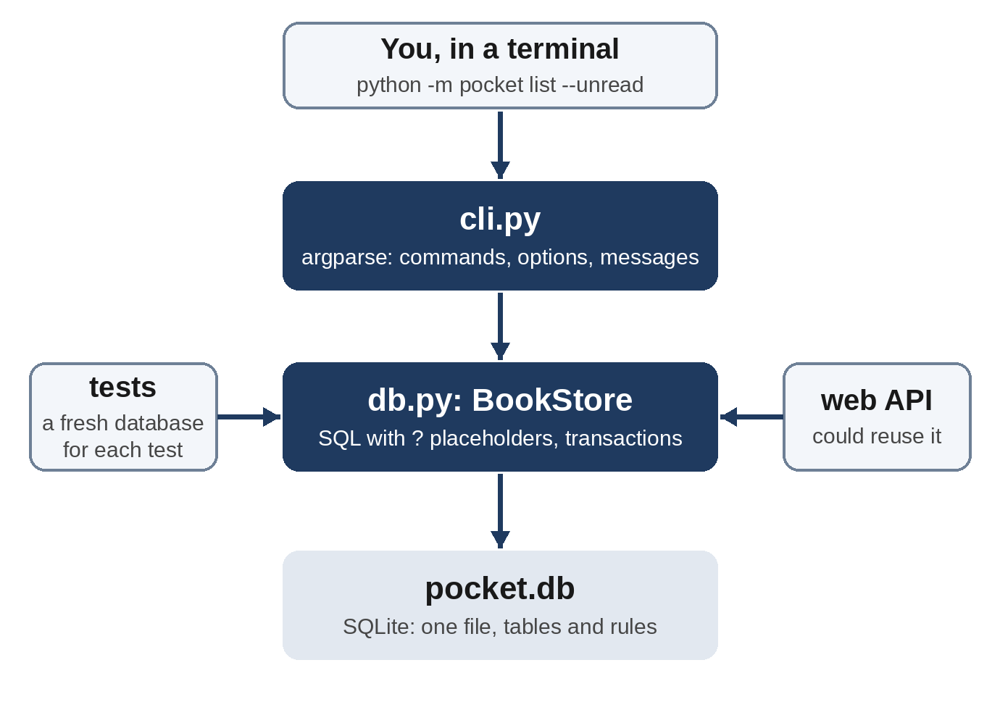

# Part V: Real-World Projects

# Chapter 23: Project: Pocket Library with SQLite

Pocket Library has kept its books in a JSON file since Chapter 10. That works well for a few hundred books, but every change rewrites the whole file, two programs saving at once can lose data, and every search means loading everything and looping through it. Real applications keep their data in a **database**. In this project, you'll move Pocket Library to **SQLite**, a complete database that comes built into Python, learn enough **SQL** to store and query your data, and finish with a tested command-line app with five commands.

## SQLite and SQL

SQLite stores a whole database in a single file. There's no server to install or run, and the `sqlite3` module is part of the standard library. It's one of the most widely used pieces of software in the world: it's inside phones, web browsers and countless desktop applications.

A database holds **tables**. A table is like a spreadsheet with fixed columns: each **row** is one record, such as one book, and each **column** has a name and a type. You talk to the database in **SQL** (Structured Query Language). A few statements cover most needs:

| SQL | What it does |
| --- | --- |
| `CREATE TABLE books (...)` | Creates a table with the given columns |
| `INSERT INTO books (title, author) VALUES (?, ?)` | Adds a row |
| `SELECT title FROM books WHERE year > 2000 ORDER BY title` | Reads rows that match a condition, in order |
| `UPDATE books SET rating = ? WHERE id = ?` | Changes rows |
| `DELETE FROM books WHERE id = ?` | Removes rows |
| `SELECT author, COUNT(*) FROM books GROUP BY author` | Summarizes groups of rows |

SQL keywords are traditionally written in capitals, which makes them easy to tell apart from table and column names.

## The Database Layer

All the database code goes in one module, `pocket/db.py`. It starts with the table's design, called its **schema**, and a dataclass for one row:

```
@include code/ch23/pocket/db.py::SCHEMA,Book
```

Each column has a type, `INTEGER` or `TEXT`, and the schema adds rules that the database enforces whatever program uses it:

- `id INTEGER PRIMARY KEY` gives each book a unique number, assigned automatically.
- `NOT NULL` means a title and an author are required. `NULL` is SQL's version of `None`.
- `CHECK (rating BETWEEN 1 AND 5)` rejects impossible ratings.
- `UNIQUE (title, author)` stops the same book being added twice.
- `-- ...` is a comment in SQL.

`CREATE TABLE IF NOT EXISTS` makes the table only if it isn't already there, so it's safe to run every time the program starts. The `Book` dataclass has one field per column, in the same order, so a row from the database becomes a `Book` with `Book(*row)`.

The `BookStore` class wraps the database connection:

```
@include code/ch23/pocket/db.py::BookStore.__init__,BookStore.close,BookStore.add,BookStore.get
```

`sqlite3.connect(path)` opens the database file, creating it if it doesn't exist. `execute` runs one SQL statement.

Look closely at how values get into the SQL: never with an f-string, always as `?` **placeholders**, with the values passed separately in a tuple. The `sqlite3` module inserts them safely. If you built SQL with an f-string, a book called `x'); DROP TABLE books; --` could change your SQL into something else entirely. This attack is called **SQL injection**, and it has caused countless real data breaches. Placeholders make it impossible.

`with self.conn:` makes a **transaction**: if the block finishes, the changes are **committed**, that is, saved permanently; if an exception happens, they're **rolled back**, as if they never happened. A database never ends up with half a change. When the `UNIQUE` rule rejects a duplicate, `sqlite3` raises `IntegrityError`, and `add` turns it into a `ValueError` with a clear message. `from None` hides the original database error from the traceback, because the new message says all that matters. `cur.lastrowid` is the `id` the database gave the new row.

`get` uses `fetchone`, which returns one row as a tuple, or `None` if nothing matched.

## Queries

```
@include code/ch23/pocket/db.py::BookStore.list,check_date,BookStore.mark_read,BookStore.stats
```

`list` builds its query from the options it's given. `WHERE 1 = 1` is always true, which simply lets every condition start with `AND`. `LIKE ?` with `%` around the search text matches it anywhere in the title or author, ignoring case for English letters. Even here, the search text goes in through a placeholder.

The `read_on` column is `TEXT`, and SQLite will store any text there, so the Python layer checks dates before saving them. `check_date` accepts only real dates written as `YYYY-MM-DD`: `date.fromisoformat` rejects text like `not-a-date` and impossible dates like `2026-02-30`, and comparing with `isoformat()` also rejects other layouts that `fromisoformat` accepts, such as `20261001`. `mark_read` calls it before changing anything.

`stats` asks the database to do the counting. `COUNT(*)` counts rows, `COUNT(read_on)` counts rows where `read_on` isn't `NULL`, and `AVG(rating)` averages the ratings, ignoring books without one. `GROUP BY author` makes one group per author, `ORDER BY n DESC` puts the largest first, and `LIMIT 1` keeps just the top author. With thousands of books, letting the database do this work is far faster than loading every row into Python.

`export_csv` writes every book to a CSV file with the `csv` module from Chapter 10, so you can open your library in a spreadsheet.

## The Command-Line Interface

`pocket/cli.py` turns command-line arguments into calls to `BookStore`, with `argparse` subcommands as in Chapter 17:

```
@include code/ch23/pocket/cli.py
```

The design keeps the layers apart: `db.py` knows SQL but nothing about the command line, and `cli.py` knows the command line but no SQL. Either could be replaced, as you'll see in Chapter 25, where a web API uses the same idea.

 `choices=range(1, 6)` lets `argparse` reject a rating of 9 before the database ever sees it, and `finally` closes the database however the command ends.

## Using Pocket Library

To show the whole app at work, this short script runs a series of commands exactly as you'd type them, using `subprocess.run` to start `python -m pocket` for each one, and prints what each command shows:

```
@include code/ch23/demo.py
```

```
@include code/ch23/demo.out
```

Every feature works: adding, refusing a duplicate, marking books read with a date and rating, listing with filters, a clear message for an unknown ID, statistics and export.

## Tests

The tests use a fixture that creates a fresh database in a temporary folder for each test, and closes it afterward. Code after `yield` in a fixture runs when the test is finished:

```
@include code/ch23/tests/test_pocket.py
```

```
@include code/ch23/run_tests.out
```

`test_cli_rating_must_be_1_to_5` checks that `argparse` refuses a rating of 9: it exits the program, which raises `SystemExit`.

## Try It

1. Run the demo commands yourself from the chapter folder, starting with `python -m pocket add "Dune" "Frank Herbert" --year 1965`, then open `books.csv` in a spreadsheet.
2. Add a book with a title containing a single quote, such as `"The Handmaid's Tale"`. It works, thanks to placeholders.
3. Explore the database with the `sqlite3` command-line tool, if your system has it: `sqlite3 pocket.db "SELECT title, rating FROM books"`.

## Exercises

1. **Remove.** Add a `remove(book_id)` method that deletes a book and raises `KeyError` if there's no book with that ID. (Hint: after a `DELETE`, the cursor's `rowcount` says how many rows were deleted.)
2. **Books per author.** Add a `books_per_author()` method that returns a dictionary from each author to their number of books, most first, using `GROUP BY`.

## Key Takeaways

- SQLite is a complete database in one file, built into Python as `sqlite3`. Tables have typed columns, and constraints such as `NOT NULL`, `UNIQUE` and `CHECK` keep the data valid.
- `SELECT`, `INSERT`, `UPDATE` and `DELETE` read and change rows; `WHERE`, `ORDER BY`, `GROUP BY` and functions like `COUNT` and `AVG` let the database do the work.
- Always pass values through `?` placeholders, never with f-strings, to prevent SQL injection. `with conn:` commits a transaction or rolls it back.
- Keep the database layer and the user interface separate, and test the database code against a fresh temporary database.
