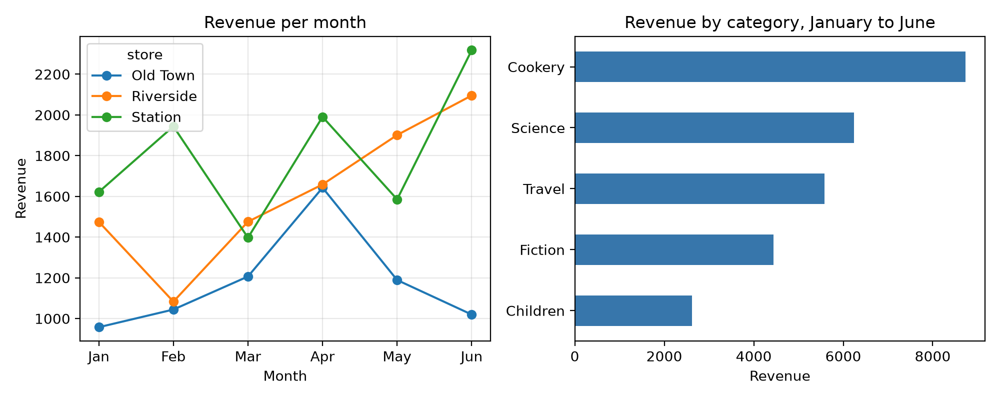

# Chapter 24: Project: Data Analysis with CSV, pandas and Charts

Python is the most popular language for working with data, and for good reason: a few lines can read a spreadsheet of thousands of rows, answer questions about it, and draw a chart. In this project you'll analyze six months of sales from a small chain of bookshops, first with the standard library alone, then with **pandas**, the most widely used data analysis library, and finally with charts from **matplotlib**.

Install the two libraries in your virtual environment before you start:

```
$ python -m pip install pandas matplotlib
```

## The Data

Paper Lantern Books is a fictional bookshop chain with three branches: Riverside, Old Town and Station. Its sales file, `sales.csv`, has one row for each sale, with the date, branch, category, title, number of copies and price per copy. Here are its first lines:

```
@include code/ch24/sales.csv#L1-L5
```

The data was made by a program, so you can see exactly how it was built, and so it's the same for every reader:

```
@include code/ch24/make_sales.py
```

```
@include code/ch24/make_sales.out
```

Each day, each branch makes zero to two sales, of a random book. The number of copies follows a **normal distribution** around 3 (`random.gauss(3, 1.5)`), scaled up for bigger branches, weekends and the busier months toward summer. Making data with known patterns is a good way to practice analysis: you know what you should find.

## Analysis with the Standard Library

You already know enough to answer the main questions with `csv`, `defaultdict` and `Counter` from Chapters 10 and 11:

```
@include code/ch24/stdlib_analysis.py
```

```
@include code/ch24/stdlib_analysis.out
```

Station, the largest branch, takes the most money, and April and June are the best months. `row["date"][:7]` takes the year and month from a date like `2026-01-01`. That works because ISO dates have a fixed layout. Walking the Coast sells the most copies, partly because it's the only travel book, so it gets every travel sale.

This approach works for any size of file and needs nothing beyond Python. But each new question means another loop and another dictionary.

## Analysis with pandas

pandas works with a **DataFrame**: a table with named columns, like a spreadsheet, that you can filter, group and summarize with single commands. Here's the same analysis and more:

```
@include code/ch24/pandas_analysis.py
```

```
@include code/ch24/pandas_analysis.out
```

Step by step:

- `pd.read_csv` reads the whole file into a DataFrame. `parse_dates=["date"]` turns the date column into real dates. `shape` gives the number of rows and columns.
- `sales["revenue"] = sales["quantity"] * sales["unit_price"]` creates a column by multiplying two columns, all 540 rows at once, without a loop. Operations on whole columns are called **vectorized**, and they're both shorter and much faster than Python loops.
- `sales[columns]` selects some columns; `head(3)` shows the first three rows.
- `groupby("store")["revenue"].sum()` does in one line what the dictionary loop did: group the rows by store and add up each group's revenue.
- `pivot_table` makes a cross-table: categories down the side, stores across the top, total revenue in each cell. Cookery is the best category in every branch, and Children's books sell best at Station.
- `dt.to_period("M")` turns each date into its month for grouping, and `dt.dayofweek` gives the day of the week as a number, Monday being 0, so `>= 5` means Saturday or Sunday.

The last result confirms a pattern built into the data: on average, weekend sales are bigger, 4.55 copies against 3.08. Finding the patterns that were put in is a good check that the analysis is right.

`to_string()` prints a whole table without abbreviation; in the shell or a Jupyter notebook you'd usually just type the variable's name.

> **Tip:** **Jupyter notebooks** are a popular way to explore data: you run code in small cells and see tables and charts right below each one. Install with `python -m pip install notebook` and start with `jupyter notebook`. The code in this chapter works there unchanged.

## Charts with matplotlib

Numbers in a table are precise; a chart shows the pattern at a glance:

```
@include code/ch24/charts.py
```

```
@include code/ch24/charts.out
```



`plt.subplots(1, 2)` creates a figure with two charts side by side. `unstack()` turns the store part of the grouping into columns, one per store, which pandas' `plot` draws as one line each, with a legend. `plot.barh` draws horizontal bars, and `savefig` saves the figure as an image file. `matplotlib.use("Agg")` tells matplotlib to draw straight to a file without opening a window; leave it out when you want to see the chart on screen, and call `plt.show()` at the end instead.

The line chart shows what the totals hid: Station's sales jump up and down from month to month, Riverside grows steadily after a weak February, and Old Town falls back after April.

## Try It

1. Find the total number of copies sold for each category, with the standard library and then with pandas.
2. Use `sales[sales["store"] == "Old Town"]` to keep only Old Town's rows, and find its best month.
3. Add a third chart that shows the number of copies sold on each day of the week.

## Exercises

1. **Busiest day.** Write `busiest_day(sales)`, which returns the name of the weekday with the most copies sold. (Hint: `dt.day_name()` and `idxmax()`.)
2. **Best title per store.** Write `best_title_per_store(sales)`, which returns a dictionary from each store to its best-selling title by copies.
3. **Growth.** Write `month_on_month_growth(sales)`, which returns the percentage change in revenue from each month to the next. (Hint: `pct_change()`.)

## Key Takeaways

- The `csv` module with `defaultdict` and `Counter` answers simple questions about data with no extra installs.
- pandas reads data into a DataFrame and answers questions with vectorized column operations, `groupby`, `pivot_table` and date tools, usually in one line each.
- matplotlib draws charts, and pandas' `plot` methods make common ones in a single call. Save them with `savefig`.
- Check an analysis by confirming patterns you already know are there.
