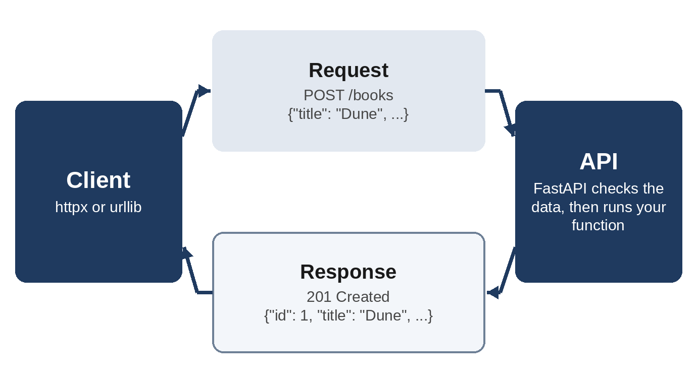

# Chapter 25: Project: Web APIs: Calling Them and Building One

Much of today's software talks to other software over the web. A weather app asks a weather service for a forecast; a shop's website asks a payment service to take a payment. These conversations go through **web APIs**: addresses on the web that accept requests from programs and answer with data, usually in JSON. In this project you'll learn how web APIs work, build one for Pocket Library with **FastAPI**, test it, and call it from Python in two ways.

Install the packages for this chapter in your virtual environment:

```
$ python -m pip install fastapi uvicorn httpx pytest
```

## How Web APIs Work

A program talks to a web API with **HTTP**, the same protocol your browser uses. Each request has:

- a **URL**, the address of a **resource**, such as `http://127.0.0.1:8000/books/1` for book 1;
- a **method**, which says what to do with it: `GET` to read, `POST` to create, `PUT` or `PATCH` to change, `DELETE` to remove;
- optionally, a **body** with data, usually JSON, for example the details of a new book;
- optionally, **query parameters** after a `?`, such as `/books?author=austen`.

Each response has a **status code**, a body, and some headers. The status codes you'll meet most are:

| Code | Meaning |
| --- | --- |
| 200 OK | It worked; the body has the result |
| 201 Created | A new resource was created |
| 204 No Content | It worked; there's nothing to send back |
| 404 Not Found | There's no such resource |
| 422 Unprocessable Content | The data sent was invalid |
| 500 Internal Server Error | The server failed |

Codes in the 200s mean success, the 400s mean the client made a mistake, and the 500s mean the server did.



## JSON, Again

Web APIs send and receive JSON, which you met in Chapter 10. The `json` module turns it into dictionaries and lists, and back:

```
@include code/ch25/json_responses.py
```

```
@include code/ch25/json_responses.out
```

## Building an API with FastAPI

**FastAPI** is a popular framework for building web APIs. You write ordinary functions with type hints, from Chapter 19, and FastAPI turns them into web endpoints, checks the data that comes in, and converts what you return into JSON:

```
@include code/ch25/books_api.py
```

- `app = FastAPI(...)` creates the application.
- `@app.get("/books")` is a decorator, as in Chapter 18, which registers `list_books` to answer `GET` requests for `/books`. Its parameter `author` isn't part of the path, so FastAPI takes it from the query string: `/books?author=austen`.
- In `@app.get("/books/{book_id}")`, the `{book_id}` part of the path becomes the function's `book_id` parameter. Because it's typed `int`, FastAPI converts it, and rejects a request for `/books/abc` with a clear error.
- `NewBook` is a **Pydantic** model: a class like a dataclass that checks its data. `Field(min_length=1)` rejects an empty title, and `ge=0, le=2100` (greater or equal, less or equal) rejects impossible years. When `add_book` takes a `NewBook`, FastAPI reads the request's JSON body, checks it against the model, and answers with status 422 and an explanation if it doesn't fit, without your function ever running.
- `raise HTTPException(status_code=404, ...)` sends an error response.
- The books are kept in a dictionary in memory, so they disappear when the server stops. A real service would store them in a database, such as the SQLite store from Chapter 23.

To run the server, type this in the chapter folder:

```
$ python -m uvicorn books_api:app --reload
```

**uvicorn** is the web server that runs FastAPI applications; `--reload` restarts it whenever you save a change. Open `http://127.0.0.1:8000/books` in your browser to see the (empty) list. Then open `http://127.0.0.1:8000/docs`: FastAPI generates an interactive documentation page from your code, where you can try every endpoint. Press Ctrl+C to stop the server.

## Testing the API

FastAPI's `TestClient` sends requests to the application directly, without starting a server, so API tests are as quick as any other tests:

```
@include code/ch25/test_books_api.py
```

```
@include code/ch25/test_books_api.out
```

The `autouse=True` fixture runs before every test, even though no test names it, and empties the library so that each test starts afresh. The tests check the status codes, the JSON that comes back, the 404 for a missing book, the 422 for an empty title, and the documentation page.

The chapter folder also has a `pytest.ini` file:

```
@include code/ch25/pytest.ini
```

Recent versions of Starlette, the toolkit FastAPI is built on, recommend a newer package called `httpx2` for `TestClient`. Using `httpx` is deprecated but still supported, and Starlette prints a warning when it's used. This book deliberately stays with the long-established `httpx` 0.28.1, pinned in `requirements.txt`, because it's also the client the rest of the chapter uses, so this setting hides that one message. To follow Starlette's recommendation instead, run `python -m pip install httpx2` and delete `pytest.ini`: `TestClient` uses `httpx2` automatically when it's installed, and the tests are unchanged. This is typical of real projects: libraries change, and you decide when to follow, rather than letting warnings pile up unread.

## Calling an API from Python

Now the client side. This program starts the API server in a background thread, using the threads from Chapter 21, and then calls it, first with `urllib.request` from the standard library and then with **httpx**, a popular HTTP client:

```
@include code/ch25/client_demo.py
```

```
@include code/ch25/client_demo.out
```

With `urllib`, you build the request yourself: encode the JSON as bytes, set the `Content-Type` header to say that the body is JSON, and decode the response. An error status raises `HTTPError`.

httpx does the same work with less code. `json=` encodes the body and sets the header, `params=` builds the query string, and `r.json()` decodes the response. Unlike urllib, httpx doesn't raise an exception for error statuses; you check `r.status_code`, or call `r.raise_for_status()`, which raises `HTTPStatusError` for any 400 or 500 code. `base_url` saves repeating the server's address in every call, and `timeout=5` stops a request from waiting forever, as recommended in Chapter 21.

The 422 response for a book without an author comes from Pydantic, which explains each problem in a list under `"detail"`: here, `Field required`.

## Calling Real Web APIs

Everything here works the same with real APIs on the internet: you call `client.get("https://...")` with the service's address. Before you use one:

- **Read its documentation** for the URLs, parameters and response format.
- **Keep keys secret.** Most APIs need an **API key**. Store it in an environment variable and read it with `os.environ["SERVICE_API_KEY"]`; never write it in your code or share it in a repository.
- **Respect the limits.** Most APIs limit how many requests you may make per minute. Cache results you need often, and wait and retry politely when you get status 429 (Too Many Requests).
- **Expect failure.** Networks fail and services go down. Set timeouts, check status codes and handle errors.

## Try It

1. Run the server with uvicorn and add a book on the `/docs` page. Then fetch `/books` in your browser.
2. Add a `GET /books/count` endpoint that returns `{"count": ...}`. Where must you put it in the file, and why? (Hint: try putting it after `/books/{book_id}`.)
3. Change `client_demo.py` to ask for `/books/abc`. What status code comes back, and why?

## Exercises

1. **Rating.** Add a `PUT /books/{book_id}/rating` endpoint that takes a JSON body like `{"rating": 4}`, accepts only 1 to 5, and returns 404 for an unknown book.
2. **Statistics.** Add a `GET /stats` endpoint that returns the number of books, the number rated, the average rating, and the year of the oldest book.
3. **Friendly client.** Write `find_book(client, book_id)`, which returns a `Book`, or `None` for a 404, and raises for any other error.

## Key Takeaways

- Web APIs answer HTTP requests (a method, a URL, maybe a JSON body) with a status code and, usually, JSON.
- FastAPI turns typed functions into endpoints; Pydantic models check incoming data and produce 422 errors automatically. `TestClient` tests an API without a server.
- `urllib.request` calls APIs with the standard library; httpx is simpler, with `json=`, `params=`, `r.json()` and `raise_for_status()`.
- With real APIs, read the documentation, keep keys in environment variables, set timeouts and handle errors and rate limits.
