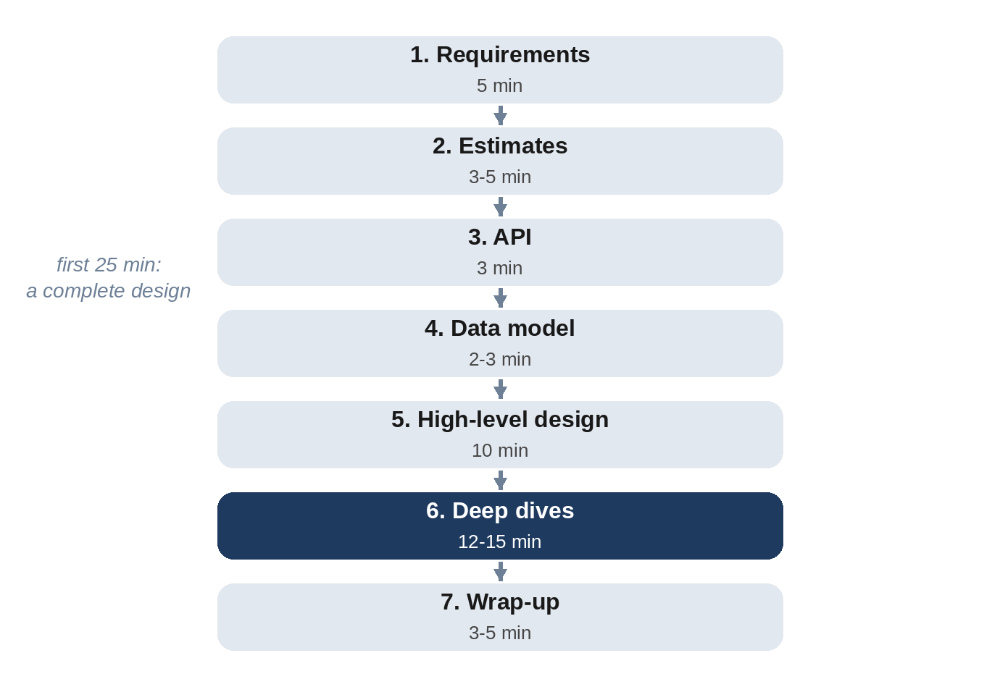

# Chapter 2: A Framework for 45 Minutes

The biggest risk in a system design interview isn't a wrong answer; it's running out of time with half a design. This chapter gives you a seven-step framework with a time budget. It works for any prompt, and every design in Part III follows it, so you'll practice it twenty times before your interview.



| Step | Time | Output on the whiteboard |
| --- | --- | --- |
| 1. Requirements | 5 min | A short list of functional and non-functional requirements, and what's out of scope |
| 2. Estimates | 5 min | Requests per second, storage, bandwidth; read-heavy or write-heavy |
| 3. API | 3 to 5 min | The main endpoints or functions, with parameters |
| 4. Data model | 3 to 5 min | The main entities and how they're stored |
| 5. High-level design | 10 min | Boxes and arrows; one request traced end to end |
| 6. Deep dives | 10 to 15 min | Two or three hard parts, with options and a choice |
| 7. Wrap-up | 3 to 5 min | Bottlenecks, failure modes, what you'd do next |

The times are a guide, not a rule. If the interviewer wants to skip the API and go straight to scaling, follow them. But keep an eye on the clock: when 25 minutes have passed, you should have a complete high-level design on the board.

## Step 1: Requirements

Prompts are deliberately vague. "Design Instagram" could mean photo upload, feeds, stories, direct messages, search, ads and more; nobody can design all of that in 45 minutes. Your first job is to agree on a scope.

**Functional requirements** are what the system does. Aim for three to five, phrased as user actions: "users post a photo with a caption", "users see a feed of posts from accounts they follow", "users like a post." Then say explicitly what you'll leave out: "I'll skip stories, messaging and ads unless you'd like me to include them."

**Non-functional requirements** are the qualities the system must have. The useful ones to ask about:

- **Scale:** how many users, how many daily active users, how much data?
- **Latency:** what must feel instant (loading a feed), and what can be slower (uploading a video)?
- **Availability versus consistency:** is it worse to show slightly stale data or to show an error? A like count can be stale; a bank balance can't.
- **Durability:** can we ever lose data? Usually no for user content; often yes for caches and analytics samples.
- **Geography:** one region or global?

> **Tip:** If the interviewer says "you decide", make a reasonable assumption out loud and write it down: "I'll assume 100 million daily active users and a global audience." A clear assumption is better than a question left hanging.

## Step 2: Estimates

Turn the requirements into numbers: requests per second for reads and writes, storage per year, bandwidth. Chapter 3 shows how to do this quickly and how far to round. The point isn't precision; it's to discover the shape of the problem:

- Is it **read-heavy** (a link shortener, a news site) or **write-heavy** (metrics ingestion, chat)?
- Does the data fit on **one machine**, or must it be **partitioned**?
- Is the bottleneck **requests**, **storage**, or **bandwidth**?

Then use the answers. "We need about 4,000 reads per second and 40 writes per second, so caching will matter much more than write throughput" is a sentence that earns credit. Numbers that are computed and then ignored earn none.

## Step 3: API

Define the main operations precisely enough that someone could implement a client. For a web service, that's usually a few HTTP endpoints:

```
POST /v1/photos            body: image, caption    returns: photo_id
GET  /v1/feed?cursor=...   returns: posts, next_cursor
POST /v1/photos/{id}/likes returns: 204
```

Think about the details that matter at scale: pagination with cursors rather than page numbers (Chapter 4 shows why), idempotency keys for operations that must not happen twice, and which calls must be fast.

## Step 4: Data Model

List the main entities, their key fields, and how they'll be looked up. The access patterns decide the storage:

- **Users, posts, follows** with lookups by ID and by user: tables keyed by ID, with an index on user.
- **A huge volume of small writes read by key** (messages, metrics): a key-value or wide-column store partitioned by key.
- **Large binary objects** (photos, videos): object storage, with only the metadata in a database.

Say which store you'd use and why. Chapter 7 covers the choices.

## Step 5: High-Level Design

Draw the main components and the arrows between them: clients, load balancers, services, databases, caches, queues, object storage. Keep it simple: five to ten boxes. Then **trace one request** through the diagram, for example a feed load from the user's phone to the response, and one write, such as posting a photo. Tracing exposes missing pieces and shows the interviewer you understand how the parts connect.

> **Common Mistake:** Drawing a "microservices" diagram with fifteen services before anything works. Start with the minimum that satisfies the requirements; split services only when you can say why.

## Step 6: Deep Dives

Now spend the most time on the two or three hardest parts of this particular system. For a news feed, that's how posts reach followers' feeds; for a chat app, it's message delivery and ordering; for a payment system, it's never charging twice. Often the interviewer chooses; if not, propose: "The interesting parts are feed generation and the hot-key problem for celebrity accounts. Shall I start with feed generation?"

For each deep dive, follow a mini-pattern:

1. State the problem precisely, with numbers.
2. Give two or three options.
3. Compare them on the requirements that matter here.
4. Choose one, and say what you'd monitor to know if the choice stops working.

This is where the building blocks of Part II earn their keep.

## Step 7: Wrap-Up

In the last few minutes, step back:

- **Bottlenecks:** what breaks first at ten times the traffic?
- **Failure modes:** what happens if the cache, a database replica, a whole region goes down?
- **Operations:** what would you monitor and alert on?
- **Extensions:** what would you build next, given more time?

A short, honest wrap-up ("the weakest part of this design is the single database for writes; with more time I'd partition it by user ID") leaves a strong final impression.

## Handling Curveballs

Interviewers deliberately change the problem: "Now 10 times the traffic." "Now it must work across continents." "What if this service is down?" These are not attacks; they test whether your design and your reasoning adapt. Go back to the numbers, find which component is now under pressure, and adjust it, rather than redrawing everything.

If you don't know something, say so and reason from first principles: "I haven't used that database, but if it's a log-structured store, writes should be cheap and reads may need several lookups, so..." Interviewers value honest reasoning far more than a confidently wrong fact.

## Key Takeaways

- Follow seven steps: requirements, estimates, API, data model, high-level design, deep dives, wrap-up.
- Agree on scope early and write down your assumptions.
- Use estimates to choose the design, not as a ritual.
- Have a complete high-level design on the board by about 25 minutes.
- Spend the remaining time going deep on the hardest parts, comparing options each time.
