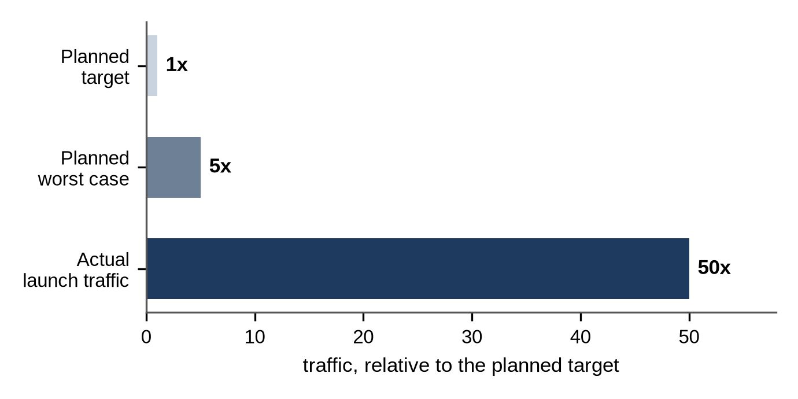

# Chapter 3: Back-of-the-Envelope Estimation

Estimation sounds intimidating, but in a design interview it takes three to five minutes and uses only multiplication and division. The goal is not an exact answer; it's the right **order of magnitude**: is this 10 requests per second or 10,000? Gigabytes or petabytes? Those differences decide the architecture.

## Numbers to Remember

You need very few facts:

| Quantity | Value | Shortcut |
| --- | --- | --- |
| Seconds in a day | 86,400 | about 100,000 |
| 1 million per day | about 12 per second | divide by 100,000 |
| 1 billion per day | about 12,000 per second | |
| 1 KB, 1 MB, 1 GB, 1 TB, 1 PB | 10³, 10⁶, 10⁹, 10¹², 10¹⁵ bytes | each step is ×1,000 |
| Peak traffic | 2 to 10 times the average | state your assumption |

This book uses **decimal units** throughout: 1 KB is 1,000 bytes, 1 GB is 10⁹ bytes, and network speeds are in bits per second (Mbps, Gbps). Binary units (1 KiB = 1,024 bytes, 1 GiB = 2³⁰ bytes) are up to 10% larger at the terabyte scale, which never changes a design decision in an estimate.

And a sense of how big things are:

| Item | Typical size |
| --- | --- |
| A short text field (a name, a URL) | tens to a few hundred bytes |
| A database row with a few fields | a few hundred bytes to 1 KB |
| A compressed photo | 100 KB to a few MB |
| A minute of HD video | tens of MB |

Appendix A lists more, including latency figures such as the time for a memory read, a network round trip and a disk seek.

## The Helper Functions

This book computes every estimate with a handful of tiny functions, so the numbers are consistent and you can rerun them with your own assumptions:

```python
@include code/common/estimates.py::per_second,peak,storage,bandwidth,servers,in_flight
```

Two of them deserve a word:

- `servers` divides the load by what one machine can handle, but plans for each machine to run at only 70% of its capacity. That headroom absorbs bursts and lets you lose a machine without overloading the rest.
- `in_flight` is **Little's law**: the average number of requests in a system equals the arrival rate times the average time each spends there. With 1,000 requests per second and 200 ms per request, about 200 requests are in progress at any moment. That tells you how many connections, threads or worker processes you need.

The tests check them against simple cases. For example, `daily_to_qps` wraps `per_second` and rounds to one decimal place:

```python
@include code/ch03/e01_estimates.py::daily_to_qps
```

```
@include code/ch03/e01_estimates.examples.txt
```

## A Worked Estimate

Suppose a photo-sharing app has 10 million uploads a day, each about 2 MB, with 100 views per upload. Photos are kept for 5 years with 3 copies. Each web server handles about 1,000 requests per second, and requests take about 200 ms.

```python
@include code/ch03/e01_estimates.py::demo
```

```
@include code/ch03/e01_estimates.demo.txt
```

Read the results like an interviewer would:

- **Uploads are modest** (about 116 per second); **views are 100 times more frequent.** This is a read-heavy system, so caching and a content delivery network (CDN) will matter most.
- **View bandwidth is enormous**, about 23 GB per second. No single data center link serves that comfortably; a CDN is not optional.
- **Storage reaches about 110 PB** over five years with three copies. That rules out a database for the images themselves: they belong in object storage, with only metadata in a database. It also suggests cheaper storage tiers or erasure coding instead of three full copies for old photos (Chapter 26).
- **Fifty web servers** for the peak, and about 7,000 requests in flight at any moment.

Each line points to a design decision. That's what makes an estimate worth its few minutes.

**Note:** These are first-order estimates, not capacity plans. The server count assumes that every request costs about the same and that a server really handles 1,000 of them per second. Real capacity depends on the request mix, payload sizes, cache hit rates and the slowest downstream dependency, and production systems also keep headroom to lose a machine or a whole zone. In an interview, state the assumption ("assuming about 1,000 simple requests per second per server") and move on; in production, measure it with a load test.

**Real-World Story:** When Pokémon GO launched in July 2016, its teams planned for a target level of traffic, with a worst-case estimate of five times that target. According to Google Cloud, which hosted the game, actual traffic reached 50 times the target: ten times the worst case. Estimates are educated guesses. Good designs leave room for being wrong, with autoscaling, load shedding and the option to launch one region at a time, as the game did.



## Rounding Like an Engineer

Round aggressively and say so:

- 86,400 seconds becomes 100,000 when you're in a hurry; 10 million a day is "about 100 per second".
- Multiply mantissas and add exponents: 2 × 10⁶ bytes × 10⁷ photos = 2 × 10¹³ bytes = 20 TB per day.
- Keep one or two significant figures. "About 20 TB a day" is better than "19.3 TB".

> **Common Mistake:** Mixing bits and bytes. Network speeds are usually quoted in bits per second (Mbps, Gbps); storage in bytes. Divide bits by 8 to get bytes: a 1 Gbps link moves about 125 MB per second.

## What to Estimate, and When to Stop

Estimate what can change the design:

1. **Read and write rates**, average and peak.
2. **Storage** over the data's lifetime, including replication.
3. **Bandwidth** for large objects.
4. **Memory** for anything you plan to cache: will the hot set fit in RAM on one machine, or must the cache be distributed?
5. **Machines** or **connections**, when relevant (chat servers holding millions of open connections, for example).

Stop as soon as the numbers have told you what you need. Five lines on the whiteboard are usually enough.

> **Interviewer's View:** Saying "this fits in memory on one machine, so a distributed cache would be overkill" is as valuable as discovering that you need petabytes. Estimates that make the design *simpler* show good judgment.

## Key Takeaways

- Estimates exist to choose the architecture: read-heavy or write-heavy, one machine or many, where the bottleneck is.
- Remember a handful of numbers: 86,400 seconds a day, 1 million a day is about 12 per second, and the powers of 1,000.
- Little's law turns rates and latencies into concurrency: requests in progress = rate × time.
- Round aggressively, keep one or two significant figures, and state your assumptions.
