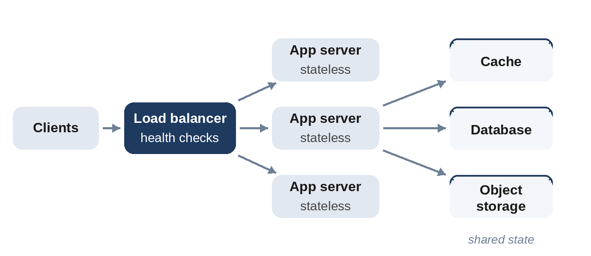

# Part II: Building Blocks

# Chapter 5: Scaling Out: Load Balancers and Stateless Services

The first scaling decision in almost every design is how to serve more requests than one machine can handle. You can buy a bigger machine (**vertical scaling**) or add more machines (**horizontal scaling**). Vertical scaling is simple and surprisingly powerful, a single modern server has dozens of cores and hundreds of gigabytes of memory, but it has a ceiling, and that one machine is a single point of failure. Horizontal scaling has no practical ceiling, but it needs two things: a way to spread requests across machines, and services that don't care which machine handles a request.

## Stateless Services

A service is **stateless** when any instance can handle any request because it keeps nothing important in its own memory between requests. Session data, uploads in progress and user preferences live in shared stores: a database, a cache, object storage. Stateless services are easy to scale (add instances), easy to deploy (replace instances one by one), and easy to recover (a crashed instance loses nothing).

Some components are inherently **stateful**: databases, caches, and servers holding long-lived connections such as WebSockets. A good design keeps state in as few, well-understood places as possible, and makes everything else stateless.

## Load Balancers

A load balancer receives client requests and forwards each to one of several backend instances. It also performs **health checks**, regularly probing each backend and removing unhealthy ones from rotation, which is what turns "we have several servers" into "we survive losing one".

Load balancers work at two levels:

- **Layer 4 (transport):** forwards TCP or UDP connections based on addresses and ports, without looking inside. Very fast, and protocol-agnostic.
- **Layer 7 (application):** understands HTTP, so it can route by path or header (`/api/*` to one service, `/images/*` to another), terminate TLS, and retry failed requests.

A typical web design has DNS pointing to a few layer-7 load balancers (themselves redundant), which spread traffic across stateless application servers.



## Choosing a Balancing Strategy

How the balancer picks a backend matters more than it seems, because requests are not all equal: most are quick, a few are slow. The model below sends the same stream of requests, most taking 1 to 4 time units and one in five taking 120, to ten servers with four strategies, and records the most requests any one server held at once:

```python
@include code/ch05/b01_balancing.py::simulate
```

```
@include code/ch05/b01_balancing.demo.txt
```

- **Random** is the worst: by chance, some servers collect several slow requests.
- **Round robin** spreads requests evenly by count, but not by work: a server can still receive a quick request right behind three slow ones.
- **Least connections** sends each request to the server with the fewest active requests. It's the best here, but the balancer must know every server's load, which is easy for one balancer and harder for many balancers sharing the work.
- **Power of two choices** picks two servers at random and sends the request to the less busy one. With almost no coordination, it gets most of the benefit of least connections. It's a surprisingly powerful idea, and the default in several modern load balancers and service meshes.

> **Interviewer's View:** You rarely need to choose a balancing algorithm in an interview. But if asked, "least connections, or power of two choices when there are many balancers", together with the reason, uneven request costs, shows real understanding.

## Sticky Sessions and Why to Avoid Them

**Sticky sessions** send all requests from one user to the same backend, usually because that server keeps session data in memory. They make scaling and failover harder: if that server dies, the user's session is lost, and load can't be rebalanced freely. Prefer storing sessions in a shared cache or in signed tokens held by the client, and keep servers stateless. The exception is long-lived connections, such as WebSockets, where a client naturally stays on one server for the life of the connection.

## Autoscaling and Capacity

Stateless services can grow and shrink automatically, typically by watching CPU use or request rate. Two cautions:

- **Scaling takes time.** New instances need minutes to start and warm up, so autoscaling smooths daily patterns but doesn't absorb a sudden spike. Keep headroom (the 70% rule from Chapter 3) and use queues to absorb bursts.
- **The bottleneck moves.** Doubling application servers doubles the load on the database behind them. Always ask what each layer can handle.

**Real-World Story:** January 4, 2021, was the first working day of the year for much of the world. As people came back to Slack after the holidays, traffic rose sharply, and AWS network gateways that carried Slack's traffic, which normally scale automatically, became overloaded and dropped packets. Errors spread, and Slack's own efforts to add servers ran into limits it had never hit before. Slack's published postmortem is a good reminder that autoscaling has limits and delays: for predictable surges, such as Monday mornings, the end of a holiday or a big launch, scale up ahead of time.

## Key Takeaways

- Scale horizontally with stateless services; keep state in a few shared stores.
- Load balancers spread requests and remove unhealthy backends using health checks.
- Request costs vary, so balancing by load (least connections, or the power of two choices) beats round robin.
- Avoid sticky sessions except for long-lived connections.
- When you add capacity to one layer, check the next one down.
