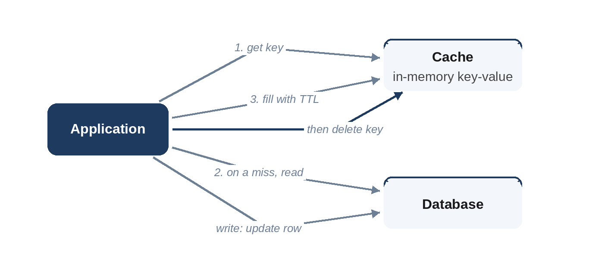

# Chapter 6: Caching

A cache keeps a copy of data somewhere faster or closer than its source: in memory instead of on disk, in the same data center instead of across the world, in the application instead of behind a network call. Caching is the single most effective tool for read-heavy systems, and also a reliable source of bugs, because every cache creates a second copy of the truth that can fall out of date.

## Where Caches Live

- **Client:** the browser or app keeps responses, controlled by HTTP cache headers.
- **CDN:** edge servers cache static content close to users (Chapter 4).
- **Application memory:** each server keeps a small local cache. Very fast, but every server has its own copy, so invalidation is harder.
- **Distributed cache:** a shared in-memory store such as Redis or Memcached, used by all application servers.
- **Database:** databases cache pages and query results internally.

## Reading and Writing Through a Cache

| Pattern | How it works | Good for | Watch out for |
| --- | --- | --- | --- |
| **Cache-aside** (lazy loading) | App reads the cache; on a miss, reads the database and fills the cache | Most read-heavy systems | Stale data until expiry or invalidation; first reads are slow |
| **Read-through** | The cache itself loads from the database on a miss | Simplifying application code | Needs a cache that knows the database |
| **Write-through** | Writes go to the cache and the database together | Data that's read right after being written | Every write pays both costs |
| **Write-behind** (write-back) | Writes go to the cache; the database is updated later | Absorbing write bursts | Data loss if the cache fails before flushing |

Cache-aside is the default answer in interviews. On a write, update the database and then **delete** the cache entry rather than updating it; the next read reloads a fresh value, which avoids races where two writers update the cache in the wrong order.



## Eviction and Expiry

A cache is smaller than the data it caches, so it must decide what to keep. **Least recently used (LRU)** eviction drops the entry unused for the longest time. A **time to live (TTL)** makes entries expire after a fixed time, which bounds how stale they can get. Real caches combine both:

```python
@include code/ch06/b01_lru_ttl.py::TTLCache
```

The test replays random sequences of reads, writes and clock ticks against a deliberately simple version that searches a list, and checks that both give the same answers. A short session shows both rules at work: `b` is evicted to make room for `c`, and `a` expires after 10 seconds:

```
@include code/ch06/b01_lru_ttl.examples.txt
```

## How Big Should a Cache Be?

Access patterns on real systems are usually skewed: a few items are very popular and most are rarely requested. The model below draws requests from 100,000 keys with a Zipf-like distribution, where key *k* is requested with weight 1/*k*, and measures the LRU hit rate for different cache sizes:

```python
@include code/ch06/b02_hit_rate.py::hit_rate
```

```
@include code/ch06/b02_hit_rate.demo.txt
```

A cache holding just 1% of the keys serves about half of all requests, and 10% serves nearly three quarters. That's why caches pay off so well, and why it's worth estimating the size of the "hot set" rather than trying to cache everything.

## The Hard Parts

- **Invalidation.** When the source changes, every cached copy must be removed or allowed to expire. A short TTL is the simplest safety net, even when you also invalidate explicitly.
- **Thundering herd (cache stampede).** When a popular entry expires, thousands of requests miss at once and all hit the database. Fixes: let one request rebuild the entry while others wait or get the stale value ("request coalescing"); add random jitter to TTLs so entries don't expire together; refresh hot entries before they expire.
- **Hot keys.** One extremely popular key (a celebrity's profile) can overload the single cache server that holds it. Replicate hot keys across several servers, or add a small local cache in front of the distributed one.
- **Cold start.** An empty cache after a restart sends all traffic to the database. Warm caches gradually, or restart them one at a time.

> **Interviewer's View:** Saying "cache-aside with a TTL, delete on write, and request coalescing for hot entries" covers what most interviewers want to hear about caching. Then quantify: what's the hit rate, and how much load does it take off the database?

## Key Takeaways

- Cache-aside is the default: read the cache, fall back to the database, delete the entry on writes.
- Combine LRU eviction with a TTL to bound both memory and staleness.
- Skewed access means a small cache gives a large hit rate; estimate the hot set.
- Plan for stampedes, hot keys and cold starts.
