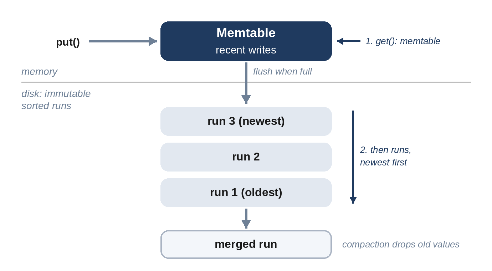

# Chapter 7: Databases and Storage Engines

"Which database would you use?" is one of the most common questions in a design interview, and "it depends" is only a good answer if you say what it depends on. This chapter compares the main families of databases, explains the two storage engines underneath most of them, and gives a short checklist for choosing.

## Relational Databases

Relational databases such as PostgreSQL and MySQL store data in tables with a fixed schema, support joins between tables, and provide **transactions**: a group of changes either all happen or none do, and concurrent transactions don't see each other's half-finished work. That's summarized by the acronym **ACID**: atomicity, consistency, isolation and durability.

They are the right default when data is structured, relationships matter (users, orders, products), and correctness matters more than extreme write throughput. A single well-tuned relational database handles a great deal; read replicas (Chapter 8) scale reads further. Their limit is scaling *writes* beyond one machine, which requires partitioning (Chapter 9), and with it the loss of easy joins and transactions across partitions.

## NoSQL Families

"NoSQL" covers several quite different designs:

| Family | Data model | Strengths | Examples of use |
| --- | --- | --- | --- |
| **Key-value** | A value looked up by a key | Very fast, simple, scales out easily | Sessions, caches, user settings |
| **Document** | JSON-like documents, queried by fields | Flexible schema, natural for nested data | Product catalogs, user profiles |
| **Wide-column** | Rows with many columns, partitioned by key, sorted within a partition | Huge write volumes, time-ordered data | Messages, metrics, activity logs |
| **Graph** | Nodes and edges | Queries that follow relationships many hops deep | Social graphs, fraud detection |
| **Time-series** | Timestamped measurements | Compression, downsampling, time-range queries | Metrics and monitoring (Chapter 31) |
| **Search** | Inverted index over text | Full-text search, relevance ranking | Product search, logs |

Many large systems use several: a relational database for accounts and payments, a wide-column store for messages, a search index for queries, object storage for files. This is sometimes called **polyglot persistence**. In an interview, choose each store for a specific access pattern and say why.

## Indexes

An index is an extra data structure that lets the database find rows without scanning the whole table, at the cost of extra storage and slower writes, since every write must update every index. Index the columns you filter and sort by in hot queries, and no more. A **composite index** on (user_id, created_at) serves "this user's posts, newest first" with one lookup.

## Two Storage Engines

Underneath, most databases use one of two families of storage engine.

**B-trees** (Bayer and McCreight, 1972) keep data in fixed-size pages organized as a balanced tree, and update pages in place. Reads are predictable, a few page reads per lookup, which is why B-trees power most relational databases.

**Log-structured merge trees** (LSM-trees, described by O'Neil and colleagues in 1996) never update in place. Writes go to an in-memory table; when it fills up, it's written to disk as an immutable, sorted file. Reads check memory first, then the files from newest to oldest. Background **compaction** merges files and discards overwritten values. Sequential writes make LSM-trees excellent for write-heavy workloads; the cost is that a read may check several files, which is mitigated with Bloom filters (Chapter 13). Wide-column stores such as Cassandra and many key-value stores use LSM-trees.

The model below captures the essential mechanism in a few lines:

```python
@include code/ch07/b01_lsm.py::LSMStore
```

A **tombstone** marks a deleted key, because an older file may still contain a value for it; compaction finally removes both. The tests compare the store with a plain dictionary over thousands of random sequences of writes, deletes, reads and compactions:

```
@include code/ch07/b01_lsm.examples.txt
```



| | B-tree | LSM-tree |
| --- | --- | --- |
| Writes | In place; random I/O | Appends; sequential I/O; very fast |
| Reads | Predictable, a few page reads | May check several files; Bloom filters help |
| Space | Some fragmentation | Old versions until compaction |
| Typical use | Relational databases, read-heavy data | Write-heavy data: logs, messages, metrics |

## Object Storage

Large binary objects (photos, videos, backups, files) go in **object storage**: a flat namespace of keys mapping to immutable blobs, built for durability and cheap capacity rather than low latency. Store the object there and its metadata (owner, size, location key) in a database. Serve popular objects through a CDN.

## Choosing a Database: a Checklist

1. **What are the access patterns?** Lookups by key, range scans, joins, full-text search, graph traversals?
2. **What's the read/write ratio and volume?** From your estimates.
3. **Do you need transactions across records?** Money and inventory usually do.
4. **How much data, and how fast does it grow?** Does it fit on one machine for the next few years?
5. **What consistency do readers need?** Chapter 8.

> **Common Mistake:** Choosing a NoSQL database "because it scales" when the data fits comfortably on one relational server. Name the access pattern that the chosen store serves better, or choose the simpler option.

## Key Takeaways

- Relational databases are the default for structured data that needs transactions; their limit is write scaling.
- NoSQL families serve specific access patterns; choose by pattern, not by fashion.
- B-trees update in place and read predictably; LSM-trees append and excel at writes.
- Put large objects in object storage and their metadata in a database.
