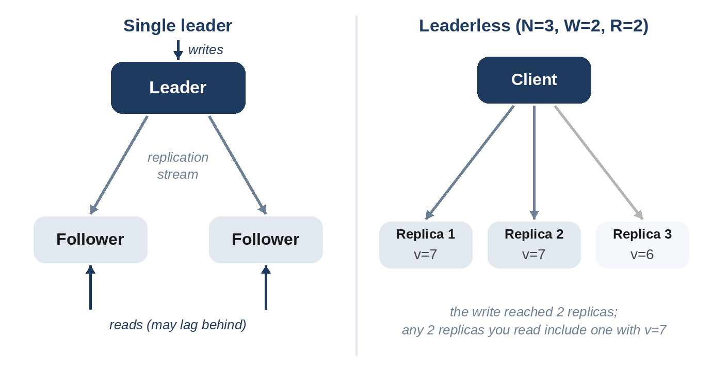

# Chapter 8: Replication and Consistency

Replication means keeping copies of the same data on several machines. It serves three goals: **availability** (if one copy is lost, others remain), **read scaling** (spread reads across copies), and **latency** (keep a copy near users in each region). Its cost is that copies can disagree, at least for a while, and every design must decide how much disagreement its users can tolerate.

## Three Ways to Replicate

**Single leader.** One replica, the leader, accepts writes and streams them to followers, which serve reads. Simple, and the most common setup for relational databases. The leader is a bottleneck for writes and a single point of failure until a follower is promoted (failover).

**Multi-leader.** Several replicas accept writes, usually one per region, and exchange changes. Writes are fast everywhere, but two leaders can change the same record at the same time, so conflicts must be resolved: last write wins, a merge function, or keeping both versions for the application to reconcile.

**Leaderless.** Any replica accepts writes; clients write to and read from several replicas at once, using **quorums** to make sure reads see recent writes. This is the approach described in Amazon's Dynamo paper (DeCandia and colleagues, 2007) and used by stores such as Cassandra.



## Synchronous or Asynchronous?

A leader can wait for followers to confirm a write before acknowledging it (**synchronous**), or acknowledge immediately and replicate in the background (**asynchronous**). Synchronous replication means no acknowledged write is lost when the leader dies, but every write waits for the slowest follower. Asynchronous replication is fast but can lose recent writes on failover, and followers lag behind the leader, so a user may not see their own update if their next read goes to a follower. A common compromise is one synchronous follower and the rest asynchronous.

## Quorums

With **N** replicas, a write succeeds once **W** of them acknowledge it, and a read asks **R** replicas and takes the newest value it gets. If **R + W > N**, every set of R replicas overlaps every set of W replicas in at least one machine, so every read reaches at least one replica with the latest acknowledged write.

The model below writes a new version to W random replicas, then reads R random replicas, many thousands of times:

```python
@include code/ch08/b01_quorum.py::stale_reads
```

```
@include code/ch08/b01_quorum.demo.txt
```

With N = 3, W = 2 and R = 2, reads are never stale; with W = 1 and R = 1, two thirds are. The test checks the rule for every combination of N, W and R up to 5: zero stale reads whenever R + W > N, and some stale reads otherwise.

Choosing the numbers is a trade-off:

- **W = N, R = 1:** fast reads, but a write fails if any replica is down.
- **W = 1, R = N:** fast writes, slow reads.
- **W = R = majority** (2 of 3, 3 of 5): balanced, and tolerates a minority of failures for both reads and writes. The usual choice.

> **Warning:** R + W > N is necessary but not sufficient for strong consistency in real systems. Concurrent writes, clock-based conflict resolution and replicas that are replaced can still produce surprises. For "exactly one winner" decisions, such as leader election or locks, use a consensus protocol.

## Consistency Models

From strongest to weakest, the guarantees you'll be asked about:

- **Linearizable (strong):** the system behaves as if there were a single copy; once a write is acknowledged, every later read sees it. Needed for locks, unique usernames, account balances.
- **Read-your-writes:** a user always sees their own updates, though others may see them later. Implemented by routing a user's reads to the leader for a short time after they write, or by tracking the version they last wrote.
- **Monotonic reads:** a user never sees data go backwards in time, for example by always reading from the same replica.
- **Eventual:** if writes stop, all replicas eventually agree. Fine for likes, view counts and recommendations.

Choose per feature, not per system. A social app can show eventually consistent like counts while requiring strong consistency for changing a password.

## CAP and PACELC

The **CAP theorem** (conjectured by Eric Brewer in 2000, proven by Gilbert and Lynch in 2002) says that when a **network partition** splits a distributed system, it must choose between **consistency** (refuse requests that might return stale data) and **availability** (answer anyway, possibly with stale data). Since partitions do happen, the practical question is what each part of your system should do during one.

**PACELC** (Daniel Abadi, 2012) adds the more common case: *else*, when there's no partition, there's still a trade-off between **latency** and **consistency**, because waiting for replicas to agree takes time. It's a more useful lens for everyday design decisions.

**Real-World Story:** In October 2018, a 43-second network interruption led GitHub's automated failover to promote databases in another region while the original side had just accepted writes. The two sides diverged, and GitHub spent about a day restoring a consistent state without losing data. Chapter 37 tells the story; it's CAP in real life.

## Consensus, Briefly

When replicas must agree on one value despite failures, such as which node is the leader, or whether a lock is held, systems use a **consensus** protocol: Paxos (Lamport, published 1998) or Raft (Ongaro and Ousterhout, 2014). They work as long as a majority of nodes can communicate, which is why clusters have an odd number of members, 3 or 5. In interviews, you rarely need the details; you need to know when to use a consensus-backed service (such as etcd or ZooKeeper) instead of inventing your own coordination.

## Key Takeaways

- Replication buys availability, read scaling and locality, at the cost of possible disagreement between copies.
- Single-leader is simplest; multi-leader and leaderless trade simplicity for write availability.
- Quorums guarantee overlap when R + W > N; majorities for both are the usual choice.
- Pick consistency per feature: strong for money and identity, eventual for counts and feeds.
- Use an existing consensus service for coordination rather than building one.
