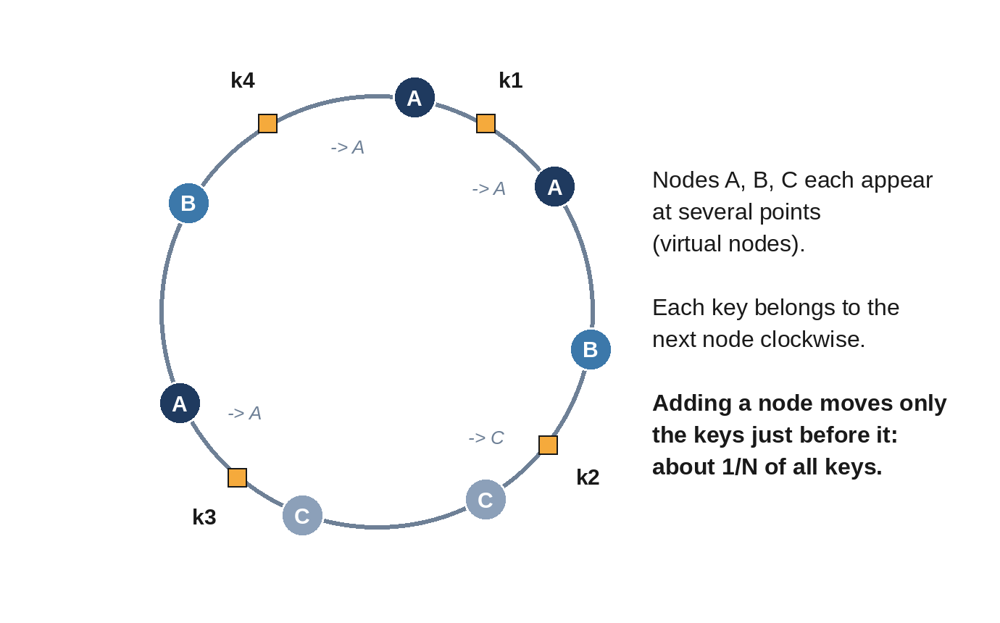

# Chapter 9: Partitioning and Consistent Hashing

Replication copies all the data to several machines; **partitioning** (also called **sharding**) splits the data so that each machine holds only part of it. Partitioning is how a system stores more data, or handles more writes, than one machine can. Most large designs use both: data is split into partitions, and each partition is replicated.

## Choosing a Partition Key

The **partition key** decides which partition a record lives on. A good key:

- **Spreads load evenly**, so no partition is much busier than the others.
- **Keeps related data together**, so common queries touch one partition. All of a user's messages on one partition makes "load this user's inbox" a single lookup.

Two ways to map keys to partitions:

- **Range partitioning:** each partition holds a contiguous range of keys (A to F, G to M, ...). Range scans are efficient, but sequential keys such as timestamps all land on the newest partition, creating a hot spot.
- **Hash partitioning:** hash the key and use the hash to choose a partition. Load spreads evenly, but range scans across keys must ask every partition.

## The Problem With Hash Mod N

The obvious hash scheme is `partition = hash(key) % N` for N servers. It works perfectly until N changes. Add one server and almost every key maps to a different partition, so nearly all data must move at once.

**Consistent hashing** (Karger and colleagues, 1997) fixes this. Servers and keys are hashed onto the same circle of values. Each key belongs to the first server found clockwise from its position. When a server joins, it takes over only the keys between itself and its predecessor; when a server leaves, only its keys move, to its successor.



With one point per server, the arcs between servers vary a lot in size, so load is uneven. The fix is **virtual nodes**: each server appears at many points on the ring, so its total share averages out. Here is a complete implementation:

```python
@include code/ch09/b01_hash_ring.py::h,HashRing
```

The model places 20,000 keys on 10 servers, then adds an 11th:

```
@include code/ch09/b01_hash_ring.demo.txt
```

Consistent hashing moves 9% of keys, close to the ideal 1/11; hash mod N moves 91%. With one virtual node per server, the busiest server holds over three times its fair share; with 100, about 16% more than its share. The test also checks the key property directly: when a server is added, every key either stays where it was or moves to the new server, and removing the server returns every key to its old place.

> **Interviewer's View:** "Consistent hashing with virtual nodes, so adding a node moves about 1/N of the keys" is the expected answer whenever a design must add or remove storage or cache servers. Being able to explain *why* virtual nodes help is what distinguishes a strong answer.

## Hot Partitions

Even a perfect hash can't spread load that is concentrated on one key: a celebrity's account, a viral post, a flash sale on one product. Options:

- **Split the hot key:** append a suffix (`post:123#0` to `post:123#9`) to spread writes across partitions, and combine the parts on read.
- **Cache aggressively** in front of the hot partition.
- **Treat big accounts differently**, as the news feed design does for celebrities (Chapter 22).

## Rebalancing and Routing

When partitions move, clients must find them. Three approaches: clients ask any node, which forwards the request; a routing tier knows the partition map; or clients cache the map themselves. The partition map itself is usually kept in a consensus-backed configuration service so all components agree on it.

Moving a partition means copying its data while it keeps serving traffic, then switching ownership. Do it gradually and throttle it, so rebalancing doesn't overload the cluster it's meant to help.

## Queries Across Partitions

Partitioning makes some operations expensive:

- **Secondary indexes:** "find posts by hashtag" when posts are partitioned by user. Either every partition keeps a local index and queries ask all of them (scatter-gather), or a global index is partitioned by the indexed value and updated asynchronously.
- **Joins and transactions across partitions** require coordination, which is slow. Choose partition keys so the most common operations stay within one partition.

## Key Takeaways

- Partition to handle more data or writes than one machine can; replicate each partition for availability.
- Choose a partition key that spreads load and keeps related data together.
- Hash mod N moves almost all data when N changes; consistent hashing moves about 1/N.
- Virtual nodes even out the load on a hashing ring.
- Plan for hot keys and for the cost of cross-partition queries.
