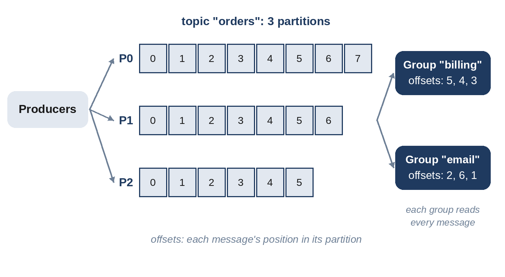

# Chapter 10: Queues, Logs and Delivery Guarantees

Synchronous calls tie services together: if the email service is slow, the sign-up request that waits for it is slow too, and if it's down, sign-up fails. Putting a **message queue** between them breaks that tie. The sign-up service records "send a welcome email" and responds immediately; the email service works through messages at its own pace. Queues absorb bursts, isolate failures and let each side scale independently, and they appear in almost every design in Part III.

## Queues and Logs

There are two main families:

- **Message queues** (such as RabbitMQ or Amazon SQS) deliver each message to one consumer and delete it once it's acknowledged. They are ideal for distributing tasks among workers.
- **Logs** (such as Kafka, described by Kreps, Narkhede and Rao in 2011) append messages to an ordered, durable log split into **partitions**. Messages aren't deleted when read; each consumer group tracks its own position, its **offset**. Several independent consumers can read the same stream, and a consumer can replay history.

Use a queue for "do this task once"; use a log when several systems need the same stream of events, or when order and replay matter. Chapter 35 designs a distributed log from scratch.



## Delivery Guarantees

Networks and processes fail, so a message system can promise one of three things:

- **At most once:** a message may be lost, but never delivered twice. Acknowledge before processing.
- **At least once:** a message is never lost, but may be delivered more than once. Acknowledge after processing; if the acknowledgement is lost, the message is delivered again. "Never lost" assumes the broker stores messages durably (replicated to disk before it confirms them to the producer), the producer retries until it gets that confirmation, and messages are kept long enough for a slow or failed consumer to come back. Idempotency prevents duplicates; it doesn't prevent loss.
- **Exactly once:** each message affects the system exactly once. Hard in general; in practice it's built from at-least-once delivery plus **idempotent processing**.

The model below sends 1,000 payments of 25 through a queue in which 20% of acknowledgements are lost, so those messages are redelivered:

```python
@include code/ch10/b01_delivery.py::run
```

```
@include code/ch10/b01_delivery.demo.txt
```

Both consumers received 1,273 deliveries. The naive one applied every delivery and overstated the total by more than a quarter; the idempotent one remembered message IDs and applied each payment exactly once. The tests check that the idempotent consumer's total always equals the true total on thousands of random message sequences.

> **Common Mistake:** Designing a consumer that assumes each message arrives once. With at-least-once delivery, the most common choice, every consumer must be idempotent: record processed message IDs, use database upserts keyed by message ID, or make the operation naturally repeatable ("set status to shipped" rather than "add one to the shipped count").

## Ordering

Logs guarantee order **within a partition**, not across partitions. If the events for one order must be processed in sequence, use the order ID as the partition key, so all its events land in the same partition. Global ordering across all events requires a single partition, which limits throughput; it's rarely needed.

## Backpressure and Dead Letters

- **Backpressure:** when consumers fall behind, the queue grows. Monitor **consumer lag** (how far behind the newest message each consumer is) and scale consumers, or slow producers, before the backlog becomes hours long.
- **Poison messages:** a message that always makes the consumer crash will be redelivered forever. After a few failed attempts, move it to a **dead-letter queue** for inspection, so it doesn't block the rest.
- **Retries with backoff:** when a downstream dependency is failing, retrying immediately makes it worse (Chapter 14).

## The Transactional Outbox

A common bug: a service updates its database and then publishes an event, and crashes between the two. The database says the order was placed, but no event was sent. The **outbox pattern** fixes it: write the event into an "outbox" table in the same database transaction as the change, and have a separate process publish rows from the outbox to the queue. The event may be published twice, but never lost, and idempotent consumers handle the duplicates.

## Key Takeaways

- Queues decouple services, absorb bursts and isolate failures.
- Use a task queue for work distribution and a partitioned log for event streams that several consumers read or replay.
- At-least-once delivery plus idempotent consumers is the practical route to exactly-once effects.
- Order is guaranteed only within a partition; partition by the entity whose events must stay in order.
- Monitor consumer lag, use dead-letter queues, and publish events with the outbox pattern.
