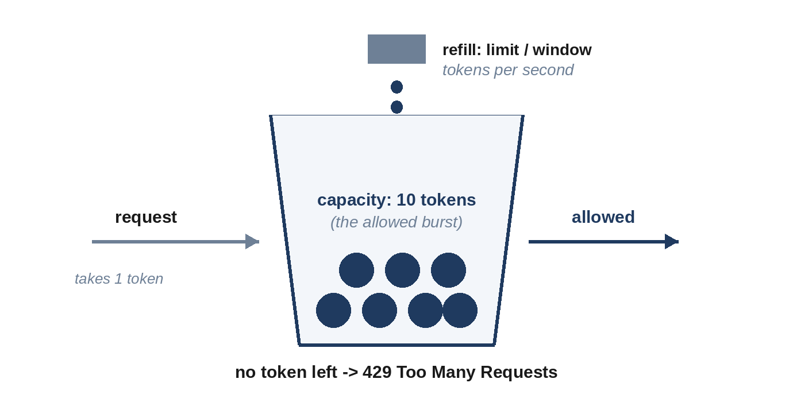

# Chapter 11: Rate Limiting

A rate limiter caps how many requests a client can make in a period: 100 requests per minute per API key, five login attempts per hour per account. It protects services from overload, from abusive or buggy clients, and from runaway costs, and it's a classic interview topic both as a building block and as a complete design (Chapter 17).

## Where to Limit

- **At the edge** (API gateway or load balancer): stops excess traffic before it costs anything. The usual place.
- **In each service:** protects a service from its own callers, including internal ones.
- **On the client:** well-behaved clients slow themselves down when told to, using the `Retry-After` header from a 429 response.

Limits are keyed by something that identifies the caller: API key, user ID, IP address, or a combination. Different endpoints usually have different limits; a search endpoint is more expensive than a profile read.

## Four Algorithms

All four limiters below have the same interface: `allow(t)` returns whether a request at time `t` is allowed, for a limit of `limit` requests per `window` seconds.

**Fixed window** counts requests in each calendar window (each minute, say) and resets the count when a new window starts. It's the simplest and uses one counter, but it has a flaw at window boundaries.

```python
@include code/ch11/b01_limiters.py::FixedWindow
```

**Sliding log** remembers the time of every allowed request in the last window, and allows a new one only if fewer than `limit` remain. It's exact, but memory grows with the limit.

```python
@include code/ch11/b01_limiters.py::SlidingLog
```

**Sliding window counter** approximates the sliding log with two counters: the current window's count, plus the previous window's count weighted by how much of it still overlaps the sliding window. Cheap, and accurate enough for most uses.

**Token bucket** holds up to `limit` tokens and refills continuously at `limit / window` tokens per second; each request takes a token. It allows short bursts up to the bucket size while enforcing the average rate, which is often exactly what an API wants.

```python
@include code/ch11/b01_limiters.py::TokenBucket
```



The sliding log is tested against a brute-force version that recounts recent requests from scratch, on thousands of random request sequences:

```
@include code/ch11/b01_limiters.examples.txt
```

## The Boundary Problem

Now the flaw. With a limit of 10 requests per 60 seconds, a client sends 10 requests at 0:59 and 10 more at 1:00:

```python
@include code/ch11/b01_limiters.py::demo
```

```
@include code/ch11/b01_limiters.demo.txt
```

The fixed window allows all 20 in two seconds, twice the intended rate, because the requests straddle a window boundary. The other three allow 10. In an interview, mentioning this weakness when someone proposes a fixed window is a quick way to show depth.

| Algorithm | Memory per key | Accuracy | Bursts |
| --- | --- | --- | --- |
| Fixed window | 1 counter | Up to 2x at boundaries | Uncontrolled at boundaries |
| Sliding log | One timestamp per request | Exact | None beyond the limit |
| Sliding window counter | 2 counters | Close approximation | Smoothed |
| Token bucket | 2 numbers (tokens, last time) | Exact average rate | Allowed up to bucket size |

> **Tip:** A token bucket is the best default. It's cheap, it allows the short bursts that real clients produce (a page load fires several API calls at once), and it's easy to explain.

## Limiting Across Many Servers

With one gateway, the limiter's state lives in its memory. With twenty gateways, a client's requests are spread across all of them, so the state must be shared, typically in a fast store such as Redis, and updated **atomically**. Chapter 17 shows what goes wrong without atomic updates, and how to keep the extra latency to about a millisecond.

## Responding to Limited Clients

Return HTTP **429 Too Many Requests** with a `Retry-After` header, and ideally headers showing the limit and how much remains, so clients can slow down. Decide whether to **fail open** (allow traffic) or **fail closed** (reject) if the limiter's store is unavailable; for most APIs, failing open briefly is better than an outage caused by the limiter itself.

## Key Takeaways

- Rate limit at the edge, keyed by API key, user or IP, with per-endpoint limits.
- Fixed windows are simple but allow double the rate across a boundary.
- Sliding logs are exact but memory-hungry; sliding counters are cheap approximations.
- Token buckets enforce an average rate while allowing bounded bursts: the usual default.
- Across many servers, keep the state in a shared store and update it atomically.
