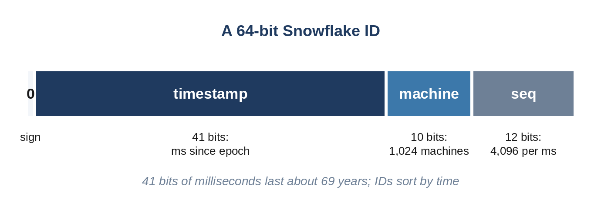

# Chapter 12: Unique IDs and Time

Every record needs an identifier, and in a distributed system generating them is surprisingly subtle. A single database's auto-increment counter becomes a bottleneck and a single point of failure. Random IDs are easy to generate anywhere, but they're long and don't sort by time. And ordering events by time is itself tricky, because the clocks on different machines never agree exactly. This chapter covers the standard solutions.

## Options for Unique IDs

| Approach | Size | Sortable by time | Coordination | Notes |
| --- | --- | --- | --- | --- |
| Database auto-increment | 64 bits | Yes | Every ID | Simple; a bottleneck at scale |
| UUID version 4 (random) | 128 bits | No | None | Collisions are practically impossible; poor index locality |
| UUID version 7 (RFC 9562, 2024) | 128 bits | Yes, by millisecond | None | Starts with a 48-bit Unix timestamp in milliseconds |
| Snowflake-style | 64 bits | Yes, by millisecond | Assign machine IDs once | Compact; depends on reasonable clocks |
| Range allocation | 64 bits | Roughly | One call per block | A central service hands out blocks of IDs (Chapter 19) |

Sortable IDs matter more than they might seem: databases insert them at the end of their indexes instead of at random positions, which keeps writes fast, and "newest first" queries can sort by ID alone.

## Snowflake IDs

The Snowflake format, announced by Twitter in 2010, packs three fields into a 64-bit integer:



- **41 bits of time** in milliseconds since a chosen epoch: enough for about 69 years.
- **10 bits of machine ID**: up to 1,024 generators.
- **12 bits of sequence**: up to 4,096 IDs per millisecond per machine.

Each machine generates IDs alone, with no coordination after its machine ID is assigned:

```python
@include code/ch12/b01_snowflake.py::SnowflakeGenerator
```

Two details matter. When a machine uses all 4,096 sequence numbers in one millisecond, it waits for the next millisecond. And if the clock moves backwards, for example after a time-synchronization correction, it refuses to generate IDs rather than risk duplicates. Decoding shows the fields:

```
@include code/ch12/b01_snowflake.examples.txt
```

The tests generate 15,000 IDs from three machines sharing a jittery clock, and check that all are unique and that each machine's IDs increase. They also confirm the 69-year lifetime of 41 bits of milliseconds and that a backwards clock raises an error.

**Real-World Story:** In December 2014, Psy's "Gangnam Style" video passed 2,147,483,647 views on YouTube, the largest number a signed 32-bit integer can hold. YouTube had seen it coming and had already moved the counter to a 64-bit integer, announcing that the video had been watched so many times they had to upgrade. When you size an ID or a counter, ask what it will need to hold in ten years; 64 bits is the safe default.

## Short IDs With Base 62

When IDs appear in URLs, such as a link shortener's codes (Chapter 16), they are written in **base 62**, using digits and upper- and lower-case letters:

```python
@include code/ch12/b02_base62.py::encode,decode
```

Seven base-62 characters give 62⁷, about 3.5 trillion, distinct codes; the test checks that 62⁷ - 1 is the largest number with seven characters.

## Ordering Events Without Trusting Clocks

Machine clocks drift, and synchronization (NTP) can be off by milliseconds or more, so timestamps from different machines can't reliably order events that happen close together. Two logical clocks solve parts of the problem without relying on physical time.

**Lamport clocks** (Leslie Lamport, 1978) give every event a counter. A process increments its counter for each event; a message carries the sender's counter, and the receiver jumps its counter past it. If event A could have caused event B, A's number is smaller:

```python
@include code/ch12/b03_clocks.py::lamport
```

```
@include code/ch12/b03_clocks.examples.txt
```

**Vector clocks** keep one counter per process, and can tell whether two versions are ordered or truly **concurrent**, which is exactly what a replicated store needs to detect conflicting writes. Two replicas of a shopping cart that accept changes while disconnected produce concurrent versions; merging them and recording a new event produces a version that comes after both:

```python
@include code/ch12/b03_clocks.py::compare,merge
```

```
@include code/ch12/b03_clocks.demo.txt
```

Many systems choose the simpler **last write wins**, keeping the version with the latest timestamp. It silently discards one of two concurrent writes, which is fine for a profile picture and wrong for a shopping cart. Saying which you'd use, and why, is the point.

> **Interviewer's View:** You won't be asked to implement vector clocks. You may be asked "two users edit the same record at the same time on different replicas; what happens?" The strong answer names the options (last write wins, vector clocks with application merge, or avoiding the conflict with a single leader per record) and picks one for the use case.

**Real-World Story:** Clocks really do go backwards. At midnight UTC on January 1, 2017, a leap second was added, and Cloudflare's DNS software, which calculated a duration from the wall clock, got a negative number where it expected zero or more. A small fraction of DNS requests failed until a one-line fix went out. On June 30, 2012, an earlier leap second triggered a Linux kernel bug that drove servers to high CPU use, affecting sites including Reddit and Mozilla and the reservation system that Qantas used for check-in. Measure durations with a monotonic clock, and never assume that timestamps from different machines are ordered.

**Interesting Fact:** Google's Spanner database, described in a 2012 paper, takes the opposite approach: instead of distrusting clocks, it puts GPS receivers and atomic clocks in its data centers, so that its TrueTime API knows the current time within a small, bounded uncertainty, generally under 10 ms. Before a transaction commits, Spanner waits out that uncertainty, which lets it order transactions across the world by timestamp.

## Key Takeaways

- Auto-increment IDs don't scale; random UUIDs don't sort; time-ordered IDs (UUIDv7, Snowflake) do both.
- Snowflake IDs pack time, machine and sequence into 64 bits, and need no coordination per ID.
- Base 62 turns large numbers into short, URL-safe codes.
- Physical clocks can't order close events across machines; Lamport and vector clocks track causality instead.
- Last write wins is simple but loses concurrent updates; choose it deliberately.
