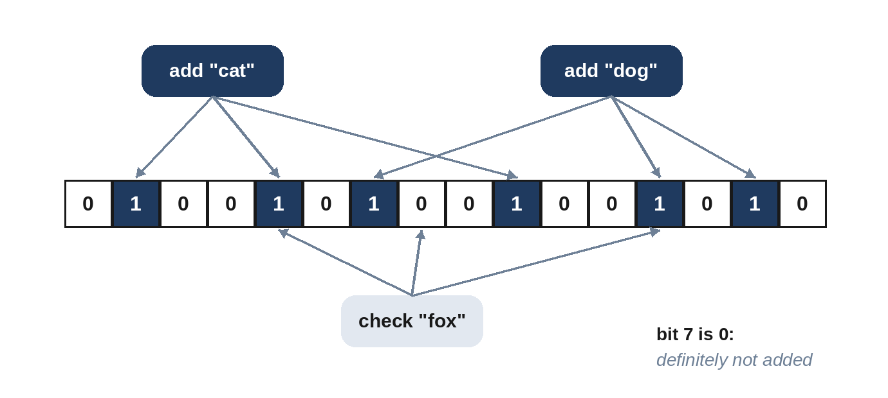

# Chapter 13: Probabilistic Data Structures

Some questions don't need exact answers. "Has this crawler seen this URL before?", "roughly how many times was this search term used today?", "how many distinct users visited?" At large scale, exact answers can need gigabytes of memory, while answers that are almost always right, with a known error, fit in kilobytes. Three structures cover most interview needs.

## Bloom Filters: "Definitely Not" or "Probably Yes"

A **Bloom filter** (Burton Bloom, 1970) tests set membership. It's an array of bits plus k hash functions. Adding an item sets k bits; checking an item looks at the same k bits. If any is 0, the item was **definitely never added**. If all are 1, it was **probably** added, but those bits might have been set by other items: a false positive. There are never false negatives.



```python
@include code/ch13/b01_bloom.py::BloomFilter
```

The size comes from standard formulas: for n items and a target false-positive rate p, use about -n ln p / (ln 2)² bits and (bits / n) ln 2 hash functions. Instead of k independent hash functions, the code derives them from two halves of one SHA-256 hash, a standard trick. For 10,000 items at 1%:

```
@include code/ch13/b01_bloom.demo.txt
```

Less than 12 KB, and the measured false-positive rate matches the target. Storing 10,000 strings exactly would take far more.

Uses: a database checks a Bloom filter before reading a file that probably doesn't contain the key (the LSM-trees of Chapter 7); a crawler skips URLs it has probably seen (Chapter 20); a browser checks URLs against a list of malicious sites before making a slower exact check. Standard Bloom filters can't delete items; variants such as counting Bloom filters can.

## Count-Min Sketch: Approximate Counts

A **Count-Min sketch** (Cormode and Muthukrishnan, 2005) estimates how often each item occurs in a stream, in fixed memory. It's a small table of counters with d rows, each with its own hash function. Adding an item increments one counter in each row; the estimate is the **minimum** of the item's d counters. Collisions only ever add to counters, so the estimate is never too low, and taking the minimum picks the counter least inflated by collisions.

```python
@include code/ch13/b02_count_min.py::CountMin
```

The test streams 50,000 items with a heavy-tailed popularity distribution into a 4 × 500 sketch, and checks that no estimate is below the true count and that at most 5% of estimates exceed it by more than the theoretical bound of about e/w of the stream size. Use it to find **heavy hitters**: trending searches (Chapter 24), the most active API clients, top products.

## HyperLogLog: Counting Distinct Items

How many distinct users visited today? An exact answer needs to remember every user ID. **HyperLogLog** (Flajolet and colleagues, 2007) estimates it with a few kilobytes. The intuition: hash each item; a hash that starts with many zero bits is rare, so the longest run of leading zeros seen hints at how many distinct items there were. HyperLogLog splits items into many registers and averages their evidence to reduce the error.

```python
@include code/ch13/b03_hyperloglog.py::HyperLogLog
```

```
@include code/ch13/b03_hyperloglog.demo.txt
```

With 4,096 registers, about 3 KB, the error stays under 1% from a thousand to a million distinct items. The expected error is about 1.04 / √m for m registers, roughly 1.6% here. Adding duplicates doesn't change the estimate, which the test checks. Registers from different servers can be merged by taking the maximum of each, so each server counts its own traffic and the results combine exactly.

| Structure | Answers | Error | Memory |
| --- | --- | --- | --- |
| Bloom filter | "Is x in the set?" | False positives only | About 10 bits per item for 1% |
| Count-Min sketch | "How often has x occurred?" | Overestimates only | Fixed: width × depth counters |
| HyperLogLog | "How many distinct items?" | About 1.04 / √m relative | Fixed: m small registers |

> **Interviewer's View:** Proposing a Bloom filter where exactness isn't required, and stating what a false positive costs ("we skip crawling a few new URLs, which is acceptable"), is a strong signal. Don't use one where a false positive is unacceptable, such as checking whether a username is taken.

## Key Takeaways

- Probabilistic structures trade a small, known error for huge memory savings.
- Bloom filters answer membership with no false negatives and a tunable false-positive rate.
- Count-Min sketches estimate frequencies, never underestimating.
- HyperLogLog counts distinct items in kilobytes, and merges across servers.
- Always say what an error costs in your design.
