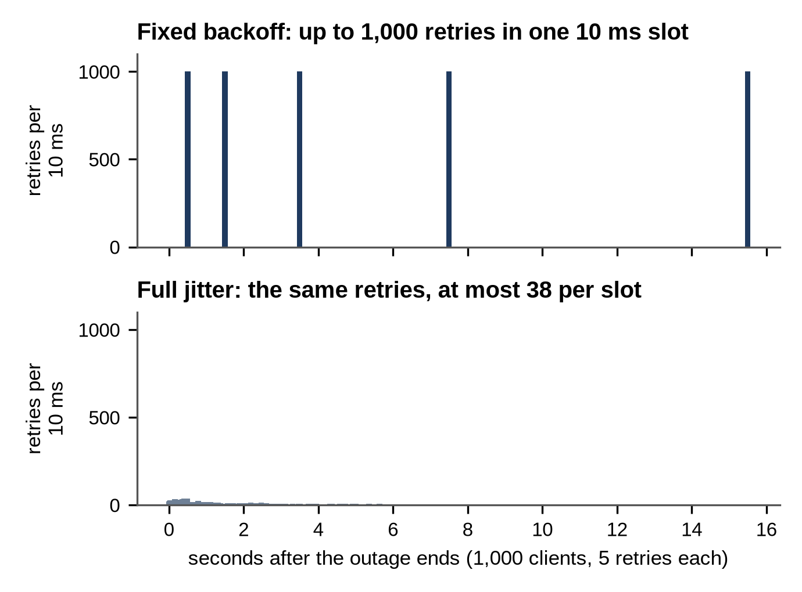
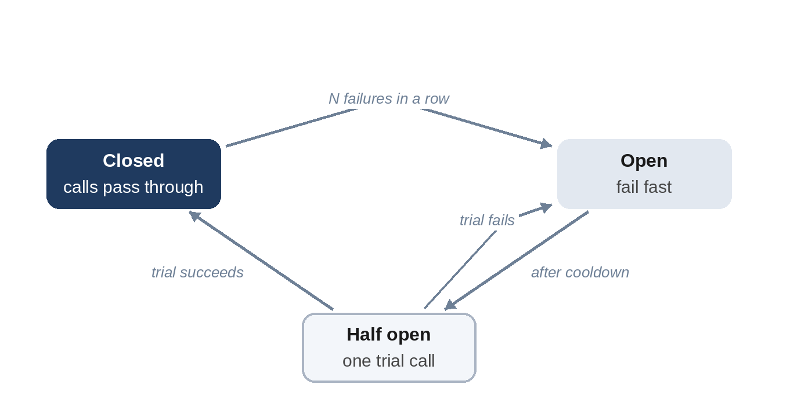

# Chapter 14: Reliability: Timeouts, Retries and Circuit Breakers

In a large system, something is always failing: a disk, a server, a network link, a dependency in another team. Reliability doesn't come from preventing every failure; it comes from making sure that one failure stays small instead of spreading. This chapter covers the patterns that do that, and that interviewers expect in the wrap-up of any design.

## Timeouts

Every network call needs a **timeout**. Without one, a slow dependency makes callers wait, their threads and connections fill up, and soon the callers are as broken as the dependency. Set timeouts from the dependency's measured latency, a little above its 99th percentile (Chapter 15), and make sure the total of nested timeouts fits within the caller's own deadline. Passing the remaining time budget along with each call ("you have 300 ms left") lets every layer give up promptly.

## Retries With Backoff and Jitter

Many failures are brief: a dropped packet, a server restarting. Retrying helps, but naive retries make outages worse. If a service struggles under load and every client retries immediately, the load multiplies, and the service never recovers: a **retry storm**.

The standard fix is **exponential backoff**: wait longer after each failure (0.5 s, 1 s, 2 s, 4 s...), up to a cap. But if all clients failed at the same moment, they all back off by the same amounts and retry in synchronized waves. Adding randomness, **jitter**, spreads them out. With "full jitter", popularized by Marc Brooker's 2015 analysis on the AWS Architecture Blog, each wait is a random time between zero and the exponential limit:

```python
@include code/ch14/b01_retry.py::backoff_delays
```

The model makes 1,000 clients retry five times after the same outage and counts the busiest 10 milliseconds of retries:

```
@include code/ch14/b01_retry.demo.txt
```

Without jitter, all 1,000 retries arrive in the same instant, five times over. With full jitter, the worst 10 ms sees 38.

Rules for safe retries:

- Retry only **idempotent** operations, or use idempotency keys (Chapter 4).
- Retry only **transient** errors (timeouts, 503), not "bad request" errors.
- Limit attempts, and use a **retry budget**: for example, retries may add at most 10% to normal traffic.
- Retry at one layer only. If three layers each retry three times, one user request can become 27 calls.



## Circuit Breakers

When a dependency is clearly down, even well-behaved retries waste time and resources. A **circuit breaker**, a pattern popularized by Michael Nygard's book *Release It!* (2007), stops calling it for a while:



```python
@include code/ch14/b01_retry.py::CircuitBreaker
```

- **Closed:** calls pass through; consecutive failures are counted.
- **Open:** after `threshold` failures, calls fail immediately without touching the dependency, giving it time to recover and keeping the caller fast.
- **Half open:** after a cooldown, one trial call is allowed. Success closes the breaker; failure opens it again.

The examples step through those transitions with a threshold of three failures and a 30-second cooldown. In the first, the breaker opens after three failures, rejects a call at second 3 while open, then lets a trial call succeed at second 40 and closes. In the second, the trial call fails and it opens again:

```
@include code/ch14/b01_retry.examples.txt
```

While the breaker is open, return a **fallback** if one makes sense: cached data, a default, or a degraded feature ("recommendations unavailable") rather than an error page.

## Bulkheads, Load Shedding and Graceful Degradation

- **Bulkheads:** give each dependency its own pool of threads or connections, so one slow dependency can't consume them all. Named after the watertight compartments of a ship.
- **Load shedding:** when overloaded, reject some requests early, cheaply and deliberately (lowest priority first), rather than slowing down for everyone.
- **Graceful degradation:** design features to fail partially. A product page without reviews is better than no product page.

## Redundancy and Failure Domains

Remove single points of failure by running at least two of everything that matters, in different **failure domains**: different machines, racks, availability zones and, for the most critical systems, regions. Test failover regularly; a backup that has never been restored, or a standby that has never been promoted, is a hope, not a plan.

**Real-World Story:** In 2011, Netflix described Chaos Monkey, a tool that randomly disables servers in its production environment. If any server can fail at any moment, engineers build services that survive it, and they find the weaknesses during the working day rather than at 3 a.m. "Chaos engineering", deliberately injecting failures to prove that redundancy works, has since become a common practice. Chapter 37 looks at real outages and the patterns behind them.

## Key Takeaways

- Put a timeout on every call and propagate deadlines.
- Retry only transient failures of idempotent operations, with exponential backoff and jitter, at one layer.
- Circuit breakers fail fast when a dependency is down and probe gently for recovery.
- Bulkheads, load shedding and graceful degradation keep one failure from spreading.
- Spread redundant components across failure domains, and test failover.
