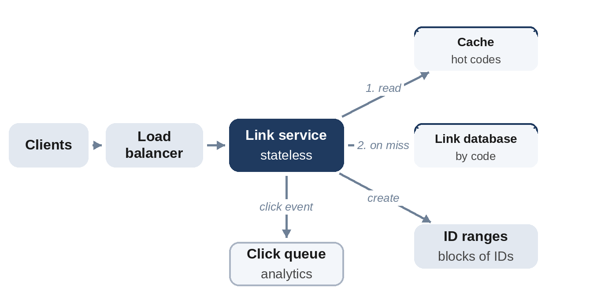

# Part III: Twenty Worked Designs

Each design in this part follows the framework of Chapter 2: requirements, estimates, API, data model, high-level design, deep dives, and a wrap-up with bottlenecks, failure modes and follow-up questions. The estimates are computed with the helpers from Chapter 3, and the core mechanism of each design is a tested Python model. Read the requirements, then try the design yourself for 30 minutes before reading on.

# Chapter 16: Link Shortener

**The prompt:** "Design a service that turns long URLs into short links, like `sho.example/aZ3kQ9x`, and redirects visitors to the original URL."

It's the classic first system design question because it's small enough to finish in 45 minutes, yet it touches ID generation, caching, storage, and abuse prevention.

## Requirements

**Functional:**

1. Create a short link for a long URL, optionally with a custom alias.
2. Visiting the short link redirects to the long URL.
3. Links may have an expiry time.
4. Optional: basic click statistics.

**Non-functional:**

- Redirects must be fast (under about 50 ms server time) and highly available; a broken link is visible to everyone who clicks it.
- Short codes should be hard to guess sequentially only if the product requires it (ask).
- Link creation can be slightly slower and less available than redirects.

**Out of scope:** user accounts and link editing, unless the interviewer wants them.

## Estimates

Assume 100 million new links a month, 100 redirects per link on average, about 500 bytes per stored link, and a peak of five times the average.

```
@include code/ch16/estimate.demo.txt
```

- **Read-heavy, by 100 to 1:** caching redirects matters far more than write throughput.
- **About 600 GB a year:** a few terabytes over several years. That fits on one large database server, but replication and possibly partitioning will be wanted for availability and growth.
- **Seven base-62 characters** give 3.5 trillion codes, enough for nearly 3,000 years at this rate.

## API

```
POST /v1/links    body {"url": "...", "alias": "optional", "ttl": seconds}
                  returns 201 {"code": "aZ3kQ9x", "short_url": "..."}
GET  /{code}      returns 301 or 302 with Location: the long URL, or 404
```

Creation should accept an idempotency key, so a retried request doesn't create two links.

## Data Model

One table, keyed by the code:

| Field | Notes |
| --- | --- |
| code (primary key) | 7 characters, or a custom alias |
| long_url | up to a few KB |
| created_at, expires_at | expires_at may be empty |
| owner_id | optional |

Lookups are always by code, so a key-value store or a relational table with the code as primary key both work. With a relational database, partition by code if it outgrows one machine.

## High-Level Design



**Redirect path:** the request reaches a load balancer, then a stateless link service, which looks up the code in a cache and, on a miss, in the database, and responds with a redirect. **Creation path:** the service validates the URL, obtains a new code, stores the row, and returns the short URL. **Analytics:** each redirect publishes a small click event to a queue; a separate consumer aggregates counts, so redirects never wait for statistics.

## Deep Dive 1: Generating Codes

Three options:

1. **Hash the URL** (for example, the first 7 base-62 characters of a SHA-256 hash). The same URL always gets the same code, but different URLs can collide, so every insert must check for a collision and retry with a salt.
2. **Random codes:** generate 7 random characters and insert if unused. Simple and unguessable; collisions are rare while the space is mostly empty, but each insert needs a uniqueness check.
3. **A counter encoded in base 62:** guaranteed unique, no collision checks, but sequential codes are guessable, and a single counter needs care at scale.

The model below uses a counter, starting at 62⁶ so every code has exactly 7 characters, and handles custom aliases, which share the namespace and so can collide with future counter codes:

```python
@include code/ch16/d01_shortener.py::Shortener
```

```
@include code/ch16/d01_shortener.demo.txt
```

The test creates 5,000 links and checks that all codes are unique and 7 characters long, then deliberately claims the next counter code as a custom alias and checks that the generator skips it.

To make a counter scale, don't use one global counter. Give each link service a **range of IDs** (a block of 1,000 or a million) from a small coordination service, as in Chapter 19; each server then counts within its own range with no coordination. If guessable codes are a concern, scramble the counter value with a reversible permutation before encoding it.

## Deep Dive 2: Fast, Available Redirects

- **Cache:** a small fraction of links receives most clicks (Chapter 6), so a distributed cache of hot codes serves most redirects from memory. Use cache-aside with a TTL.
- **Replicas:** database read replicas serve cache misses; the database's leader only handles creation.
- **Edge caching:** a CDN can cache redirect responses for very popular links.
- **Negative caching:** cache "not found" briefly too, so scans for random codes don't hammer the database.

**301 or 302?** A 301 (permanent) redirect is cached by browsers, which reduces load but means later clicks never reach you, so they can't be counted and the link can't be changed or expired reliably. A 302 (temporary) redirect sends every click through the service. If analytics or expiry matter, use 302; ask the interviewer.

## Deep Dive 3: Abuse

Shorteners are attractive to spammers because short links hide the destination. Defenses: rate limit creation per user and IP (Chapter 11), check destinations against lists of known malicious sites, allow users to report links, and show an interstitial warning for suspicious ones.

## Wrap-Up

- **Bottlenecks:** cache capacity for hot links; the ID range service, mitigated by large ranges; database size after several years, handled by partitioning by code.
- **Failures:** if the cache fails, replicas absorb misses, so size them for it; if creation is down, existing links still redirect.
- **Expired links:** delete them lazily on read and with a periodic cleanup job.

## Follow-Up Questions

- "Make codes unpredictable." Random codes with a uniqueness check, or a scrambled counter.
- "Show per-link click counts in near real time." Aggregate click events by code in a stream processor; store counts per minute.
- "The same long URL submitted twice: same code?" Only if required; then look up existing URLs through an index on a hash of the long URL.

## Key Takeaways

- A link shortener is read-heavy by about 100 to 1, so caching dominates the design.
- Generate codes from per-server ID ranges encoded in base 62; handle custom aliases in the same namespace.
- Choose 301 or 302 based on whether you need analytics and expiry.
- Keep analytics off the redirect path with a queue.
