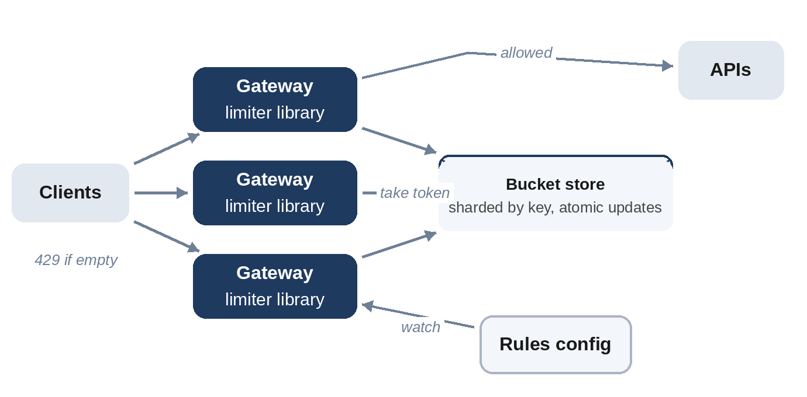

# Chapter 17: Distributed Rate Limiter

**The prompt:** "Design a rate limiter for an API used by millions of clients and served by many gateway servers."

Chapter 11 covered the algorithms on one machine. This chapter is about the hard part of the full design: enforcing one limit consistently across many servers, quickly enough that every request can be checked, and safely when parts of the system fail.

## Requirements

**Functional:**

1. Limit requests per client (API key) per endpoint, with configurable rules such as "100 requests per minute, bursts up to 20".
2. Reject excess requests with HTTP 429 and a `Retry-After` header.
3. Change rules without redeploying.

**Non-functional:**

- Add little latency: about 1 to 2 ms per request.
- Be accurate enough that clients can't exceed limits by much, even across many gateways.
- Never become the cause of an outage.

## Estimates

```
@include code/ch17/estimate.demo.txt
```

Half a million checks per second is a lot of operations, but the state is tiny: 16 bytes per client, 160 MB for ten million clients. It fits in memory comfortably; the challenge is the operation rate, which a handful of in-memory store shards can handle.

## API and Rules

The limiter is a library or sidecar inside each gateway, not a public API. Rules live in a configuration store:

```
rule: endpoint="/v1/search", key="api_key", limit=100, window=60s, burst=20
```

Gateways load the rules at startup and watch for changes.

## High-Level Design



For each request, the gateway identifies the client and the rule, performs one atomic "take a token" operation on the client's bucket in a shared in-memory store, and either forwards the request or returns 429.

## Deep Dive 1: Why Updates Must Be Atomic

The natural implementation reads the bucket, computes the new token count, and writes it back. With many gateways, two can read the same value at the same time, both decide there's a token left, and both write: one update is lost, and an extra request gets through. The model below sends 400 requests through 4 gateways at a bucket of 100 tokens, interleaving the gateways' reads and writes randomly:

```python
@include code/ch17/d01_shared_limiter.py::run
```

```
@include code/ch17/d01_shared_limiter.demo.txt
```

With read-then-write, 264 requests are allowed against a limit of 100. With **compare-and-set**, a write succeeds only if the bucket hasn't changed since it was read, and otherwise the gateway re-reads and retries, so exactly 100 are allowed. The test checks this for 20 different interleavings.

In practice, the cleanest solution is to run the whole token-bucket update **inside the store** as one atomic operation. Redis, for example, executes a Lua script atomically: the script reads the bucket, refills it based on elapsed time, takes a token if available, and writes it back, all in one round trip. One network call per request, no races.

## Deep Dive 2: Latency and Scale

- **Partition buckets** across store shards by client key with consistent hashing (Chapter 9); each check touches exactly one shard.
- **Co-locate** the store with the gateways in each data center; a round trip of well under a millisecond keeps the budget.
- **Local pre-checks:** a gateway can keep a small local token allowance per hot client and only synchronize every few hundred milliseconds. This trades a little accuracy for far fewer store operations, a good choice for very high-volume clients.
- **Multiple regions:** synchronizing buckets across regions on every request would add tens of milliseconds. Instead, give each region its own share of the limit, or synchronize counts asynchronously and accept brief overshoot.

## Deep Dive 3: Failure Behavior

If the store is unreachable, the gateway must decide: **fail open** (allow requests) or **fail closed** (reject them). For most APIs, failing open, perhaps with a conservative local limit, is right: a limiter outage shouldn't become an API outage. For limits that protect against fraud or brute-force attacks, such as login attempts, failing closed may be safer. Either way, put a short timeout on the store call (Chapter 14) and alert when the limiter is degraded.

## Wrap-Up

- **Bottleneck:** store operations for very hot clients; mitigated by local allowances.
- **Accuracy:** exact within a region with atomic scripts; approximate across regions by design.
- **Observability:** metrics for allowed and rejected requests per rule, store latency, and how often the limiter fails open.

## Follow-Up Questions

- "Different limits for free and paid tiers." Rules keyed by plan; the gateway looks up the client's plan with the API key.
- "Limit by cost, not count." Take more tokens for expensive requests.
- "Limit concurrent requests rather than rate." Use a counter incremented on start and decremented on completion, with a lease to recover from crashed requests.

## Key Takeaways

- The central problem is sharing one limit across many servers.
- Read-then-write loses updates under concurrency; use compare-and-set or an atomic script in the store.
- Keep the check to one fast operation: shard the state, co-locate it, and use local allowances for hot clients.
- Decide deliberately whether to fail open or closed.
