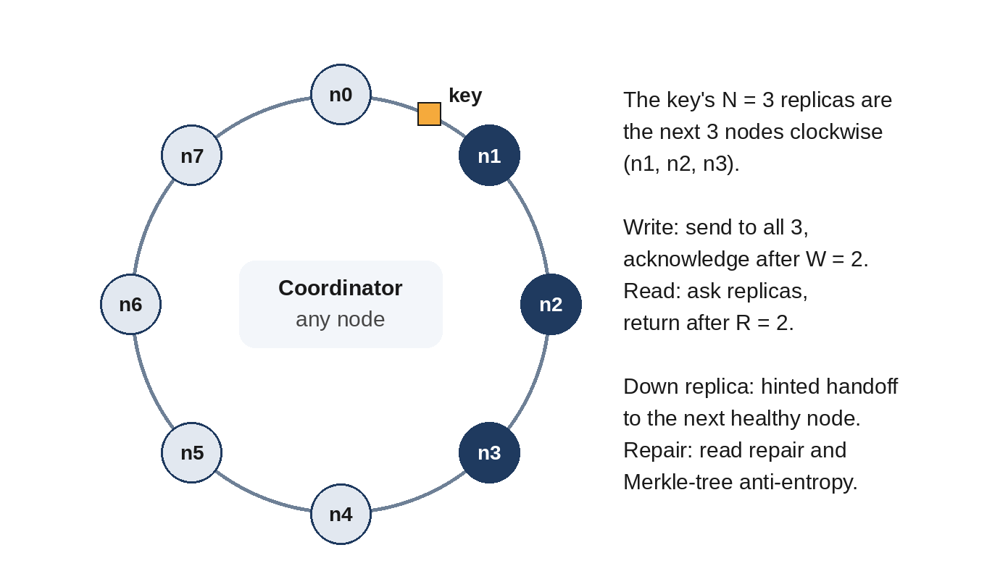

# Chapter 18: Key-Value Store

**The prompt:** "Design a distributed key-value store: put(key, value) and get(key), for a large amount of data, highly available."

This design brings together most of Part II: partitioning, replication, quorums, conflict handling and storage engines. It's often asked of senior candidates because it's all deep dives.

## Requirements

**Functional:** `put(key, value)`, `get(key)`, `delete(key)`. Values up to about 1 MB.

**Non-functional:**

- Store about 100 TB of data, growing.
- About a million operations per second at peak.
- Highly available: reads and writes succeed even when some machines or a whole rack fail.
- Tunable consistency: some clients want the latest value, others prefer lower latency.

## Estimates

Assume each node has 4 TB of usable disk and handles about 20,000 operations per second, with three copies of every item.

```
@include code/ch18/estimate.demo.txt
```

Storage, not load, decides the cluster size here: about 75 nodes. That tells us partitioning is unavoidable, and that adding nodes must be routine and cheap.

## API

```
put(key, value, consistency=QUORUM) -> ok
get(key, consistency=QUORUM) -> value (or several conflicting versions)
delete(key) -> ok
```

## High-Level Design



- **Partitioning:** a consistent-hashing ring with virtual nodes (Chapter 9). Each key is stored on the N = 3 distinct nodes that follow its position clockwise.
- **Replication:** leaderless, with quorums (Chapter 8). Any node can act as **coordinator** for a request: it forwards a write to all N replicas and acknowledges after W = 2 succeed; for a read, it asks the replicas and returns after R = 2 answer. R + W > N, so reads overlap the latest acknowledged write.
- **Membership:** nodes learn about each other and detect failures through a gossip protocol, each periodically exchanging its view of the cluster with a few random peers.
- **Storage engine:** an LSM-tree on each node (Chapter 7), because the workload includes many writes; Bloom filters avoid unnecessary disk reads.

## Deep Dive 1: Writes When Nodes Are Down

If one of a key's three replicas is down, a strict quorum can still succeed with the other two. If two are down, the write would fail. A **sloppy quorum** accepts the write on the next healthy node along the ring, with a note, a **hint**, saying which node it really belongs to. When that node returns, the hint is delivered: **hinted handoff**. This keeps writes available during failures, at the cost that a read during the outage might not find the latest write on the "real" replicas.

## Deep Dive 2: Conflicting Versions

With leaderless writes, two clients can update the same key concurrently through different coordinators. Options:

- **Last write wins** by timestamp: simple, but silently drops one write, and depends on clocks.
- **Vector clocks** (Chapter 12): each version carries a vector clock, so the store can tell whether one version supersedes another or they are concurrent. Concurrent versions are returned together to the client, which merges them (for example, the union of two shopping carts) and writes back the result.

Offer both: last write wins for clients that don't care, version vectors for those that do.

## Deep Dive 3: Repairing Replicas

Replicas drift apart: a hint is lost, a node is down for days. Two repair mechanisms:

- **Read repair:** when a read sees that one replica returned an older version, the coordinator writes the newer one back to it.
- **Anti-entropy:** a background process compares replicas and copies missing data. Comparing every key would mean sending the whole dataset over the network. Instead, each replica builds a **Merkle tree**: keys are grouped into buckets, each bucket is hashed, and each parent hashes its children. Two replicas compare root hashes; only where hashes differ do they descend further.

```python
@include code/ch18/d01_merkle.py::build,differing_buckets
```

With 100,000 keys and a single changed value:

```
@include code/ch18/d01_merkle.demo.txt
```

Twenty-one hash comparisons narrow the difference to one bucket of 94 keys, instead of comparing 100,000. The test checks, on thousands of random pairs of replicas, that the keys found through the tree are exactly the keys that differ.

## Wrap-Up

- **Adding nodes:** a new node takes over ranges from its neighbors on the ring and streams that data; throttle the transfer so the cluster stays responsive.
- **Hot keys:** cache them at the coordinator, or replicate them more widely.
- **Failure domains:** place a key's replicas on different racks or availability zones, not just different nodes.
- **Consistency per request:** let clients choose R and W, for example R = 1 for low-latency reads that tolerate staleness.

## Follow-Up Questions

- "Support range queries." Hash partitioning scatters ranges across nodes; use range partitioning for those tables, and handle hot ranges by splitting.
- "Make it strongly consistent." Use a leader per partition chosen by consensus (Raft), and route all writes and strong reads through it.
- "Delete semantics." Tombstones replicated like writes, removed by compaction after all replicas have seen them; otherwise a deleted value can come back from a stale replica.

## Key Takeaways

- Consistent hashing places each key on N replicas; quorums with R + W > N give overlapping reads and writes.
- Sloppy quorums and hinted handoff keep writes available during failures.
- Detect concurrent versions with vector clocks, or accept last write wins deliberately.
- Repair replicas with read repair and Merkle-tree anti-entropy, which finds differences with very few comparisons.
