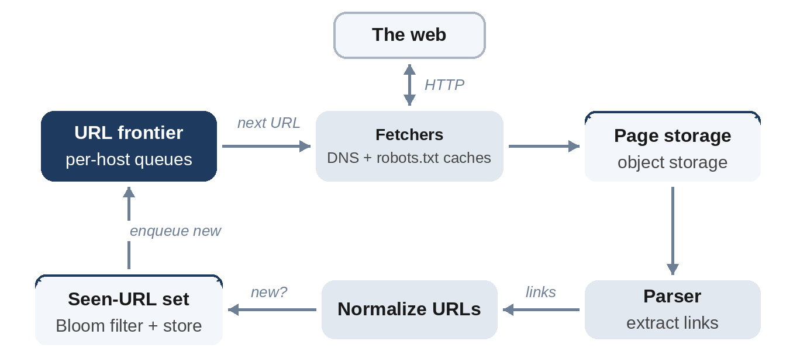

# Chapter 20: Web Crawler

**The prompt:** "Design a web crawler that downloads a billion pages a month, for example to build a search index."

A crawler is a long-running pipeline: pick a URL, fetch the page, store it, extract links, add new links to the queue, and repeat, forever. The interesting problems are not the fetching itself but deciding what to fetch next, avoiding duplicates, and being polite to the websites being crawled.

**Interesting Fact:** In 2008, Google announced that its systems had found more than 1 trillion unique URLs on the web, with the number of pages growing by several billion per day. It didn't index them all. Much of the web is duplicate content and endless auto-generated pages, which is why URL normalization, deduplication and politeness matter as much as raw fetching speed.

## Requirements

**Functional:**

1. Start from seed URLs and discover new pages by following links.
2. Download and store HTML pages for later processing (indexing is out of scope).
3. Revisit pages periodically to pick up changes.

**Non-functional:**

- About 1 billion pages per month.
- **Politeness:** never overload a website; respect its `robots.txt` rules.
- Robust to bad pages: huge files, slow servers, infinite link traps, malformed HTML.
- Avoid storing duplicate content.

## Estimates

Assume 500 KB downloaded per page, 100 KB stored after compression, and about 10 links per page.

```
@include code/ch20/estimate.demo.txt
```

- **About 400 pages per second** and **200 MB per second** of downloads: a fleet of fetchers, but not an enormous one.
- **About 100 TB of compressed HTML per month:** object storage.
- **10 billion links found per month:** the set of URLs already seen grows to tens of billions over time. Even as 8-byte fingerprints, that's tens of gigabytes per month, so the "seen" check needs a partitioned store, or a Bloom filter in front of it (Chapter 13).

## High-Level Design



1. The **URL frontier** decides which URL to fetch next.
2. **Fetchers** resolve DNS (with a cache), check `robots.txt` (also cached), and download the page with a timeout and a size limit.
3. Pages go to **content storage**; a **content fingerprint** (a hash of the page) detects exact duplicates of pages already stored under other URLs.
4. A **parser** extracts links.
5. Links are **normalized**, checked against the **seen-URL set**, and new ones are added to the frontier.

## Deep Dive 1: Normalizing and Deduplicating URLs

The same page has many spellings: `HTTPS://Example.com:443/a#top` and `https://example.com/a` are the same resource. Normalizing before the "seen" check avoids fetching it twice:

```python
@include code/ch20/d01_frontier.py::normalize
```

```
@include code/ch20/d01_frontier.examples.txt
```

The function lower-cases the scheme and host, removes default ports and fragments, and makes empty paths `/`. Real crawlers go further, removing tracking parameters and following canonical-URL hints in pages.

At tens of billions of URLs, the seen set itself is large. A Bloom filter answers "definitely new" for most URLs cheaply; only "maybe seen" answers check the exact, partitioned store. A false positive means skipping a genuinely new URL, which is acceptable for a crawler.

## Deep Dive 2: Politeness and Priority

A naive queue would send hundreds of requests per second to one big site, which is rude and gets the crawler blocked. The frontier therefore keeps **one queue per host**, and a schedule of when each host may next be contacted:

```python
@include code/ch20/d01_frontier.py::Frontier
```

`next(now)` takes the host whose waiting time has passed soonest, fetches one URL from its queue, and schedules that host again `delay` seconds later. The test fills the frontier with 500 URLs across 5 hosts and checks two properties over the whole crawl: no host is ever contacted twice within the delay, and every URL is eventually fetched.

Real frontiers add **priority**: important or frequently changing pages (news home pages) go into higher-priority queues, and are re-crawled more often. A common structure is a set of front queues by priority feeding back queues by host.

## Deep Dive 3: Robustness

- **Timeouts and size limits** on every fetch.
- **Crawler traps:** sites that generate infinite URLs, such as calendars with a "next month" link forever. Limit URL length, crawl depth per site, and pages per host.
- **`robots.txt`:** fetch and cache it per host; respect disallowed paths and crawl-delay hints.
- **Checkpointing:** the frontier must survive restarts, so persist it (for example as per-host queues in a durable store or log).

## Wrap-Up

- **Scaling out:** partition the frontier and the seen set by host, so each crawler machine owns a set of hosts. That keeps politeness local to one machine.
- **Freshness:** revisit pages at a rate based on how often they've changed before.
- **Bottlenecks:** DNS lookups (cache aggressively), the seen-set lookups (Bloom filter plus partitioned store), and slow hosts tying up fetchers (asynchronous I/O and tight timeouts).

## Follow-Up Questions

- "Detect near-duplicate pages" (same article, different ads). Use similarity fingerprints such as SimHash rather than exact hashes.
- "Crawl JavaScript-heavy sites." Render pages in headless browsers, which is far more expensive, so reserve it for sites that need it.
- "Prioritize new content." Feed sitemaps and RSS feeds into a high-priority queue.

## Key Takeaways

- A crawler is a loop: frontier, fetch, store, parse, normalize, deduplicate, enqueue.
- Normalize URLs before checking whether they've been seen; use a Bloom filter to make the check cheap.
- Politeness needs per-host queues and a schedule of when each host may be contacted next.
- Partition the work by host, so politeness and deduplication stay local.
