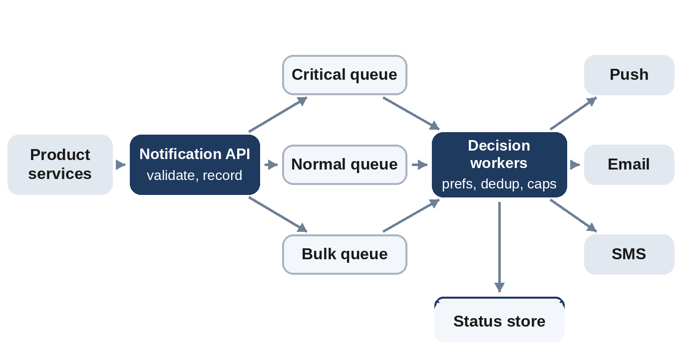

# Chapter 21: Notification Service

**The prompt:** "Design a service that sends push notifications, emails and text messages to users on behalf of other teams' products."

Notification systems look simple, call a provider's API, but users judge them harshly: a missed security alert is dangerous, and ten duplicate "someone liked your photo" messages are annoying enough to make people uninstall the app. The design is about reliability on one side and restraint on the other.

## Requirements

**Functional:**

1. Other services request notifications: recipient, type, content, channel(s), priority.
2. Deliver through push (mobile and web), email and SMS, via third-party providers.
3. Respect user preferences: channels turned off, quiet hours.
4. Avoid duplicates and limit how many non-urgent notifications a user gets.
5. Track delivery status.

**Non-functional:**

- About 2 billion notifications a day, with bursts of ten times normal (breaking news, a marketing campaign).
- Critical notifications (security alerts, one-time passcodes) must arrive within seconds; marketing can wait.
- At-least-once delivery inside the system, without visible duplicates to users.

## Estimates

```
@include code/ch21/estimate.demo.txt
```

About 23,000 notifications per second on average and 230,000 at peak. The volume is high, but each message is small; the real constraints are provider rate limits, provider failures, and bursts. Deduplication state for an hour fits in a few gigabytes of memory.

## API

```
POST /v1/notifications
  body {"user_id", "type", "channels": ["push", "email"], "priority",
        "template_id", "params", "dedupe_key"}
  returns 202 Accepted {"notification_id"}
```

Accept quickly and process asynchronously; the caller doesn't wait for delivery.

## High-Level Design



1. The **API** validates the request, records it, and publishes it to a **queue per priority** (critical, normal, bulk), so a marketing blast can't delay a security alert.
2. **Decision workers** load the user's preferences and contact details (cached), apply the rules below, and render the template in the user's language.
3. **Channel workers**, one pool per channel, call the providers: mobile push services, an email provider, an SMS gateway. Each pool has its own rate limits and circuit breakers (Chapter 14), so a failing SMS provider doesn't affect email.
4. A **status store** records every attempt; providers' delivery callbacks update it.

## Deep Dive 1: Deciding Whether to Send

The core logic is a sequence of rules, each of which can stop a notification:

```python
@include code/ch21/d01_notify.py::decide
```

1. Skip channels the user turned off.
2. Drop a **duplicate** of the same event (same user and dedupe key) within an hour. Producers retry; queues redeliver; users must not notice.
3. During the user's **quiet hours**, send only critical notifications.
4. Cap non-critical notifications at a few per user per hour.

```
@include code/ch21/d01_notify.examples.txt
```

The like is sent, its retry a minute later is dropped as a duplicate, email is off, a promotion at 23:00 waits for quiet hours to end (here simply skipped), and the 23:00 login alert goes through because it's critical. The test replays 3,000 random events and checks two properties over everything sent: no event is sent twice within an hour, and no user receives more than three non-critical notifications in any hour.

In production, "skipped for quiet hours" usually means **delayed** until the quiet period ends, and capped notifications may be merged into a digest ("Ana and 12 others liked your photo").

## Deep Dive 2: Reliable Delivery

- **Retries** with exponential backoff and jitter for provider errors, using the notification ID as an idempotency key where the provider supports one.
- **Fallback channels:** if push fails because a device token is invalid, fall back to email for important messages, and remove dead tokens.
- **Dead-letter queue** for notifications that keep failing.
- **Provider redundancy:** two email or SMS providers, with routing that shifts traffic when one degrades.

## Deep Dive 3: Bursts

A campaign to 100 million users must not starve transactional messages. Separate queues per priority, separate worker pools, and a sending rate for bulk campaigns that stays within provider limits, spreading the campaign over minutes or hours.

## Wrap-Up

- **Bottlenecks:** provider rate limits and the preference lookups (cache them).
- **Observability:** delivery rate and latency per channel and provider, failure reasons, opt-out rate after campaigns.
- **Compliance:** honor unsubscribes immediately, include unsubscribe links in marketing email, and follow regional rules for SMS.

## Follow-Up Questions

- "Guarantee a one-time passcode arrives in 10 seconds." A dedicated critical queue, the fastest provider, and fallback to a second provider after a short timeout.
- "Let users see a notification inbox in the app." Store notifications per user (a wide-column store partitioned by user ID) and show them with cursor pagination.
- "Avoid notifying users about content they've already seen." Check read state before sending, which requires a fast lookup service.

## Key Takeaways

- Accept requests quickly and deliver asynchronously through priority queues.
- Apply preferences, deduplication, quiet hours and rate caps before sending; users notice every duplicate.
- Isolate channels and providers with their own workers, rate limits and circuit breakers.
- Keep critical messages fast even during bulk campaigns.
