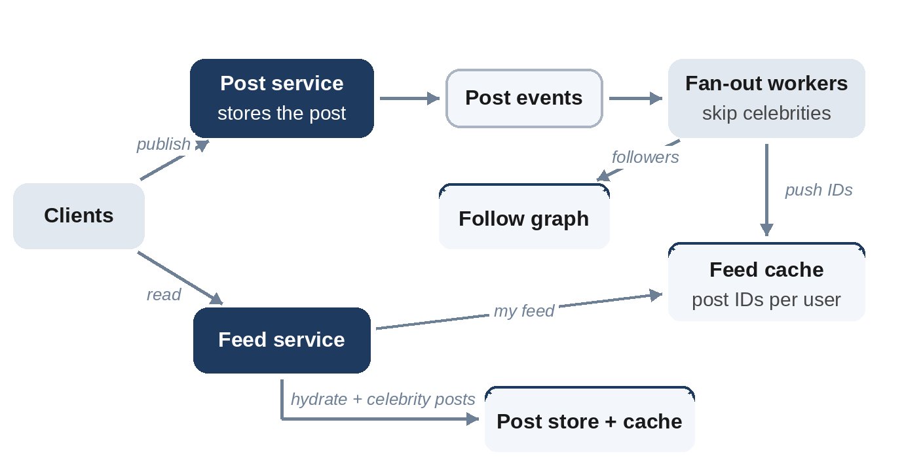

# Chapter 22: News Feed

**The prompt:** "Design the home feed of a social network: users follow accounts and see their recent posts."

The news feed is one of the most frequently asked design questions because it has a famous central trade-off, doing the work when a post is written or when a feed is read, and a famous complication: accounts with millions of followers.

## Requirements

**Functional:**

1. Users publish posts (text, with optional media).
2. Users follow other users.
3. A user's feed shows recent posts from the accounts they follow, newest first (ranking is a follow-up).

**Non-functional:**

- 300 million daily active users.
- Feed loads must be fast: a couple of hundred milliseconds.
- A new post can take a few seconds to appear in followers' feeds (eventual consistency is fine).

## Estimates

Assume half of users post once a day, users load their feed 10 times a day, and accounts have 200 followers on average.

```
@include code/ch22/estimate.demo.txt
```

- Reads (about 35,000 per second) outnumber posts (about 1,700 per second) by 20 to 1.
- But if every post is copied into every follower's feed, the system performs about **350,000 feed writes per second**. The fan-out, not the posts themselves, is the write load.
- A cached feed of 500 post IDs per user costs about 1.2 TB across all users: large, but feasible for a distributed cache.

## API

```
POST /v1/posts               body {"text", "media_ids"}  returns {"post_id"}
GET  /v1/feed?cursor=...      returns {"posts": [...], "next_cursor"}
POST /v1/users/{id}/follow
```

## Data Model

- **Posts:** post_id (time-ordered, Chapter 12), author_id, text, media references, created_at. Partitioned by author.
- **Follows:** (follower_id, followee_id), with indexes in both directions.
- **Feed cache:** for each user, a list of recent post IDs.

## High-Level Design



**Publishing:** the post service stores the post and publishes an event. **Fan-out workers** look up the author's followers and push the post ID into each follower's feed cache. **Reading:** the feed service reads the user's list of post IDs, fetches the posts themselves (from a post cache), and returns them.

## Deep Dive 1: Fan-Out on Write or on Read?

- **Fan-out on write (push):** copy each post to every follower's feed when it's published. Feed reads are a single cache lookup, very fast. But writes multiply by the follower count, and work is wasted on followers who never log in.
- **Fan-out on read (pull):** at read time, fetch recent posts from every followed account and merge them. No write amplification, but a user following 500 accounts makes every feed load expensive.

The problem with pure push is the **celebrity**: an account with 50 million followers turns one post into 50 million writes. The standard answer is a **hybrid**: push for ordinary accounts, pull for accounts above a follower threshold. At read time, the user's pushed feed is merged with recent posts from the few celebrities they follow.

```python
@include code/ch22/d01_feed.py::FeedService
```

The test checks, on thousands of random follow graphs, that the hybrid feed always equals a simple "pull everything" feed. The demo measures what the hybrid saves: 2,000 users each follow 20 random users and one celebrity, and one post in ten comes from the celebrity:

```
@include code/ch22/d01_feed.demo.txt
```

The hybrid does 18,086 inbox writes instead of 218,086: the celebrity's 100 posts would have been 200,000 writes on their own. At real scale, with celebrity accounts of tens of millions of followers, the difference is what makes the system feasible.

## Deep Dive 2: Feed Storage and Hydration

Feeds store **post IDs**, not posts: a post appears in thousands of feeds but is stored once, and edits or deletions show up everywhere immediately. Reading a page of the feed means "hydrating" 20 IDs into posts with a batched lookup from a post cache. Keep only the newest few hundred IDs per feed in the cache; users rarely scroll further, and older pages can be computed by pulling.

Users who haven't logged in for weeks don't need a precomputed feed at all. Skip them during fan-out and build their feed by pulling when they return.

## Deep Dive 3: Ranking

Real feeds are ranked, not purely chronological. Ranking fits naturally on top of this design: candidate posts come from the pushed feed and pulled celebrity posts, a ranking service scores them with features such as the relationship to the author and engagement so far, and the top results are returned. Keep ranking within the latency budget by limiting the candidate set to a few hundred.

## Wrap-Up

- **Bottlenecks:** fan-out workers during spikes (queue the work, scale workers), the follower lookup for large accounts (pre-split follower lists), the post cache for viral posts (replicate hot entries).
- **Consistency:** a post may take a few seconds to reach all feeds; the author should see their own post immediately (read-your-writes, Chapter 8), so insert it into their own feed synchronously.
- **Deletes:** remove from the post store; feeds containing the dead ID simply skip it at hydration.

## Follow-Up Questions

- "Unfollow should remove that account's posts from the feed." Filter at read time against the current follow list, and let old entries age out.
- "Show a 'new posts' indicator." Push a lightweight signal over an open connection, or have the client poll the head of its feed cheaply.
- "Support multiple regions." Replicate posts asynchronously; fan out within each region.

## Key Takeaways

- The fan-out, not the posts, is the main write load.
- Push gives fast reads but amplifies writes; pull is the reverse; a hybrid pushes for most accounts and pulls for celebrities.
- Store post IDs in feeds and hydrate at read time.
- Skip inactive users during fan-out, and let authors see their own posts immediately.
