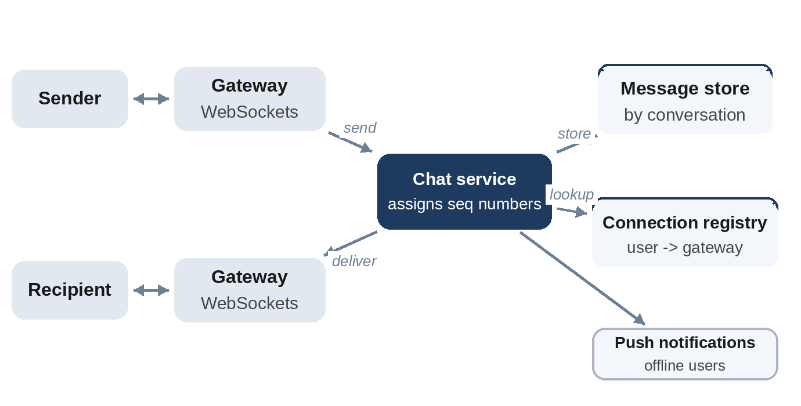

# Chapter 23: Chat and Messaging

**The prompt:** "Design a chat app supporting one-to-one and small group conversations, with online status and message history."

Chat combines real-time delivery over long-lived connections with the expectation that no message is ever lost, duplicated or shown out of order, even on flaky mobile networks. That combination drives every decision.

## Requirements

**Functional:**

1. Send and receive messages in one-to-one and group conversations (groups up to a few hundred members).
2. Messages appear in real time when the recipient is online, and are delivered when they come back online.
3. Message history on every device.
4. Delivery and read receipts; online presence.

**Non-functional:**

- 500 million daily active users.
- Low latency: messages appear within a second or so.
- No lost messages; consistent order within a conversation; no visible duplicates.

## Estimates

Assume 40 messages per user per day, 60% of daily users online at peak, and about 200 bytes per stored message.

```
@include code/ch23/estimate.demo.txt
```

- About 230,000 messages per second on average.
- **300 million open connections** at peak: at 100,000 connections per server, about 3,000 gateway servers. Connection management is a central concern.
- About 1.5 PB of messages per year: a partitioned, write-optimized store.

## API

Clients keep a WebSocket open to a gateway (Chapter 4) and exchange small messages:

```
client -> server: send {conversation_id, client_msg_id, text}
server -> client: ack  {client_msg_id, seq}
server -> client: message {conversation_id, seq, sender, text}
client -> server: sync {conversation_id, after_seq}
```

## Data Model

- **Messages:** partitioned by conversation_id and sorted by sequence number within it, in a wide-column store: perfect for "the latest messages in this conversation" and "messages after seq 1,042".
- **Conversations and members:** a relational or key-value store.
- **Connection registry:** which gateway each online user is connected to, in a fast in-memory store with short TTLs.

## High-Level Design



To send a message: the sender's gateway forwards it to the **chat service**, which assigns the next sequence number in the conversation, stores the message, acknowledges the sender, and looks up each recipient in the **connection registry**. Online recipients get the message through their gateway; offline ones get a push notification and fetch it when they reconnect.

## Deep Dive 1: Ordering, Gaps and Duplicates

Mobile networks drop connections constantly. The design that survives this is simple:

- The server assigns each message a **sequence number** within its conversation, so there is one agreed order.
- Each client remembers the **last sequence number it has**, and after reconnecting asks for everything after it.
- Clients retry sends after a lost acknowledgement using the same **client message ID**, so the server can drop the duplicate.

```python
@include code/ch23/d01_chat.py::ChatServer,Client
```

The test simulates three users sending messages while randomly disconnecting and reconnecting, with 30% of sends retried after a lost acknowledgement. Across 30 random runs, every client ends with exactly the server's log: the same order, no gaps, no duplicates.

Sequence numbers per conversation require one place to assign them. Partition conversations across chat-service instances (by conversation ID), so each conversation's counter lives in one place and different conversations scale independently.

## Deep Dive 2: Connections at Scale

- **Gateways are stateful**: each holds many WebSockets. Register each connection in the registry with a TTL refreshed by heartbeats, so stale entries disappear when a server dies.
- **Deployments** must drain connections gradually; clients reconnect to another gateway and sync from their last sequence number, so nothing is lost.
- **Multiple devices:** the registry maps a user to several connections; deliver to all, and sync each device by its own last sequence number.

## Deep Dive 3: Groups and Presence

- **Groups:** for groups of a few hundred, the chat service fans out each message to the members' gateways. Very large broadcast channels need a different design, closer to the news feed (pull rather than push).
- **Presence:** online status changes constantly. Update it via heartbeats, broadcast changes only to contacts who are currently online, and tolerate delays of a few seconds. Presence is a cache, not a source of truth.
- **Receipts:** delivery and read receipts are small messages in the same conversation stream, so they inherit the same ordering and retry logic.

## Wrap-Up

- **End-to-end encryption:** if required, the server stores and routes only ciphertext; keys stay on devices. That moves features such as search to the client.
- **Bottlenecks:** the connection registry (partition it), hot group conversations, and storage growth (tiered storage for old messages).
- **Failure:** if a chat-service instance dies, another takes over its conversations; clients retry, and duplicates are dropped by client message ID.

## Follow-Up Questions

- "Search message history." A search index per user, updated asynchronously; with end-to-end encryption, on-device search.
- "Edit and delete messages." New events in the stream that refer to the original sequence number.
- "Typing indicators." Ephemeral messages, not stored, delivered only to online members.

## Key Takeaways

- Real-time delivery uses persistent connections, tracked in a registry with TTLs.
- Per-conversation sequence numbers give one order; clients sync from their last sequence number after reconnecting.
- Client message IDs make retries safe; the server drops duplicates.
- Partition conversations so each one's sequence lives in one place.
