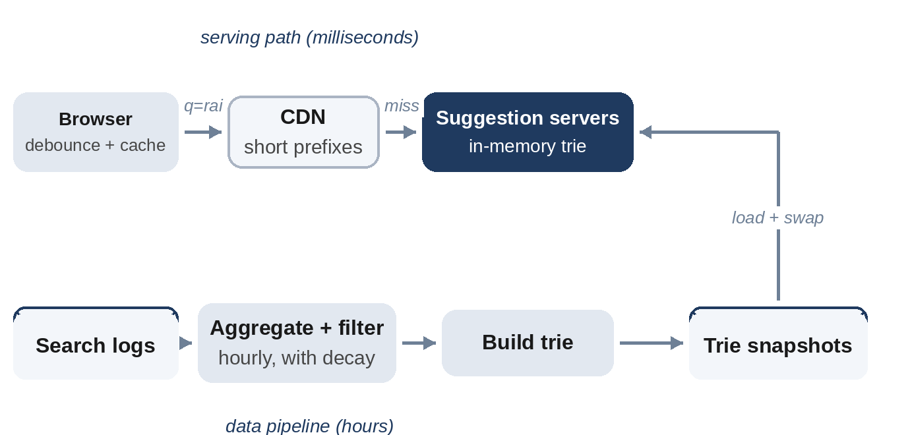

# Chapter 24: Search Autocomplete

**The prompt:** "Design the suggestions that appear under a search box as the user types."

Autocomplete has an unusual profile: a request on every keystroke, a latency budget measured in tens of milliseconds, and data (popular queries) that changes slowly enough to be precomputed. The design separates a fast, read-only serving path from a slower pipeline that builds the data.

**Interesting Fact:** Google says autocomplete reduces typing by about 25% on average, and estimates that it saves its users more than 200 years of typing time every day. Small savings per request add up when there are billions of requests.

## Requirements

**Functional:**

1. As the user types, return the top 5 to 10 completions for the current prefix.
2. Rank by popularity, with recent trends reflected within about an hour.
3. Filter offensive or unsafe suggestions.

**Non-functional:**

- Results within about 100 ms end to end, so typing feels instant.
- Highly available; if suggestions fail, search itself must still work.

## Estimates

Assume 5 billion searches a day and about six keystroke requests per search.

```
@include code/ch24/estimate.demo.txt
```

Hundreds of thousands of requests per second, but the data, 100 million popular phrases with their top-completion lists, is about 20 GB: it fits in memory on a single large server, and can be replicated many times to handle the request rate.

## API

```
GET /v1/suggest?q=rai&lang=en  returns ["rain", "rainbow", "rails", ...]
```

The client waits briefly after each keystroke (debouncing, 50 to 100 ms), cancels outdated requests, and caches results for prefixes it has already seen.

## High-Level Design



- **Serving path:** suggestion servers keep a trie of popular phrases in memory and answer from it. Responses for common short prefixes are cacheable at the CDN and in the browser.
- **Data pipeline:** search logs are aggregated (for example hourly) into phrase counts, filtered, and used to build a new trie, which is distributed to the servers and swapped in atomically.

## Deep Dive 1: A Trie With Top-K at Every Node

A trie stores phrases letter by letter. A naive lookup walks to the prefix's node and then searches the whole subtree for the most popular phrases, too slow for short prefixes like "a" with millions of completions. The fix is to **store the top k completions at every node**, computed when the trie is built. A lookup is then just a walk down the prefix:

```python
@include code/ch24/d01_autocomplete.py::Autocomplete
```

```
@include code/ch24/d01_autocomplete.examples.txt
```

"rain" was searched three times, "rainbow" twice, and "railway" and "rails" once each; ties are broken alphabetically. The test compares the trie with a brute force that counts and sorts every matching phrase, on thousands of random query streams.

Storing top-k lists multiplies memory by the trie's depth, but for the top 10 phrases per node it's affordable, and lookups become O(length of prefix).

## Deep Dive 2: Building and Updating the Data

Updating counts on every search would mean writing to the trie hundreds of thousands of times per second. Instead:

1. Log every completed search.
2. Aggregate counts per phrase over a window (hourly, with older windows decayed so recent trends rise), using a stream or batch job. A Count-Min sketch (Chapter 13) can find heavy hitters cheaply in the stream.
3. Filter: remove offensive phrases, personal information, and phrases searched by too few distinct users (a privacy safeguard).
4. Build a new trie offline and ship it to servers, which load it and switch over without downtime.

For very fresh trends (a breaking news event), merge a small "trending" trie, rebuilt every few minutes, with the main one at query time.

## Deep Dive 3: Scaling the Serving Path

- **Replicate** the whole trie on every server if it fits in memory; add servers for throughput.
- If it doesn't fit, **partition by prefix range** (a to f, g to m...), being careful that popular first letters are split finer.
- **Cache** results for the shortest prefixes, which are the most requested and the most expensive.

## Wrap-Up

- **Personalization:** blend global suggestions with the user's own recent searches on the client or in a small per-user store.
- **Languages and regions:** one trie per language or region.
- **Failure:** if suggestion servers are unavailable, the client simply shows no suggestions.

## Follow-Up Questions

- "Handle typos." Fuzzy matching (edit distance), usually as a second pass when the exact prefix has few results.
- "Rank by more than popularity." Score candidates from the trie with freshness and personalization features before returning them.
- "Remove a harmful suggestion immediately." A blocklist checked at serving time, in addition to filtering in the pipeline.

## Key Takeaways

- Separate a read-only, in-memory serving path from an offline pipeline that builds the data.
- Store the top-k completions at every trie node so lookups are a short walk.
- Aggregate counts in batches with decay for trends; never update the serving trie per search.
- Debounce and cache on the client; cache short prefixes everywhere.
