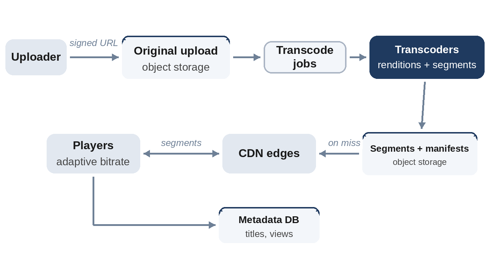

# Chapter 25: Video Streaming

**The prompt:** "Design a video platform where users upload videos and millions watch them on phones, computers and TVs."

Video platforms are dominated by two numbers: storage and egress bandwidth. Almost every design decision, transcoding into several formats, chunking into segments, pushing them to CDNs, follows from making playback smooth on unreliable networks while keeping those numbers affordable.

## Requirements

**Functional:**

1. Users upload videos.
2. Viewers watch videos on any device, starting quickly and without stalling.
3. Basic metadata: titles, view counts.

**Non-functional:**

- Hundreds of hours of video uploaded every minute; tens of millions of concurrent viewers.
- Playback starts in about a second and rarely rebuffers, even on poor connections.
- Uploaded videos are never lost.

## Estimates

Assume 500 hours uploaded per minute, five renditions per video (0.4 to 8 Mbps), 20 million concurrent viewers at peak watching at 3 Mbps on average.

```
@include code/ch25/estimate.demo.txt
```

- About **5 PB of new storage a day** for all renditions. Storage tiers and deleting rarely watched high renditions matter.
- About **7.5 TB per second** of egress at peak. That is far beyond any single data center; it's only possible with CDNs and caches deep inside internet service providers' networks.

## High-Level Design



**Upload:** the client uploads directly to object storage using a pre-signed URL, in resumable chunks, so large uploads survive network drops. A message triggers processing.

**Processing:** the video is split into short pieces and **transcoded** in parallel into several renditions (resolutions and bitrates) and codecs. Each rendition is cut into **segments** of a few seconds, and a **manifest** lists them (formats such as HLS and DASH). Thumbnails and metadata are generated along the way.

**Playback:** the player downloads the manifest, then requests segments from the nearest CDN edge, choosing a rendition for each segment.

## Deep Dive 1: Adaptive Bitrate Streaming

Network bandwidth changes from second to second. Because every rendition is cut into the same segments, the player can switch quality at each segment boundary. A simple and effective rule is **buffer-based**: if the buffer of downloaded video is low, choose a low bitrate to refill it quickly; when the buffer is healthy, step up.

```python
@include code/ch25/d01_abr.py::play,buffer_based
```

The model plays 60 two-second segments over a connection that drops from 12 Mbps to 1.5 Mbps for 40 seconds, like a train going through a tunnel, then recovers:

```
@include code/ch25/d01_abr.demo.txt
```

Always streaming at 8 Mbps freezes for 162 seconds; the buffer-based player stalls for a tenth of a second and averages 4.6 Mbps. The test checks over 200 random bandwidth traces that the adaptive player never rebuffers more than the fixed one. Production players combine buffer level with bandwidth estimates, but the principle is the same: quality is worth less to viewers than continuity.

## Deep Dive 2: Transcoding at Scale

- **Parallelism:** split each video into chunks and transcode them in parallel across a worker fleet, coordinated through a queue; reassemble the segments.
- **Priority:** popular creators and short videos first; long, rarely watched videos can wait.
- **Cost:** transcoding is expensive. Encode rare formats lazily, on first request, and skip the highest renditions for videos that few people watch.
- **Reliability:** each step is idempotent and retried; the original upload is kept so everything can be re-encoded later with better codecs.

## Deep Dive 3: Delivery and Storage

- **CDN caching:** popular videos are served almost entirely from edge caches. The long tail of rarely watched videos is fetched from origin storage on demand.
- **Storage tiers:** recent and popular videos on fast storage; old, rarely watched ones on cheaper, slower tiers, with **erasure coding** instead of full copies (Chapter 26).
- **Startup time:** the first segment at low quality, small segments at the start, and prefetching the next video in a feed.

## Wrap-Up

- **Bottlenecks:** egress (CDNs, efficient codecs), transcoding capacity during upload spikes (queue and prioritize), and the long tail of cold content (origin capacity).
- **View counts:** a classic hot counter. Count in a stream and update in batches, accepting slight delays (Chapter 31).
- **Live streaming** is a different design: segments are produced in real time, with a latency target of a few seconds.

## Follow-Up Questions

- "Resume watching on another device." Store the playback position per user per video, updated every few seconds.
- "Copyright detection." Compare fingerprints of uploads with a reference database during processing.
- "Reduce bandwidth costs." Newer codecs, per-title encoding that adapts bitrates to content complexity, and deeper CDN caching.

## Key Takeaways

- Storage and egress bandwidth dominate; CDNs are essential, not optional.
- Upload directly to object storage; transcode in parallel into several renditions cut into aligned segments.
- Adaptive bitrate players switch quality per segment to avoid stalling; continuity beats quality.
- Treat popular and long-tail content differently for both storage and caching.
