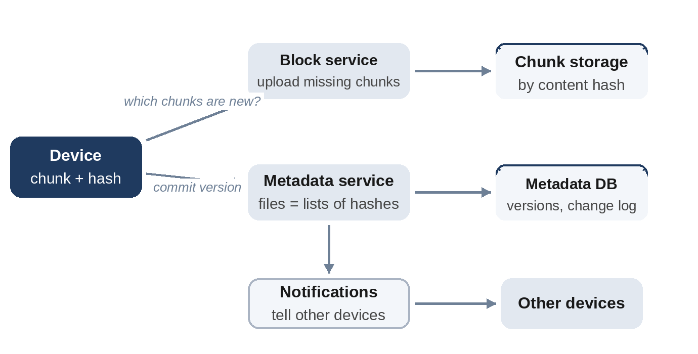

# Chapter 26: File Storage and Sync

**The prompt:** "Design a cloud file storage service that keeps a user's files in sync across devices."

The interesting parts are not storing files, object storage does that well, but **syncing efficiently** (sending only what changed), **deduplicating** content, and handling **conflicts** when the same file is edited on two offline devices.

## Requirements

**Functional:**

1. Upload, download and delete files and folders.
2. Changes on one device appear on the user's other devices automatically.
3. File version history.
4. Sharing with other users (a follow-up).

**Non-functional:**

- 200 million users, about 10 GB each on average.
- Never lose a file.
- Sync quickly, and use little bandwidth for small edits to large files.

## Estimates

Assume deduplication saves 30%, and compare storing three full copies with erasure coding at 1.5 times overhead.

```
@include code/ch26/estimate.demo.txt
```

About 2,000 PB of logical data. The difference between three copies (4,200 PB) and erasure coding (2,100 PB) is around two exabytes of disks: **erasure coding** splits data into fragments plus parity fragments, so it survives the loss of several fragments while storing far less than full copies. It's slower to read and repair, so it suits colder data, while hot data may keep replicas. And about 200 billion metadata rows (one per file) call for a partitioned metadata store.

## High-Level Design



- **Client:** watches the local folder, splits changed files into **chunks**, hashes each chunk, and asks which hashes the server lacks.
- **Block storage:** stores chunks, addressed by their hash (content-addressed), in object storage. Identical chunks are stored once: deduplication for free.
- **Metadata service:** records each file version as an ordered list of chunk hashes, plus name, folder, size and owner. Partitioned by user (or by shared namespace).
- **Notification service:** keeps a connection open to each device (long polling or WebSockets) and tells it when its files change; the device then pulls the new metadata and any missing chunks.

## Deep Dive 1: Chunking

Uploading only changed chunks makes small edits cheap, but it depends on **where chunk boundaries fall**. With fixed-size chunks, inserting one byte near the start of a file shifts every later boundary, so every chunk looks new. **Content-defined chunking** cuts where a rolling hash of the last few bytes matches a pattern, so boundaries are tied to the content, not to positions, and move along with it:

```python
@include code/ch26/d01_chunks.py::cdc_chunks
```

The model inserts one byte near the start of a 1 MB file and counts how many chunks the server doesn't already have:

```
@include code/ch26/d01_chunks.demo.txt
```

Fixed 2 KiB chunks force all 489 chunks to be uploaded again; content-defined chunks need just 1 of 383. The tests check that chunks always reassemble into the original data and stay within the minimum and maximum sizes. Real services use larger chunks (several megabytes) to keep metadata small, but the principle is the same.

## Deep Dive 2: Metadata and Consistency

The metadata store is the source of truth for "what is in my folder". Each change is a new **version** of a file, with a version number used for optimistic concurrency (Chapter 30): a client uploads its change saying "this replaces version 7". If the server is already at version 8, the client is out of date and must resolve a conflict. Metadata changes for a user are also appended to a per-user **change log**, so a device can ask "what changed since cursor X?" and catch up after being offline.

## Deep Dive 3: Conflicts

Two devices edit the same file while offline; both try to upload. The second upload fails its version check. Automatically merging arbitrary files is impossible, so file sync services keep both: the second version is saved as a **conflicted copy** next to the original, and the user decides. For specific formats (documents edited online), real-time collaboration avoids conflicts entirely (Chapter 34).

## Wrap-Up

- **Durability:** chunks in object storage with replication or erasure coding across failure domains; metadata in a replicated database with backups and point-in-time recovery.
- **Bottlenecks:** metadata operations for users with millions of files, and the notification fan-out for widely shared folders.
- **Garbage collection:** chunks referenced by no file version (after deletions and version expiry) are removed by a background job using reference counts.

## Follow-Up Questions

- "Sharing folders between users." Shared folders are their own metadata namespace with an access list; notifications go to every member's devices.
- "Large files over slow connections." Resumable, chunked uploads, in parallel.
- "End-to-end encryption." Encrypt chunks on the client; server-side deduplication then only works within one user's data.

## Key Takeaways

- Store files as lists of content-addressed chunks: deduplication and incremental sync come naturally.
- Content-defined chunking keeps most chunks unchanged after insertions; fixed-size chunking doesn't.
- The metadata service is the source of truth; version numbers detect conflicting updates.
- Keep both versions on conflict, and let the user resolve it.
- Erasure coding saves enormous amounts of storage for colder data.
