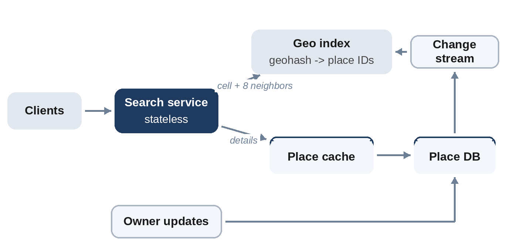

# Chapter 27: Nearby Places

**The prompt:** "Design a service that finds restaurants, shops or other places near a user, such as 'cafes within 2 km'."

The core problem is a **spatial index**: ordinary database indexes sort values in one dimension, but "near" is two-dimensional. The design turns two-dimensional locations into keys that a normal index can search.

## Requirements

**Functional:**

1. Search for places within a radius of a location, optionally filtered by category.
2. Show place details.
3. Business owners add and update places (changes may take minutes to appear).

**Non-functional:**

- 200 million places worldwide; searches return in about 100 ms.
- Read-heavy: searches vastly outnumber updates.

## Estimates

```
@include code/ch27/estimate.demo.txt
```

Place records total about 200 GB, but the **geo index**, a location key and a place ID per place, is under 5 GB. It fits in memory on a single server, and can be replicated across many servers for about 2,000 searches per second, and far more at peak.

## API

```
GET /v1/places/search?lat=51.50&lon=-0.12&radius_km=2&category=cafe&cursor=...
GET /v1/places/{id}
POST /v1/places   (owners)
```

## High-Level Design



Searches go to a stateless **search service**, which queries the **geo index** for candidate place IDs, filters them by exact distance and category, and loads details from a **place cache** backed by the **place database**. Owner updates write to the database; a change stream updates the index within minutes.

## Deep Dive 1: Geohash

A **geohash** (introduced by Gustavo Niemeyer in 2008) encodes a latitude and longitude as a short string. It repeatedly halves the world, alternating between longitude and latitude, and records each choice as a bit; the bits are written in base 32. Each additional character narrows the cell, and nearby points usually share a prefix, so a plain sorted index on geohash strings becomes a spatial index:

```python
@include code/ch27/d01_geohash.py::encode
```

The test checks the implementation against a well-known reference value (57.64911, 10.40744 encodes to `u4pruydqqvj`) and checks the size of a five-character cell: about 4.9 km by 4.9 km at the equator.

To search, find the cell containing the user and its **eight neighbors**, because a nearby place can sit just across a cell boundary, and then filter candidates by exact distance:

```python
@include code/ch27/d01_geohash.py::precision_for,nearby
```

```
@include code/ch27/d01_geohash.examples.txt
```

## A Bug the Tests Found

The first version of `nearby` always used five-character cells, "about 4.9 km wide", for any radius up to 4.9 km. The random tests, which compare the search with a brute-force distance check, failed at latitude 59: a 3 km search missed a place. The reason is geometric: lines of longitude converge toward the poles, so a cell's **width shrinks by a factor of cos(latitude)**. At latitude 59, a "4.9 km" cell is only about 2.5 km wide, so the eight neighbors don't cover a 3 km radius.

The fix, `precision_for`, chooses the finest precision whose cells are at least as tall and as wide as the radius at that latitude. It's a good example of why tests against a simple, obviously correct version are worth having, and of an edge case worth mentioning in an interview: geohash cells are not squares everywhere.

## Deep Dive 2: Alternatives

- **Quadtrees:** recursively split regions with too many places into four. Adapts to density, so dense cities get small cells and oceans large ones. Usually kept in memory.
- **S2 and H3 cell systems:** project the Earth onto a cube (S2) or a hexagonal grid (H3) to get more uniform cells and better neighbor handling.
- **Database support:** many databases provide spatial indexes (R-trees), which are enough for moderate scale.

In an interview, geohash is the easiest to explain; mention quadtrees or S2 as ways to handle uneven density.

## Wrap-Up

- **Dense areas:** a cell in central Tokyo may hold thousands of places; return the closest and best rated, and paginate.
- **Ranking:** combine distance with rating, popularity and whether the place is open now.
- **Updates:** places change rarely; asynchronous index updates within minutes are fine.

## Follow-Up Questions

- "Search along a route." Cover the route with cells and query them.
- "Very large radius." Use coarser cells, and rank by quality rather than listing everything.
- "Show places on a moving map." Query by the visible bounding box, cache tiles of results.

## Key Takeaways

- Convert two-dimensional locations into one-dimensional keys (geohash, S2, H3) that ordinary indexes can search.
- Search the user's cell and its eight neighbors, then filter by exact distance.
- Choose cell size from the radius and the latitude; cells narrow toward the poles.
- The geo index is small: keep it in memory and replicate it.
