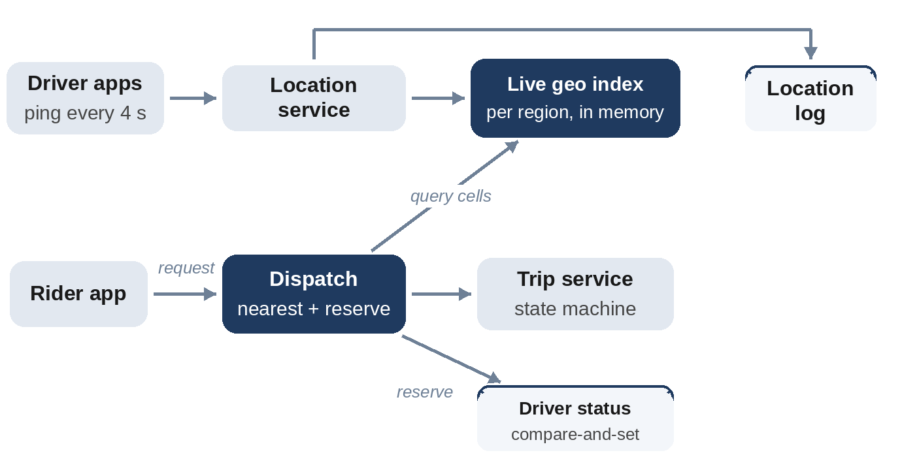

# Chapter 28: Ride Matching

**The prompt:** "Design the system that matches riders with nearby drivers in a ride-hailing app."

Compared with nearby places, everything moves: millions of drivers report their positions every few seconds, and a match must be made in about a second, without giving the same driver to two riders.

## Requirements

**Functional:**

1. Drivers send their location every few seconds while online.
2. A rider requests a ride; the system finds a nearby available driver and offers the trip.
3. The rider sees the driver approach in real time.

**Non-functional:**

- 5 million drivers online at peak; tens of thousands of ride requests per second at peak.
- A match within a second or two.
- A driver is never assigned to two rides at once.

## Estimates

```
@include code/ch28/estimate.demo.txt
```

- **1.25 million location updates per second**, but tiny: about 125 MB per second in total.
- The **live index** of driver positions is only about 500 MB: it fits in memory, so the challenge is the update rate, not the size. Partition by city or region.
- Location history for analytics is written to a log, not to the live index.

## High-Level Design



- **Location service:** receives pings, updates the **in-memory geo index** for that region, and appends the ping to a log for history and analytics.
- **Dispatch service:** for each ride request, queries the index for nearby available drivers, ranks them (by estimated time to pick up, not straight-line distance), **reserves** one atomically, and sends the offer.
- **Trip service:** stores the trip and its state machine (requested, accepted, arrived, in progress, completed), and streams the driver's position to the rider.

## Deep Dive 1: The Live Index

Drivers move constantly, so the index must handle many more updates than queries. A simple grid works well: divide the map into cells of about 1 km and keep a set of drivers per cell. An update moves a driver between cells only when they cross a boundary. A query searches rings of cells outward from the rider and stops as soon as no unsearched cell could contain a closer driver:

```python
@include code/ch28/d01_matching.py::Dispatcher
```

```
@include code/ch28/d01_matching.examples.txt
```

The first request gets d2, the closest; the second gets d1, because d2 is no longer available; the third finds no one. The test compares the grid search with a brute force that checks every driver, over thousands of random driver and rider positions.

**Interesting Fact:** Uber built, and in 2018 open-sourced, H3: a geospatial index that divides the world into hexagons instead of geohash's rectangles. All six neighbors of a hexagon are the same distance from its center, while a square's corner neighbors are farther away than its edge neighbors, which makes "nearby" calculations more even. Uber uses H3 for analysis, pricing and dispatch.

## Deep Dive 2: Never Double-Book a Driver

Two dispatch servers may pick the same driver for two riders at the same moment. The reservation must be **atomic**: a compare-and-set on the driver's status from "available" to "offered to trip T" in the store that owns that driver (Chapter 17 shows why). If the set fails, try the next candidate. If the driver declines or doesn't respond within a few seconds, release them and offer the trip to the next driver.

Partitioning by region makes this simpler: all drivers in a city are owned by one partition, so the reservation is a local operation.

## Deep Dive 3: Matching Quality

Nearest by straight line isn't the best match. Real dispatch estimates **arrival time** using road networks and traffic, and may batch requests for a second or two to make better assignments overall: matching two riders and two drivers jointly can beat matching each greedily. Mention this as an improvement after the basic design works.

## Wrap-Up

- **Hot spots:** stadiums and airports concentrate requests and drivers; split hot cells finely.
- **Failure:** if a location server dies, drivers' next pings (within seconds) rebuild its part of the index on a replacement; positions are soft state.
- **Surge pricing:** compute supply and demand per cell in a stream processor, separate from the matching path.

## Follow-Up Questions

- "Shared rides." Match a request to drivers whose existing route can absorb it with little detour.
- "Show nearby cars before requesting." Query the index for a few drivers' approximate positions; cache per cell for a second or two.
- "Prevent location spoofing." Detect impossible jumps and cross-check with other signals.

## Key Takeaways

- The live driver index is small but updated constantly; keep it in memory, partitioned by region.
- Use a grid or geohash cells and search outward until no closer driver is possible.
- Reserve drivers atomically so concurrent dispatchers can't double-book them.
- Treat locations as soft state that the next pings rebuild after failures.
