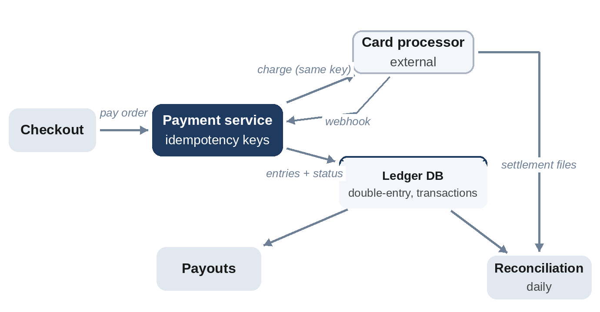

# Chapter 29: Payment System

**The prompt:** "Design the payment system for an online marketplace: customers pay, the marketplace keeps a fee, sellers are paid out."

Payment systems are where "eventually consistent" and "at least once" stop being acceptable on their own. The design is shaped by one rule: **never lose money and never move it twice**, even when every network call can fail halfway.

## Requirements

**Functional:**

1. Charge a customer's payment method for an order, through an external payment processor.
2. Record money owed to sellers and the marketplace's fee.
3. Pay sellers out periodically.
4. Refunds.

**Non-functional:**

- About 50 million payments a day, with holiday peaks of ten times the average.
- Correctness over speed: no double charges, no lost payments, a complete audit trail.
- Reconcile every day against the processor's and the bank's records.

## Estimates

```
@include code/ch29/estimate.demo.txt
```

Hundreds to thousands of payments per second: not an extreme rate. The difficulty is correctness, not throughput. Seven years of ledger history (a common retention requirement) is about 50 TB.

## High-Level Design



1. The checkout service calls the **payment service** with an order ID and an **idempotency key**.
2. The payment service records a **payment intent** (status "pending") and calls the external **processor** with the same key.
3. On success, it writes **ledger entries** and marks the payment "succeeded", in one database transaction.
4. The processor also sends **webhooks** to confirm outcomes, and a daily **reconciliation** job compares the ledger with the processor's settlement files.
5. A **payout service** periodically transfers seller balances to their bank accounts.

## Deep Dive 1: Idempotency

The most dangerous moment is a timeout: the processor may have charged the card even though no response arrived. Retrying blindly could charge twice; giving up could lose a valid payment. The answer is idempotency at every step:

- The client sends an idempotency key with each logical payment; retries reuse it.
- The payment service stores the key with the result, and returns the stored result for any repeat.
- The processor call uses the same key, so the processor also refuses to charge twice.

```python
@include code/ch29/d01_ledger.py::Ledger
```

```
@include code/ch29/d01_ledger.examples.txt
```

Ana tops up 50.00, then pays 30.00. The client's retry with key `k2` returns the original result without moving money again. A genuinely new payment with key `k3` is rejected, because only 20.00 is left. Amounts are stored in **integer cents**, never floating point, which can't represent most decimal amounts exactly.

## Deep Dive 2: Double-Entry Bookkeeping

Each transfer writes **two entries that sum to zero**: money leaves one account and enters another. Balances are never updated in place; they are sums of entries, so the ledger is an append-only, auditable history. For a sale of 100.00 with a 10% fee, the entries move 100.00 from the customer's payment account to an escrow account, then 90.00 to the seller and 10.00 to the marketplace's revenue.

The test performs 2,000 random transfers, many of them retries of the same keys, and checks the invariants: all entries sum to zero (money is conserved), no customer balance goes negative, and every transfer has exactly two entries.

## Deep Dive 3: Reconciliation and Failure Recovery

Even with idempotency, systems drift: a webhook is lost, a crash happens between the processor call and the ledger write. Two safety nets:

- **A recovery job** finds payments stuck in "pending" and asks the processor for their real status, using the idempotency key.
- **Daily reconciliation** compares every ledger entry with the processor's and bank's records; any mismatch creates an alert and a manual review case.

Assume something will go wrong, and design so it's detected and corrected, not silently accumulated.

## Wrap-Up

- **Database:** a relational database with transactions, replicated synchronously within a region. Partition by account if needed, keeping both entries of a transfer in one transaction.
- **Security and compliance:** never store raw card numbers; use the processor's tokens, which keeps most of the system out of the scope of card-industry security standards. Encrypt sensitive data and audit access.
- **Asynchronous parts:** payouts, receipts and analytics are driven by events from the ledger (with the outbox pattern of Chapter 10).

## Follow-Up Questions

- "Multiple currencies." Store currency per entry; convert through explicit exchange entries with recorded rates.
- "Partial refunds." New transfers in the opposite direction, linked to the original payment.
- "Fraud checks." A risk-scoring step before charging, with its own latency budget and a decision to fail open or closed.

## Key Takeaways

- Every operation that moves money is idempotent, end to end, with the same key.
- Use double-entry bookkeeping: append-only entries that sum to zero, with balances computed from entries.
- Store money as integer minor units, never floating point.
- Recover stuck payments by asking the processor, and reconcile daily against external records.
