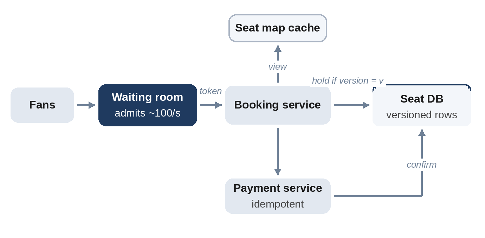

# Chapter 30: Ticket Booking

**The prompt:** "Design a ticket booking system for concerts, where a popular event sells out in minutes."

The design must handle an extreme spike, many thousands of buyers per seat, while guaranteeing that no seat is ever sold twice, and while being reasonably fair to the people waiting.

## Requirements

**Functional:**

1. Browse events and see available seats.
2. Select seats, which are held for a few minutes while the buyer pays.
3. Pay to confirm; unpaid holds expire and the seats become available again.

**Non-functional:**

- A popular event: 60,000 seats and 3 million fans arriving within minutes.
- **No double booking**, ever.
- Fairness: roughly first come, first served.
- The rest of the site stays up during the rush.

## Estimates

```
@include code/ch30/estimate.demo.txt
```

Five thousand new arrivals per second, 50 buyers per seat. Letting everyone hit the seat database at once would overload it, and most would fail anyway. The numbers point to a **virtual waiting room** that admits buyers at a controlled rate, about 100 per second here, which still sells the event in about half an hour.

## API

```
GET  /v1/events/{id}/seats            returns availability (cached, may be slightly stale)
POST /v1/events/{id}/holds  {seats}   returns {hold_id, expires_at} or 409
POST /v1/holds/{id}/purchase  {payment_token, idempotency_key}
```

## High-Level Design



- **Waiting room:** users join a queue and receive a token when admitted; only token holders can reach the booking pages.
- **Booking service:** holds and confirms seats in the **seat database**, using conditional updates.
- **Seat map cache:** serves availability views, refreshed every second or so; it may be slightly stale, but the hold itself is always checked against the database.
- **Payment service:** charges with idempotency (Chapter 29); success confirms the hold.

## Deep Dive 1: Holding Seats Safely

Two buyers click the same seat at the same moment. Both read "free", and both try to hold it. Only one may succeed. Two standard approaches:

- **Pessimistic locking:** lock the seat row while checking and updating it. Correct, but locks are held across network calls and can pile up under heavy contention.
- **Optimistic concurrency control:** each seat row has a **version number**. A hold succeeds only if the version hasn't changed since the seat was read; otherwise the buyer is told the seat was taken. In SQL, that's `UPDATE seats SET state = 'held', ..., version = version + 1 WHERE id = ? AND version = ?`, followed by a check of how many rows were updated.

```python
@include code/ch30/d01_booking.py::Seats
```

Expired holds are treated as free at read time, so no background job is needed to release them, though one can tidy up. The test runs 50 random races of 30 users holding and buying 5 seats and checks that no seat is ever sold twice, and checks directly that when two users read the same free seat, only the first write wins.

## Deep Dive 2: The Waiting Room

The waiting room protects everything behind it:

- Users arriving before the sale starts get a **random position**, which is fairer than rewarding the fastest connection; later arrivals join the end.
- The queue admits users at a rate the booking path can handle, and adjusts it as holds expire or seats sell out.
- Admission tokens are signed and short-lived, so they can't be shared or forged.
- The waiting room itself is mostly static content served from a CDN, so it can absorb millions of visitors cheaply.

## Deep Dive 3: Bots and Abuse

Popular events attract scalpers' bots. Defenses: per-account purchase limits, verified accounts or presale codes for high-demand events, rate limiting and bot detection at the edge, and holds that require a logged-in session.

## Wrap-Up

- **Hot rows:** contention on one event's seats is inherent; keep each hold a single, fast conditional update, and partition by event.
- **General admission** (no assigned seats) is simpler: a counter decremented with a conditional update, or tickets pre-split into buckets to spread contention.
- **Failure:** if payment fails after the hold, the hold simply expires; if payment succeeds but confirmation fails, the idempotency key lets the confirmation be retried safely.

## Follow-Up Questions

- "Let users pick the best available seats automatically." Search free seats by section and price, then attempt holds on the top candidates.
- "Show live seat availability." Push updates over SSE from the seat cache, at most once a second per event.
- "Resale marketplace." A transfer of ownership with the same version checks and idempotent payments.

## Key Takeaways

- Protect the booking path with a waiting room that admits users at a sustainable rate.
- Hold seats with conditional updates (optimistic concurrency) so concurrent buyers can't both win.
- Let holds expire by time; treat expired holds as free when reading.
- Serve availability from a cache, but always check the database when holding.
