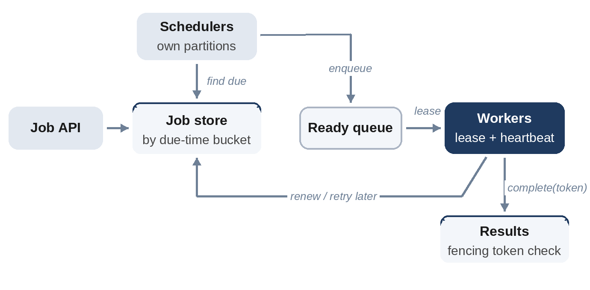

# Chapter 32: Distributed Job Scheduler

**The prompt:** "Design a service that runs scheduled and delayed jobs, such as 'send this reminder at 9:00' or 'run this report every night', reliably across a fleet of workers."

The challenge is reliability: jobs must run at about the right time, at least once, even when workers crash mid-job, and ideally never twice at the same time.

## Requirements

**Functional:**

1. Submit one-off jobs at a time, delayed jobs, and recurring jobs (cron-style schedules).
2. Workers execute jobs; results and failures are recorded.
3. Retries with backoff for failed jobs.

**Non-functional:**

- About a billion job executions a day, with spikes when many jobs are due at the same moment (on the hour).
- Jobs start within a few seconds of their due time.
- Every job runs at least once; jobs should be idempotent so a rare second run is harmless.

## Estimates

```
@include code/ch32/estimate.demo.txt
```

The average rate is modest, about 12,000 jobs per second, but schedules cluster: twenty times that at the top of the hour is common, because people schedule "every hour" on the hour. Spreading recurring jobs across a few minutes with jitter, when the schedule allows it, reduces the spike.

## High-Level Design



1. **Job store:** each job with its next run time, partitioned so that "jobs due in this minute" is a cheap query, for example by time bucket and a hash.
2. **Schedulers:** each owns some partitions, and every second moves due jobs into a **ready queue**. Recurring jobs get their next run time computed and stored.
3. **Workers:** take jobs from the queue under a **lease**, run them, heartbeat while running, and report completion.

## Deep Dive 1: Leases, Heartbeats and Crashes

If a worker takes a job and crashes, the job must not be lost. So a worker doesn't simply take a job; it **leases** it for a period, say 10 seconds, and renews the lease with **heartbeats** while running. If the heartbeats stop, the lease expires and another worker can take the job.

There's a subtle danger: a worker that pauses (a long garbage-collection pause, a network hiccup) may lose its lease, wake up, and finish the job after a new worker has started it. Its late result could overwrite the new one. The fix is a **fencing token**: each lease gets an increasing number, and completion is accepted only with the current token.

```python
@include code/ch32/d01_leases.py::Scheduler
```

The simulation runs 20 jobs on 4 workers that randomly crash, pause without heartbeating, and resume. Across 40 random runs, the test checks that every job finishes, despite crashes and expired leases; stale completions from workers that lost their lease are rejected by the token check.

## Deep Dive 2: Exactly Once Is Not Free

Leases give **at least once** execution: a job can run twice when a lease expires while the original worker is still working. Fencing tokens stop the *stale result* from being recorded, but they can't undo side effects the old worker already performed, such as sending an email. So jobs must be **idempotent**: use the job ID as an idempotency key for external effects (Chapter 4), and design steps that are safe to repeat.

## Deep Dive 3: Scheduling Accuracy and Scale

- **Time buckets:** store jobs by due minute; a scheduler reads the current bucket, which keeps "find due jobs" fast even with billions of future jobs.
- **Partitioning schedulers:** assign partitions to scheduler instances with leases too, so a crashed scheduler's partitions are taken over.
- **Priorities and isolation:** separate queues for latency-sensitive jobs and big batch jobs, so a nightly report flood can't delay a 9:00 reminder.
- **Retries:** failed jobs return to the store with a later run time (exponential backoff), and move to a dead-letter state after a maximum number of attempts.

## Wrap-Up

- **Clock dependence:** schedulers depend on time; keep clocks synchronized and tolerate small skew.
- **Observability:** queue depth, scheduling delay (due time vs. start time), failure rate per job type.
- **Very long jobs:** split into steps with checkpoints, so a crash doesn't restart hours of work.

## Follow-Up Questions

- "Jobs with dependencies" (run B after A). A workflow engine: store the dependency graph and schedule each job when its inputs are complete (topological order).
- "Run a job on exactly one machine at a time." Leases plus fencing tokens, as above; for strict guarantees, a lock service built on consensus.
- "Pause and cancel jobs." State changes in the job store, checked by workers at heartbeat time.

## Key Takeaways

- Store jobs by due time, move due jobs to a ready queue, and let workers lease them.
- Leases with heartbeats recover jobs from crashed workers; fencing tokens reject stale results.
- Execution is at least once; make jobs idempotent.
- Isolate priorities, and spread recurring jobs away from the top of the hour.
