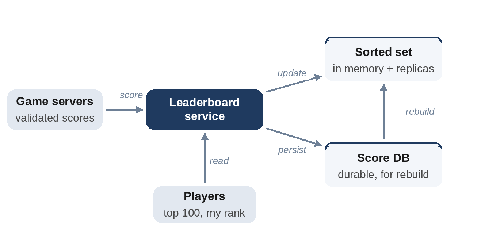

# Chapter 33: Real-Time Leaderboard

**The prompt:** "Design a leaderboard for an online game with millions of players: show the top 100 and each player's own rank, updated in real time."

The top 100 is easy; **"what is my rank among 50 million players?"** is the interesting part, because a database query that counts everyone with a higher score is far too slow to run on every request.

## Requirements

**Functional:**

1. Update a player's score after each game.
2. Show the top N players.
3. Show any player's rank, and the players just above and below them.
4. Leaderboards per season (and optionally per region or among friends).

**Non-functional:**

- 50 million players; about 100,000 score updates and 300,000 rank reads per second at peak.
- Ranks visible within a second or so of a game ending.

## Estimates

```
@include code/ch33/estimate.demo.txt
```

A sorted set holding every player needs only about 5 GB, so the whole leaderboard fits in memory on one machine; the challenge is the operation rate and availability, not size.

## High-Level Design



Game servers report results to the **leaderboard service**, which updates an **in-memory sorted structure** and writes the score durably to a **database** for recovery and history. Reads of the top N, a player's rank and their neighbors are served from memory, with read replicas for scale.

## Deep Dive 1: Data Structures for Rank

- **A database with an index on score:** `SELECT COUNT(*) WHERE score > ?` scans a large part of the index for low-ranked players. Too slow at this scale.
- **A sorted set** (a skip list or balanced tree that tracks subtree sizes, as Redis's sorted sets do): updates, top-N and rank queries all in O(log n). The standard answer.
- **Counting by score:** when scores are bounded integers, such as 0 to 1,000,000 points, keep a **count of players per score** in a Fenwick tree (a binary indexed tree). A player's rank is one plus the number of players with a higher score, a prefix sum in O(log max_score), whatever the number of players.

```python
@include code/ch33/d01_leaderboard.py::Leaderboard
```

```
@include code/ch33/d01_leaderboard.examples.txt
```

Ana's score improves from 50 to 80, so she's first; Ben with 70 is second; Cy with 50 is third. The test compares ranks with a brute-force count on thousands of random update sequences. The Fenwick tree for a million possible scores is only 8 MB, whatever the number of players.

## Deep Dive 2: Ties and Ordering

Players with equal scores need a rule: same rank for everyone with that score (as above), or a tie-breaker such as "who reached the score first". To encode a tie-breaker in a sorted set, combine score and time into one sortable key, for example score × 10¹⁰ minus the timestamp, so that among equal scores the earlier one ranks higher.

## Deep Dive 3: Scaling Beyond One Machine

If one machine can't handle the update rate:

- **Partition by score range:** each shard holds a range of scores and knows the count of players in all higher ranges, so rank = higher-range count + rank within the shard. Shards for crowded score ranges must be split finer.
- **Approximate ranks** for players far down the board: "top 37%" is often enough, computed from a histogram of scores, which is cheap to maintain.
- **Batch updates:** apply score updates in small batches every few hundred milliseconds instead of one by one.

## Wrap-Up

- **Recovery:** rebuild the in-memory structure from the database on restart; replicas take over meanwhile.
- **Seasons:** a new leaderboard key per season; archive old ones.
- **Friends leaderboards:** small sets, so compute them on demand from friends' scores rather than maintaining a separate structure.
- **Cheating:** validate scores on game servers, never trust clients.

## Follow-Up Questions

- "Show the players just above and below me." In a sorted set, fetch by rank range around the player's rank.
- "Daily, weekly and all-time boards." Separate structures, each updated on every game; expire daily boards.
- "Global board across regions." Regional boards plus a merged global top N, updated every few seconds.

## Key Takeaways

- Counting higher scores in a database is too slow at scale; keep a sorted structure in memory.
- Sorted sets give O(log n) updates and ranks; with bounded scores, a Fenwick tree of counts per score is even smaller.
- Decide on a tie rule and encode it in the sort key.
- Persist scores durably and rebuild memory from them after failures.
