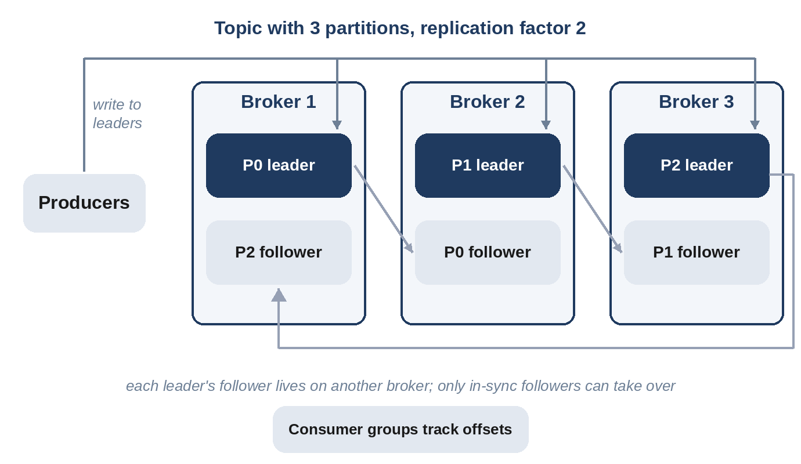

# Chapter 35: Distributed Message Queue

**The prompt:** "Design a distributed message queue: producers publish messages to topics, consumers read them, at very high throughput and without losing data."

This design turns Chapter 10 inside out: instead of using a queue, you build one. The model is a **partitioned, replicated, append-only log**, the architecture popularized by Kafka.

## Requirements

**Functional:**

1. Producers publish messages to named **topics**.
2. Consumers subscribe in **consumer groups**: each message is processed by one consumer per group, and different groups each see every message.
3. Messages with the same key are delivered in order.
4. Messages are retained for a configurable time (days), so consumers can replay.

**Non-functional:**

- Millions of messages per second; low latency (milliseconds).
- Durable: acknowledged messages survive machine failures.
- Horizontally scalable.

## Estimates

```
@include code/ch35/estimate.demo.txt
```

About 2 GB per second at peak, and over a petabyte retained for a week with three replicas. Per-partition throughput of about 10 MB per second suggests a couple of hundred partitions for the largest topics.

## High-Level Design



- A **topic** is split into **partitions**; each partition is an append-only log of messages numbered by **offset**.
- **Brokers** store partitions on disk. Each partition has a **leader** broker and **follower** replicas on other brokers.
- **Producers** send a message to the leader of its partition, chosen by hashing the message key.
- **Consumer groups** divide a topic's partitions among their members, and record a committed offset per partition.
- A **controller**, backed by a consensus system, tracks brokers, partition leaders and group membership.

## Deep Dive 1: Partitions, Keys and Offsets

```python
@include code/ch35/d01_log.py::Log
```

Hashing the key picks the partition, so all messages for one key stay in order. Consumers poll from their committed offset and commit after processing. If a consumer crashes after processing a batch but before committing, the group re-reads from the last commit:

```
@include code/ch35/d01_log.demo.txt
```

Twelve events produced 15 deliveries: a batch of three was processed, the consumer crashed before committing, and the batch was delivered again. That's **at-least-once** delivery, the normal guarantee; consumers deduplicate or make processing idempotent (Chapter 10). The test checks the full set of properties on 60 messages: without crashes, every message is delivered exactly once; per-key order is preserved; a second pass delivers nothing new; and after a crash, every message is still delivered, some more than once.

## Deep Dive 2: Durability and Replication

A message is **acknowledged** to the producer once it's written to the leader and replicated to enough followers. The set of followers that are fully caught up is the **in-sync replica set**; the producer can require acknowledgement from all of them. If the leader fails, the controller promotes an in-sync follower, so no acknowledged message is lost. Trade-off: waiting for followers adds latency; acknowledging after the leader alone is faster but can lose recent messages on failover.

## Deep Dive 3: Why It's Fast

- **Sequential disk I/O:** appending to a log and reading it in order is fast even on spinning disks, and very fast on SSDs.
- **Batching and compression:** producers send batches, compressed; brokers write and replicate whole batches.
- **The operating system's page cache** serves recent messages from memory, and data can go from disk to network without being copied through the application.
- **Partitions** spread load across brokers and allow consumers to work in parallel.

## Wrap-Up

- **Rebalancing:** when consumers join or leave a group, partitions are reassigned; consumers resume from committed offsets.
- **Retention:** delete old log segments by time or size, or **compact** them, keeping only the latest message per key (useful for change streams).
- **Ordering limits:** order is per partition; adding partitions later changes which partition a key maps to, so plan partition counts ahead.
- **Exactly-once processing:** combine idempotent producers (deduplicating retries by producer sequence numbers) with transactional writes of results and offsets.

## Follow-Up Questions

- "Delayed messages." A separate delay topic or a timer wheel that republishes messages when due.
- "Very slow consumers." Lag monitoring and alerts; longer retention; separate consumer groups for slow analytics.
- "Multi-region." Replicate topics asynchronously between regions, accepting that consumers in the second region see messages slightly later.

## Key Takeaways

- A partitioned, replicated, append-only log provides high throughput, ordering per key, retention and replay.
- Consumers track offsets per partition; committing after processing gives at-least-once delivery.
- Acknowledge writes after in-sync replicas have them, and promote only in-sync followers.
- Speed comes from sequential I/O, batching, compression and partition parallelism.
