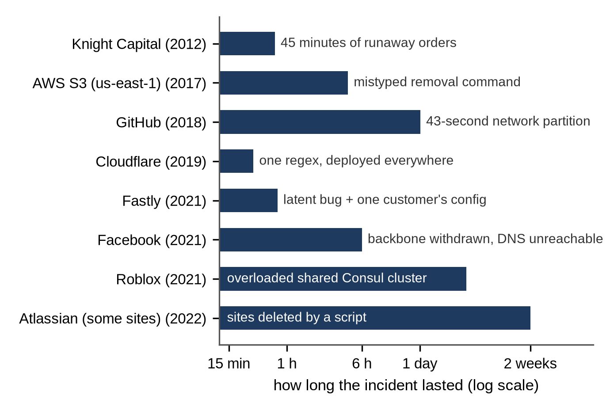
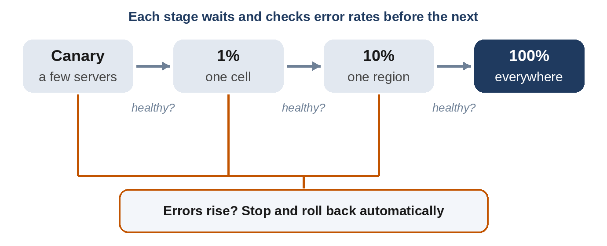

# Chapter 37: Lessons From Real Outages

Every pattern in this book exists because something, somewhere, broke. The best way to make that real is to read what happened when it did. Many large companies publish detailed, blameless postmortems after major incidents: what failed, why it spread, and what they changed. They are some of the most valuable free engineering material there is, and they make excellent interview stories.

This chapter retells eight well-documented incidents in plain words, each with the design lesson it teaches and how to use that lesson in an interview. Every fact comes from the company's own postmortem or official statement, listed at the end of the chapter. None of this is about blaming the people involved: in each case, a reasonable person did a reasonable thing, and the system let a small mistake become a big outage. That is exactly the kind of system your interviewer wants you not to design.

## AWS S3, 2017: One Mistyped Input

**What happened.** On February 28, 2017, an S3 engineer in the us-east-1 region was debugging a slow billing system. Following an established playbook, they ran a command to remove a few servers. One input was entered incorrectly, and a much larger set of servers was removed, including servers for two subsystems that every S3 request in the region depended on: the index (which knows where every object lives) and placement (which decides where new objects go). Both had to be restarted, which hadn't been done at that scale for years and took hours. Many websites and other AWS services that relied on S3 in that region failed with it.

**What changed.** AWS changed the tool to remove capacity more slowly and to refuse any removal that would take a subsystem below its minimum required capacity, and audited other tools for similar checks.

**The lesson.** Operational tools are part of your system. Limit the **blast radius** of any single action: rate-limit destructive operations, check invariants ("never fewer than N healthy servers") in the tool itself, and practice restarting core components, so recovery isn't a first-time experience during an outage.

**In your interview:** when you discuss deployment or operations in the wrap-up, mention guardrails: "Capacity changes go through a tool that refuses to drop below the minimum, and they roll out gradually."

## GitHub, 2018: 43 Seconds, 24 Hours

**What happened.** On October 21, 2018, routine maintenance to replace failing network equipment cut the connection between GitHub's US East Coast network hub and its primary East Coast data center for 43 seconds. GitHub's automated MySQL failover tool saw the primary as unreachable and promoted databases in the West Coast data center. During those seconds, the East Coast had accepted writes that never reached the West. When the network returned, the two sides had **diverged**: each held writes the other didn't. Serving traffic from the West Coast across the country also added latency that the applications weren't built for.

GitHub chose data integrity over speed: rather than discard the East Coast writes, they restored and reconciled carefully. The site was degraded for 24 hours and 11 minutes, webhooks and Pages builds were delayed, and some writes needed manual reconciliation.

**The lesson.** This is CAP (Chapter 8) in real life. Automated failover is a consistency decision: promoting a new leader while the old one may still accept writes risks split brain. Leader election needs a quorum and fencing (Chapter 32), and failing over across regions changes latency for everything.

**In your interview:** when you propose automatic failover, say what happens to in-flight writes and how a stale leader is fenced off. That one sentence separates senior answers from the rest.

## Facebook, 2021: Locked Out From the Inside

**What happened.** On October 4, 2021, during routine maintenance, a command meant to assess the capacity of Facebook's global backbone network accidentally took down every connection in the backbone. An audit tool that should have blocked the command had a bug. With the backbone gone, Facebook's DNS servers, designed to stop advertising themselves when they can't reach the data centers, withdrew their routes from the internet. Facebook, Instagram and WhatsApp vanished from the internet for about six hours.

Recovery was slow for a reason worth remembering: the same outage took down the internal tools engineers would normally use to fix it. Engineers had to go to the data centers in person, and, as Facebook's post explains, those facilities are deliberately hard to get into, so activating the secure access procedures took extra time. Even then, turning everything back on at once risked a new crash from the surge of returning traffic, so services were brought back gradually.

**The lesson.** Keep an **out-of-band** path for operations that doesn't depend on the system being repaired, and plan **recovery** (cold starts, traffic ramps) as carefully as normal operation.

**In your interview:** "What if the whole region goes down?" is a common follow-up. Mention how operators reach the system when it's down, and that you'd ramp traffic back gradually rather than all at once.

## Cloudflare 2019 and Fastly 2021: One Change, Everywhere at Once

**What happened at Cloudflare.** On July 2, 2019, Cloudflare deployed a new firewall rule. It contained a regular expression that backtracked excessively on some inputs, and it pushed CPU usage to 100% on Cloudflare's machines around the world. Because firewall rule changes were deployed globally at once, there was no small group of servers to show the problem first. The outage lasted about 27 minutes.

**What happened at Fastly.** On May 12, 2021, Fastly deployed software containing a latent bug that only certain customer configurations could trigger. On June 8, one customer pushed a perfectly valid configuration change that did. Within minutes, 85% of Fastly's network was returning errors, taking many large news and commerce sites down with it. Fastly detected the problem within a minute and had 95% of the network back to normal within 49 minutes.

**The lesson.** Configuration is code: it can break production as easily as a binary can. Roll out any change, code or config, in **stages**, watching error rates at each step, with automatic rollback. The July 2024 CrowdStrike incident, in which a faulty configuration update crashed about 8.5 million Windows computers within hours, is the same lesson at a different scale.

**In your interview:** in a configuration service, feature-flag system or any design with a "push" path (Mock 4 in Chapter 36), describe staged rollout and automatic rollback.

## Knight Capital, 2012: The Server That Didn't Get the Update

**What happened.** Knight Capital, a large US trading firm, prepared new order-routing code for a new stock exchange program. Its rollout reused a flag that had once enabled an old, unused feature. The new code reached seven of eight servers; the eighth still had the old code, for which the flag meant something completely different. When the market opened on August 1, 2012, that server began sending orders it never recorded as complete. In about 45 minutes, Knight's router sent more than 4 million orders while trying to fill 212 customer orders, and the firm lost more than $460 million. Before the market opened, the system had sent 97 automated emails flagging an error; they weren't designed as alerts, and nobody acted on them.

**The lesson.** Deployments must be **verified**, not assumed: check that every server runs the expected version. Don't reuse flags or identifiers with old meanings. And an alert that isn't routed to a person who is expected to act is not an alert (Chapter 15).

**In your interview:** for any money-moving design (Chapter 29), mention kill switches and limits: "If outgoing payment volume exceeds three times normal, the system pauses and pages someone."

## GitLab, 2017: Backups You've Never Restored

**What happened.** On January 31, 2017, GitLab.com's database was under heavy load from spam, and replication to the secondary database fell behind. While working late to rebuild replication, an engineer ran a command to remove a data directory, intending to run it on the secondary, but it ran on the primary.

When the team turned to its backups, they found that several backup and replication methods weren't working as expected. They restored from a copy about six hours old: database changes from that window, about 5,000 projects, 5,000 comments and 700 new user accounts, were lost. Git repositories themselves weren't affected. GitLab live-streamed parts of the recovery and published a detailed, blameless postmortem.

**The lesson.** A backup you have never restored is a hope, not a backup. Test restores regularly, monitor backup jobs, and make dangerous commands hard to run in the wrong place.

**In your interview:** when discussing durability, distinguish **replication** (protects against machine failure, but copies mistakes instantly) from **backups and point-in-time recovery** (protect against mistakes).

## Roblox, 2021: When Monitoring Shares the System's Fate

**What happened.** From October 28 to 31, 2021, Roblox was down for 73 hours. Its infrastructure relied on a single Consul cluster for service discovery and coordination. A newly enabled Consul streaming feature caused heavy contention under load, and a performance problem in BoltDB, the database Consul uses for its logs, made things worse. Because Roblox's own monitoring also depended on that Consul cluster, engineers lost much of their visibility exactly when they needed it. Restoring service also meant carefully warming caches and letting players back in gradually.

**The lesson.** Avoid single shared dependencies for everything, and never let monitoring depend on the system it monitors. Roll out new features of critical infrastructure gradually, like any other change.

**In your interview:** in a metrics and alerting design (Chapter 31), say that the alerting path should be independent of the systems it watches, ideally running in a different failure domain.

## Atlassian, 2022: Delete Is Easy, Restore Is Hard

**What happened.** On April 5, 2022, Atlassian ran a script to delete data for a retired app. The script was given the wrong IDs: identifiers for customers' entire sites instead of the app, and it didn't check what the IDs referred to. In 23 minutes it deleted 883 sites belonging to 775 customers. Backups existed, and no customer lost more than five minutes of data, but restoring hundreds of individual sites into a shared multi-tenant system, without disturbing other customers, was slow and complex: some customers waited up to 14 days.

**The lesson.** Make destructive operations safe by design: **soft delete** first (mark as deleted, purge later), validate inputs against what they refer to, and build and rehearse restoring a **single customer**, not just the whole system.

**In your interview:** in any multi-tenant design, mention per-tenant backup and restore, and soft deletes with a grace period.

## Patterns Across the Stories

| Pattern | Seen in | Design defense |
| --- | --- | --- |
| One action with a huge blast radius | AWS S3, Atlassian, Facebook | Guardrails in tools; rate-limited and validated destructive actions; soft deletes |
| Global change all at once | Cloudflare, Fastly, CrowdStrike | Staged rollout with health checks and automatic rollback |
| Failover that breaks consistency | GitHub | Quorum-based election, fencing, explicit handling of in-flight writes |
| Recovery tools inside the failure | Facebook, Roblox | Out-of-band access; independent monitoring; rehearsed cold starts |
| Untested recovery paths | GitLab, Atlassian | Regular restore drills, including restoring one customer |
| Inconsistent deployments | Knight Capital | Version checks on every server; no reused flags; real alerts and kill switches |

Notice that almost none of these began with a hardware failure. Most began with a routine change, a valid configuration, or a command run by a careful person. Large systems fail at their seams: between tools and the systems they manage, between one region and another, between a deployment and the servers it missed.

**Interviewer's View:** Mentioning a real incident briefly, in one sentence, when it fits ("this is why I'd stage config pushes; a single global push is how several CDN outages happened") shows that you think about production, not just diagrams. Don't over-tell the story, and don't claim inside knowledge of any company's systems beyond what its postmortem says.

**Try It:** Pick a service you use every day, and find its public status page or engineering blog. Read one postmortem and write down the trigger, why it spread, and what changed. Do this once a week, and in a month you'll have a library of real stories for your wrap-ups.

## Key Takeaways

- Most major outages start with a routine change, not a hardware failure; limit the blast radius of every change and every tool.
- Roll out code and configuration in stages with automatic rollback.
- Failover is a consistency decision: fence stale leaders and plan for in-flight writes.
- Keep operations, monitoring and recovery paths independent of the system they repair.
- Test restores, including restoring a single customer; replication isn't a backup.
- Use real incidents in interviews briefly, accurately and without blame.

## Sources

- AWS, "Summary of the Amazon S3 Service Disruption in the Northern Virginia (US-EAST-1) Region", 2017.
- GitHub, "October 21 post-incident analysis", GitHub blog, October 30, 2018.
- Facebook Engineering, "More details about the October 4 outage", October 5, 2021.
- Cloudflare, "Details of the Cloudflare outage on July 2, 2019", Cloudflare blog, July 12, 2019.
- Fastly, "Summary of June 8 outage", Fastly blog, June 2021.
- Microsoft, "Helping our customers through the CrowdStrike outage", July 20, 2024.
- U.S. Securities and Exchange Commission, press release 2013-222 and order in the matter of Knight Capital Americas LLC, October 16, 2013.
- GitLab, "Postmortem of database outage of January 31", February 10, 2017.
- Roblox, "Roblox Return to Service 10/28-10/31 2021", Roblox blog, January 2022.
- Atlassian, "Post-Incident Review on the Atlassian April 2022 outage", 2022.
